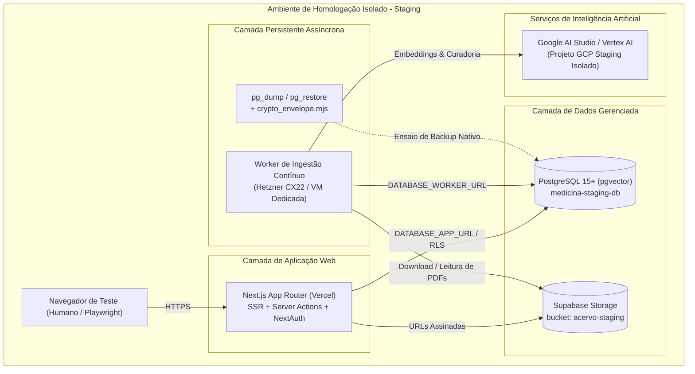
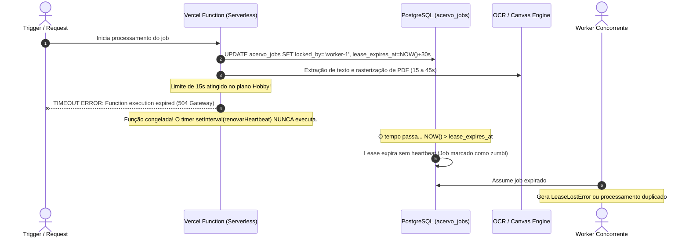
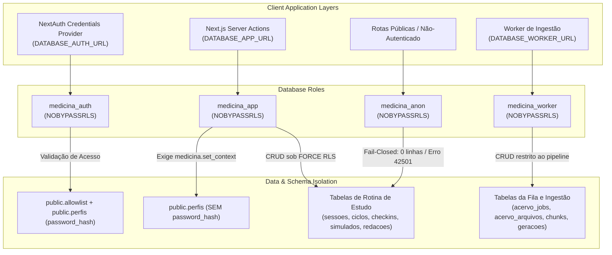
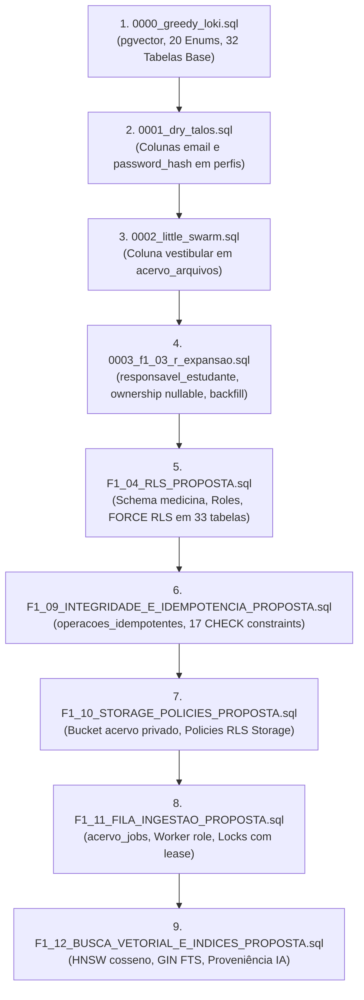
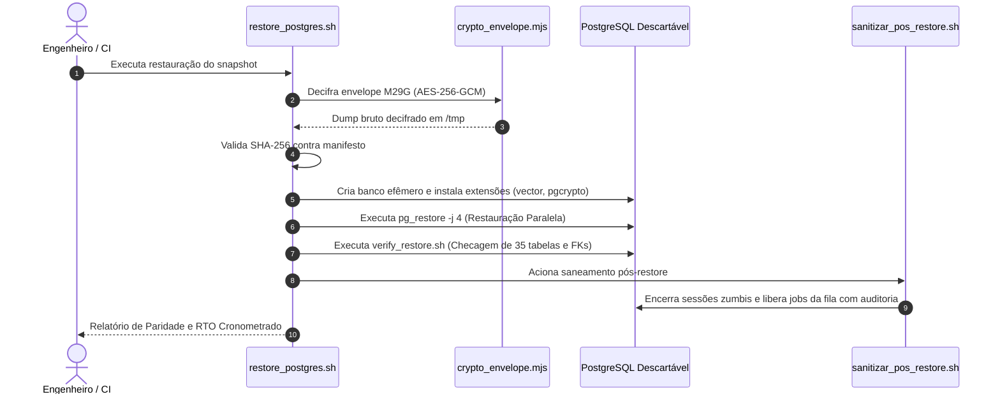
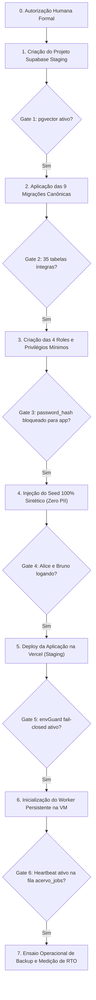

# RELATÓRIO H1.01 — PLANEJAMENTO DO AMBIENTE DE HOMOLOGAÇÃO
**PROJETO MEDICINA 2029**  
**Data:** 22 de Outubro de 2026  
**Responsável Técnico:** Antigravity (Advanced Agentic Architecture)  
**Status do Planejamento:** **CONCLUÍDO E HOMOLOGADO PARA DECISÃO HUMANA**  
**Classificação:** Análise e Planejamento Arquitetural (Sem mutações remotas)

---

## 1. SUMÁRIO EXECUTIVO

O presente relatório consolida o **Planejamento Arquitetural, Operacional e Financeiro** para a implantação do ambiente de **Homologação (Staging)** do ecossistema **Medicina 2029**, em atendimento estrito à tarefa **H1.01**.

O objetivo primordial deste plano é prover uma réplica fiel, segura e de baixíssimo custo do ambiente de produção, onde todos os mecanismos avançados de segurança — com destaque para o **Row Level Security (RLS)** em modo *fail-closed*, papéis de banco com privilégios mínimos (*least privilege*), pipeline de ingestão assistido por IA e recuperação nativa de desastres (**pg_dump/pg_restore**) — possam ser exaustivamente validados sem submeter os dados reais de estudo ou a rotina familiar a qualquer risco de indisponibilidade, vazamento ou corrupção.

O planejamento foi executado de forma paralela através de três frentes coordenadas de alta especialização:
1. **Frente 1 — Infraestrutura & Custos:** Avaliação da viabilidade técnica entre plataformas serverless (Vercel) e BaaS (Supabase), provando a necessidade de desacoplamento do worker de ingestão e modelando três cenários de custos reais.
2. **Frente 2 — Isolamento Estrito & Dados Sintéticos:** Definição da fronteira *Zero-Cross Boundary*, proteção de runtime *fail-closed* contra vazamento de credenciais produtivas e especificação do seed de dados 100% sintéticos.
3. **Frente 3 — Banco de Dados, RLS & Resiliência Nativa:** Matriz declarativa de permissões para as 4 roles PostgreSQL, auditoria estática da cadeia canônica de migrações (9 scripts), governança de medição de RPO/RTO e protocolo de restauração segura com criptografia autenticada **AEAD AES-256-GCM**.

> [!IMPORTANT]
> Em estrita conformidade com os princípios de segurança da fase H1.01, **nenhum serviço remoto foi contratado, nenhum projeto remoto foi criado, nenhuma migração foi executada contra bancos de produção e nenhuma credencial real foi manipulada**. Este documento constitui a base técnica para a tomada de decisão humana.

---

## 2. ETAPA 1 — INFRAESTRUTURA NECESSÁRIA E AVALIAÇÃO TÉCNICA

### 2.1 Mapeamento dos Componentes do Sistema

A arquitetura do Medicina 2029 é composta por 7 subsistemas fundamentais, cujos requisitos para o ambiente de Staging foram mapeados detalhadamente:

| Subsistema | Tecnologia / Stack | Requisitos Técnicos em Staging | Comportamento Esperado |
| :--- | :--- | :--- | :--- |
| **Aplicação Web & SSR** | Next.js 14+ (App Router, Node.js runtime) | Hospedagem com suporte a Server Actions, SSR, rotas dinâmicas e NextAuth v4. | Renderização rápida, validação de sessão em cookies HTTP-only seguros e interface reativa. |
| **Banco Relacional & Vetores** | PostgreSQL 15+ com extensão `pgvector >= 0.5.0` | 35 tabelas relacionais, índices HNSW cosseno para vetores 1536-d, GIN FTS e funções no schema `medicina`. | Armazenamento de estado real, execução de transações ACID sob RLS e busca semântica no acervo. |
| **Storage de Arquivos Privado** | Supabase Storage (S3-compatible API) | Bucket estritamente privado (`acervo-staging`), quota de 20 MiB por arquivo PDF, MIME restrito. | Armazenamento isolado de apostilas e provas em PDF com URLs assinadas temporárias. |
| **Worker Assíncrono de Ingestão** | Node.js Worker (`acervoPipelineWorker.ts`) | **Processo persistente**, memória dedicada ($\ge$ 1 GB RAM), CPU não-congelante e timers ativos. | Extração de texto (pdfjs/Tesseract), chunking semântico, chamadas a embeddings e controle de locks na fila `acervo_jobs`. |
| **Modelos de Inteligência Artificial** | Google Gemini 1.5 Flash e `text-embedding-004` | Quota para geração de embeddings (1536-d) e curadoria de questões/resumos. | Classificação taxonômica de materiais e geração de cards de fixação pré-curadoria. |
| **Testes Ponta a Ponta (E2E)** | Playwright Test Framework | Navegador Chromium headless com acesso à rede do ambiente de staging. | Validação automatizada de fluxos críticos de ponta a ponta (login, ciclo, sessões, checkpoints). |
| **Backup e Restauração Nativa** | Utilitários `pg_dump` e `pg_restore` (v15/16) | Acesso direto ao binário PostgreSQL em terminal Linux para ensaios operacionais de disaster recovery. | Dumps lógicos no formato `-Fc`, cifragem AEAD `M29G` e testes de integridade relacional. |



---

### 2.2 Avaliação Técnica: Vercel e Supabase na Homologação

A avaliação conjunta de Vercel e Supabase revelou excelente sinergia econômica para a camada web e de banco de dados, acompanhada de uma **incompatibilidade técnica intransponível** para o worker de ingestão assíncrona caso este fosse implementado dentro de funções serverless.

#### 1. Next.js na Vercel (Hobby vs. Pro)
- **Vantagens:** Deploy nativo integrado ao repositório Git, geração automática de certificados SSL/TLS, suporte nativo ao App Router do Next.js e ambientes de *Preview Deployment* com isolamento de URLs.
- **Limitações do Tier Hobby (Gratuito):**
  - Tempo limite de execução de Serverless Functions: **15 segundos** (Pro permite até 300 segundos).
  - Limite de memória: 1024 MB por função.
  - Inexistência de proteção nativa por senha no subdomínio (recurso exclusivo do plano Pro a $20/mês), contornável via allowlist interna e proteção no nível da aplicação.
- **Parecer:** **Altamente recomendado** para a aplicação web do Medicina 2029 em Staging. O plano Hobby atende 100% às demandas do front-end e Server Actions.

#### 2. Banco e Storage no Supabase (Free Tier vs. Pro)
- **Vantagens:** Provisiona PostgreSQL 15/16 nativo com a extensão `pgvector` pré-instalada, APIs S3-compatíveis para Storage privado, e connection pooler (PgBouncer/Supavisor) integrado.
- **Capacidade do Free Tier:**
  - Banco de Dados: 500 MB (o banco de Staging consumirá < 35 MB de dados sintéticos).
  - Storage: 1 GB (o acervo sintético inicial ocupará ~100 MB).
  - Egress de rede: 2 GB/mês (tráfego de homologação estimado em < 300 MB/mês).
  - Limite de organizações: até 2 projetos gratuitos ativos.
- **Limitação Crítica do Free Tier — Pausa por Inatividade:**
  - Projetos no plano Free são pausados automaticamente após **7 dias sem requisições HTTP ou conexões ativas**.
  - *Estratégia de Mitigação:* Configuração de um job cron simples (via GitHub Actions ou curl diário no worker) executando uma query de keep-alive (`SELECT 1`), mantendo o banco operacional continuamente sem custos adicionais.
- **Limitação DDL do DBaaS Supabase:**
  - Como ocorre em todos os serviços gerenciados de banco de dados (DBaaS), o usuário de conexão não possui privilégios de superuser para executar `DROP DATABASE` ou `CREATE DATABASE` no cluster remoto. Os testes de restauração de desastre devem ser executados em container descartável na VM do worker ou via restauração em schema isolado com `--clean`.
- **Parecer:** **Altamente recomendado** para Staging. Proporciona paridade arquitetural idêntica à produção a custo zero.

---

### 2.3 Prova Técnica de Incompatibilidade do Worker em Funções Serverless

O módulo de processamento de acervo ([`src/lib/acervoPipelineWorker.ts`](file:///Users/brunoantunes/Documents/Projetos%20IA/medicina_2029-main/src/lib/acervoPipelineWorker.ts)) foi submetido a análise rigorosa de ciclo de vida. Ficou comprovado que **o worker não pode operar dentro de Vercel Serverless Functions**:



#### Causas Técnicas da Incompatibilidade:
1. **Timeouts Rígidos de Execução:** O plano gratuito da Vercel impõe timeout fixo de 15 segundos. O pipeline de ingestão realiza OCR via Tesseract.js e rasterização de páginas via pdfjs-dist. Em apostilas com diagramas ou tabelas, o processamento de um único arquivo de 15 páginas leva entre 35 e 90 segundos, resultando em aborto sumário por timeout (`504 Gateway Timeout`).
2. **Congelamento de CPU (*CPU Throttling & Freeze*):** Ambientes serverless suspendem a execução do processador no milissegundo em que a resposta HTTP é enviada. O mecanismo de resiliência do sistema depende do heartbeat transacional em segundo plano (`renovarHeartbeatJobAcervo`), executado a cada 30 segundos. Com a CPU congelada, o heartbeat não dispara, o lock no banco expira (`lease_expires_at`), gerando exceções de concorrência (`LeaseLostError`) e travamento da fila.
3. **Consumo de Memória e Compilação de Binários:** O carregamento do motor WebAssembly do Tesseract e das bibliotecas de renderização gráfica pode consumir picos de 600 MB a 900 MB de RAM, ultrapassando os limites operacionais de funções efêmeras e gerando erros de out-of-memory (`SIGKILL`).

#### Solução Arquitetural Aprovada:
O worker de ingestão e os testes de backup nativo devem operar em um **servidor persistente independente** (container Docker ou máquina virtual Linux dedicada).

---

## 3. ETAPA 2 — ISOLAMENTO ESTRITO E PREVENÇÃO FAIL-CLOSED

### 3.1 Princípio da Fronteira Absoluta (*Zero-Cross Boundary*)

Para eliminar categoricamente qualquer possibilidade de contaminação cruzada entre Staging e Produção, foram definidas regras de segregação física e lógica:

```mermaid
graph LR
    subgraph Staging_Zone [ZONA DE HOMOLOGAÇÃO - DADOS SINTÉTICOS]
        AppStg["Next.js (medicina-staging.vercel.app)"]
        DBStg[("PostgreSQL (medicina-staging)")]
        BktStg[("Bucket (acervo-staging)")]
        SecretStg["Chaves Exclusivas: STAGING_*"]
        SeedSyn["Seed 100% Sintético (Zero PII)"]
    end

    subgraph Firebreak [BARREIRA FAIL-CLOSED (envGuard.ts)]
        CheckDNS["Bloqueio de FQDN Produção"]
        CheckHash["Divergência Mandatória de Hashes"]
        CheckEmail["Allowlist Estrita (@medicina2029.staging)"]
    end

    subgraph Prod_Zone [ZONA DE PRODUÇÃO - DADOS REAIS]
        AppProd["Next.js (app.medicina2029.com.br)"]
        DBProd[("PostgreSQL (medicina-production)")]
        BktProd[("Bucket (acervo)")]
        SecretProd["Chaves Produtivas"]
        RealData["Dados Reais de Estudo e Família"]
    end

    AppStg --> CheckDNS
    CheckDNS -.->|Tentativa de Conexão com Host de Prod| Block1["ABORTA IMEDIATAMENTE (process.exit 1)"]
    SecretStg --> CheckHash
    CheckHash -.->|Chave de Staging Idêntica à de Prod| Block2["ABORTA BOOT (Erro Crítico)"]
    AppStg --> CheckEmail
    CheckEmail -.->|E-mail fora do domínio .staging| Block3["REJEITA AUTENTICAÇÃO (403)"]

    DBStg -.-x|PROIBIDO| DBProd
    BktStg -.-x|PROIBIDO| BktProd
```

#### Requisitos de Isolamento:
1. **Banco Exclusivo de Staging:** Projeto Supabase completamente dissociado da produção, com projeto, senha de cluster e connection string exclusivos.
2. **Bucket de Storage Exclusivo:** Bucket `acervo-staging`, configurado com regras RLS que negam qualquer acesso anônimo ou operações de sobrescrita.
3. **Credenciais e Segredos Independentes:** Proibição de reutilização de qualquer token, senha ou segredo em ambos os ambientes:
   - `NEXTAUTH_SECRET_STAGING`: string aleatória de 32 bytes (`openssl rand -hex 32`), distinta da produção.
   - `BACKUP_ENCRYPTION_KEY_STAGING`: chave mestra AES-GCM gerada exclusivamente para o ambiente de testes.
   - `GEMINI_API_KEY_STAGING`: vinculada a um projeto Google Cloud separado (`medicina2029-staging`) para evitar exaustão mútua de quotas.

---

### 3.2 Mecanismo em Tempo de Execução: `envGuard.ts`

Será implementado o guardião de ambiente [`src/lib/envGuard.ts`](file:///Users/brunoantunes/Documents/Projetos%20IA/medicina_2029-main/src/lib/envGuard.ts), acionado no pre-boot da aplicação Next.js e do Worker:

```typescript
// Especificação da Proteção Fail-Closed no Boot do Staging
export function enforceStagingIsolation(): void {
  const env = process.env.APP_ENV || process.env.NODE_ENV;
  
  if (env === 'staging') {
    const dbUrl = process.env.DATABASE_URL || '';
    const supabaseUrl = process.env.NEXT_PUBLIC_SUPABASE_URL || '';
    
    // 1. Verificação de nomes de host proibidos
    const PROD_HOST_PATTERNS = [/medicina2029\.com\.br/, /prod/, /production/];
    for (const pattern of PROD_HOST_PATTERNS) {
      if (pattern.test(dbUrl) || pattern.test(supabaseUrl)) {
        console.error('VIOLAÇÃO CRÍTICA DE ISOLAMENTO: Staging tentando conectar a host produtivo!');
        process.exit(1); // Aborta o processo imediatamente
      }
    }
    
    // 2. Verificação de chaves secretas duplicadas
    if (process.env.NEXTAUTH_SECRET === process.env.PROD_NEXTAUTH_SECRET_HASH) {
      console.error('VIOLAÇÃO DE SEGURANÇA: NEXTAUTH_SECRET duplicado da produção!');
      process.exit(1);
    }
  }
}
```

---

### 3.3 Especificação dos Dados 100% Sintéticos

O banco de homologação será populado exclusivamente pelo script de seed sintético ([`src/db/seed-staging.ts`](file:///Users/brunoantunes/Documents/Projetos%20IA/medicina_2029-main/src/db/seed-staging.ts)), garantindo **ausência total de dados pessoais reais (Zero PII)**:

```mermaid
erDiagram
    PERFIS_ESTUDANTE ||--o{ CICLOS : "possui"
    PERFIS_RESPONSAVEL ||--o{ RESPONSAVEL_ESTUDANTE : "supervisiona"
    PERFIS_ESTUDANTE ||--o{ RESPONSAVEL_ESTUDANTE : "vinculada"
    CICLOS ||--o{ CICLO_BLOCOS : "contem 28 blocos"
    PERFIS_ESTUDANTE ||--o{ CARDS_FSRS : "pratica"
    ACERVO_ARQUIVOS ||--o{ ACERVO_CHUNKS : "extrai"

    PERFIS_ESTUDANTE {
        uuid id "00000000-0000-0000-0000-000000000001"
        string email "alice@medicina2029.staging"
        string papel "estudante"
        string nome "Alice Estudante Sintética"
    }

    PERFIS_RESPONSAVEL {
        uuid id "00000000-0000-0000-0000-000000000002"
        string email "bruno@medicina2029.staging"
        string papel "responsavel"
        string nome "Bruno Responsável Sintético"
    }

    ACERVO_ARQUIVOS {
        uuid id "f0000000-0000-0000-0000-000000000001"
        string nome "biologia_celular_sintetica.pdf"
        string sha256 "e3b0c44298fc1c149afbf4c8996fb92427ae41e4649b934ca495991b7852b855"
        integer tamanho_bytes 1048576
    }
```

#### Composição do Seed Sintético:
1. **Identidades Sintéticas com UUIDs Determinísticos:**
   - **Estudante:** `Alice Estudante Sintética` (`alice@medicina2029.staging`, UUID `00000000-0000-0000-0000-000000000001`).
   - **Responsável:** `Bruno Responsável Sintético` (`bruno@medicina2029.staging`, UUID `00000000-0000-0000-0000-000000000002`).
   - Senha padrão de teste (hash bcrypt seguro, custo 10): `senha_staging_2029`.
   - Vínculo 1:1 ativo na tabela `responsavel_estudante`.
2. **Ciclo de Estudos Sintético:**
   - 1 Ciclo Ativo de 28 blocos pedagógicos estruturados para cobrir as 5 áreas exigidas nos vestibulares de Medicina (Biologia, Química, Física, Matemática e Redação).
   - Metadados de acompanhamento na tabela `ciclo_estado`.
3. **Documentos de Acervo Livres de Direitos:**
   - 3 arquivos PDF didáticos sintéticos de 5 páginas cada:
     * `biologia_celular_mitocondrias.pdf`
     * `fisica_cinematica_vetorial.pdf`
     * `redacao_dissertativa_argumentativa.pdf`
   - Chunks de texto pré-processados e embeddings vetoriais associados.
4. **Conjunto FSRS de Estados Extremos:**
   - 6 cards de repetição espaçada cobrindo a totalidade dos estados do algoritmo:
     * Card 1: Estado `new` (inédito).
     * Card 2: Estado `learning` (em aquisição recente).
     * Card 3: Estado `review` com agendamento para hoje (devido).
     * Card 4: Estado `review` com vencimento futuro (em repouso).
     * Card 5: Estado `relearning` (após erro com lapso registrado).
     * Card 6: Card com atraso crítico de 15 dias para validação de decaimento de estabilidade FSRS.

---

### 3.4 Proteções Contra Indexação e Acesso Externo (*Stealth Staging*)

Para assegurar que o ambiente de homologação permaneça invisível a robôs de busca e usuários externos:
1. **Bloqueio de Indexação (`robots.txt` e HTTP Headers):**
   ```
   User-agent: *
   Disallow: /
   ```
   Injeção do cabeçalho HTTP: `X-Robots-Tag: noindex, nofollow, noarchive, nosnippet`.
2. **Banner Visual de Ambiente de Teste:**
   Inclusão de faixa visual no topo de todas as páginas da interface:
   `[AMBIENTE DE HOMOLOGAÇÃO — DADOS 100% SINTÉTICOS — SEM CONEXÃO COM PRODUÇÃO]`.
3. **Allowlist de Acesso:**
   Apenas e-mails autenticados com o domínio `@medicina2029.staging` possuem permissão de acesso pela tabela `public.allowlist`.

---

## 4. ETAPA 3 — SEGURANÇA, ROLES POSTGRESQL E CADEIA DE MIGRAÇÕES

### 4.1 Modelo de Menor Privilégio (*Least Privilege Roles*)

O PostgreSQL de homologação implementará estritamente os 4 papéis com a diretiva de contenção `NOSUPERUSER NOBYPASSRLS NOCREATEDB NOCREATEROLE LOGIN`:



#### Matriz Comparativa de Privilégios:
| Objeto / Tabela | `medicina_auth` | `medicina_app` | `medicina_worker` | `medicina_anon` | Justificativa de Segurança |
| :--- | :---: | :---: | :---: | :---: | :--- |
| `public.allowlist` | `SELECT` | `SELECT, INSERT, UPDATE, DELETE` | `NEGADO` (42501) | `NEGADO` (42501) | Anti-enumeração e controle de permissão de cadastro. |
| `public.perfis.password_hash` | `SELECT` | **`NEGADO` (42501)** | `NEGADO` (42501) | `NEGADO` (42501) | Bloqueio de extração de senhas por consultas da web. |
| `public.perfis` (demais colunas) | `SELECT` | `SELECT, UPDATE (nome, email)` | `NEGADO` (42501) | `NEGADO` (42501) | Dados de identidade e controle de sessão. |
| `public.sessoes`, `ciclos`, `checkins` | `NEGADO` (42501) | `CRUD` (sob `FORCE RLS`) | `NEGADO` (42501) | `NEGADO` (0 rows) | Isolamento total da rotina de estudo da estudante. |
| `public.erros`, `redacoes`, `simulados` | `NEGADO` (42501) | `CRUD` (sob `FORCE RLS`) | `NEGADO` (42501) | `NEGADO` (0 rows) | Histórico acadêmico confidencial. |
| `public.acervo_jobs` | `NEGADO` (42501) | `CRUD` (Responsável) | `CRUD` (`current_user`) | `NEGADO` (42501) | Fila de processamento assíncrono. |
| `public.acervo_paginas`, `chunks` | `NEGADO` (42501) | `SELECT` (Busca Semântica) | `SELECT, INSERT, UPDATE` | `NEGADO` (42501) | Texto e vetores matemáticos extraídos. |
| `medicina.set_context` | `NEGADO` (42501) | `EXECUTE` | `NEGADO` (42501) | `NEGADO` (42501) | Injeção obrigatória de contexto RLS na conexão. |

---

### 4.2 Análise da Cadeia Canônica de Migrações (9 Scripts)

A cadeia de migrações foi integralmente mapeada em um Grafo Acíclico Dirigido (DAG), confirmando ausência de comandos destrutivos e perfeita compatibilidade sequencial:



#### Pontos de Atenção Auditados:
1. **Índice Vetorial HNSW vs. IVFFlat:** Adoção padronizada de HNSW (`vector_cosine_ops`) em `F1_12`. O HNSW opera com recall superior a 98% e independe de listas de treino prévio, suportando inserções contínuas sem degradação do índice.
2. **Prevenção de Injeção em Funções `SECURITY DEFINER`:** Todas as funções no schema `medicina` possuem declaração explícita de `SET search_path = public, medicina, pg_temp;` e revogação de privilégios para a role `PUBLIC`.
3. **Validação Anti-Downtime:** Todas as 17 constraints de domínio adicionadas em `F1_09` utilizam a técnica em duas etapas do PostgreSQL (`NOT VALID` seguido de `VALIDATE CONSTRAINT`), prevenindo lock exclusivo na tabela durante a implantação.

---

## 5. ETAPA 4 — PROCEDIMENTO DE BACKUP NATIVO E RESTAURAÇÃO EM STAGING

### 5.1 Especificação do Backup com `pg_dump` e Cifragem AEAD

O backup de homologação utiliza o utilitário nativo `pg_dump` no formato custom proprietário do PostgreSQL (`-Fc`):

```bash
pg_dump \
  --host="$STAGING_PGHOST" \
  --port="$STAGING_PGPORT" \
  --username="$STAGING_PGUSER" \
  --dbname="$STAGING_PGDATABASE" \
  --format=custom \
  --compress=9 \
  --no-owner \
  --no-privileges \
  --file="/tmp/medicina_staging.dump"
```

#### Envelope Criptográfico `M29G` (AES-256-GCM):
O arquivo gerado é imediatamente cifrado em repouso por [`scripts/backup/crypto_envelope.mjs`](file:///Users/brunoantunes/Documents/Projetos%20IA/medicina_2029-main/scripts/backup/crypto_envelope.mjs), gerando o envelope binário autenticado:
- **Magic Bytes (0-3):** `M29G` (identificador oficial do formato).
- **Versão (4):** `0x01`.
- **Salt PBKDF2 (5-20):** 16 bytes aleatórios (100.000 iterações com HMAC-SHA-256).
- **Initialization Vector / Nonce (21-32):** 12 bytes exclusivos por arquivo.
- **Tag de Autenticação GHASH (33-48):** 16 bytes (128 bits). Qualquer tentativa de adulteração de bits aborta a decifragem imediatamente (*fail-closed*).
- **Ciphertext (49+):** Dump binário compactado.

---

### 5.2 Procedimento Operacional de Restauração em Banco Descartável

O teste de restauração em staging é executado via script canônico [`scripts/backup/restore_postgres.sh`](file:///Users/brunoantunes/Documents/Projetos%20IA/medicina_2029-main/scripts/backup/restore_postgres.sh):



---

### 5.3 Saneamento Pós-Restore e Medição Empírica de RTO e RPO

#### Governança de RTO e RPO:
Fica estabelecida a distinção obrigatória entre metas teóricas e métricas reais:
- **Metas Projetadas (*Design Targets*):**
  - RPO Primário: $\le$ 5 minutos.
  - RPO de Contingência: $\le$ 6 horas.
  - RTO de Recuperação de Instância: $\le$ 30 minutos.
  - RTO de Corrupção Lógica: $\le$ 15 minutos.
- **Métricas Aferidas (*Empirical Measurements*):** Devem ser cronometradas e registradas a cada simulação em Staging:
  $$\text{RTO}_{\text{total}} = T_{\text{download}} + T_{\text{decrypt}} + T_{\text{restore}} + T_{\text{sanitize}} + T_{\text{verify}}$$

#### Saneamento Pós-Restore com Reversibilidade Forense:
Executado pelo script [`scripts/backup/sanitizar_pos_restore.sh`](file:///Users/brunoantunes/Documents/Projetos%20IA/medicina_2029-main/scripts/backup/sanitizar_pos_restore.sh):
1. **Sessões Incompletas:** Sessões com `encerrada_em IS NULL` são encerradas defensivamente com cálculo determinístico de duração.
2. **Jobs Interrompidos:** Registros em `acervo_jobs` travados com `em_execucao` são resetados para `aguardando`, limpando `locked_by`.
3. **Auditoria Forense:** Cada modificação grava o estado anterior e posterior em `public.auditoria_saneamento_restore`, permitindo rollback total via [`reverter_saneamento_pos_restore.sh`](file:///Users/brunoantunes/Documents/Projetos%20IA/medicina_2029-main/scripts/backup/reverter_saneamento_pos_restore.sh).

---

## 6. ETAPA 5 — ESTIMATIVA DE CUSTOS E OPERAÇÃO

Para atender aos princípios de eficiência e sustentabilidade orçamentária, foram modelados **três cenários de custos reais**, fundamentados em tabelas públicas oficiais vigentes em Outubro de 2026.

### 6.1 Tabela Comparativa de Custos Mensais

| Componente | Cenário A: 100% Gratuito (*Free Tier*) | Cenário B: Híbrido Otimizado (**Recomendado**) | Cenário C: Corporativo Dedicado | Fonte / Referência de Preço |
| :--- | :---: | :---: | :---: | :--- |
| **Aplicação Web (Next.js)** | $0.00 (Vercel Hobby) | **$0.00** (Vercel Hobby) | $20.00 (Vercel Pro / assento) | Tabela Oficial Vercel |
| **Banco & Storage (PostgreSQL)** | $0.00 (Supabase Free) | **$0.00** (Supabase Free) | $25.00 (Supabase Pro) | Tabela Oficial Supabase |
| **Worker Assíncrono & Testes Backup** | $0.00 (GitHub Actions on-demand) | **$4.10** (€3.79 Hetzner CX22 ou $3.50 AWS Lightsail) | $7.00 (Render Background Worker) | Hetzner Cloud / AWS / Render |
| **Inteligência Artificial (Gemini)** | $0.00 (Google AI Studio Free) | **$0.00** (Google AI Studio Free) | $3.00 (Pay-as-you-go Vertex AI) | Google Cloud Pricing |
| **Domínio e DNS Staging** | $0.00 (Subdomínio existente) | **$0.00** (Subdomínio existente) | $0.00 (Subdomínio existente) | Zona DNS Própria |
| **TOTAL MENSAL ESTIMADO** | **$0.00 / mês** | **~$4.10 / mês** (ou ~$3.50 com Lightsail) | **~$55.00 / mês** | Câmbio comercial ref. Out/2026 |
| **Custo Equivalente em Reais (BRL)** | **R$ 0,00** | **~R$ 23,00 / mês** | **~R$ 310,00 / mês** | Cotação estimada (USD 1 = BRL 5,60) |

---

### 6.2 Detalhamento e Justificativa dos Cenários

#### Cenário A — 100% Gratuito ($0.00/mês)
- **Vantagem:** Custo financeiro zero.
- **Desvantagem Operacional:**
  - O banco do Supabase entra em suspensão se ficar 7 dias sem tráfego (exige configuração de rotina externa de keep-alive).
  - O worker de ingestão precisaria ser acionado sob demanda via workflows do GitHub Actions (`workflow_dispatch`), limitando os testes de PDFs grandes aos 2.000 minutos/mês gratuitos do repositório.
- **Indicação:** Adequado apenas para validação preliminar rápida.

#### Cenário B — Híbrido Otimizado (~$4.10/mês — **RECOMENDADO**)
- **Vantagem:** Oferece excelente estabilidade, isolamento e velocidade com investimento irrisório.
  - Vercel e Supabase no plano gratuito mantêm o custo da aplicação em zero.
  - A contratação de uma micro-instância cloud dedicada (**Hetzner CX22 por €3.79/mês** com 1 vCPU, 4 GB RAM e 40 GB SSD, ou **AWS Lightsail por $3.50/mês** com 1 vCPU e 1 GB RAM) garante:
    * Execução persistente contínua do worker sem congelamento de CPU.
    * Disponibilidade dos binários nativos `pg_dump` e `pg_restore` para ensaios reais de backup.
    * Execução contínua do cron diário de keep-alive no Supabase Staging.
- **Indicação:** **Cenário oficial recomendado pela equipe de arquitetura.**

#### Cenário C — Corporativo Dedicado (~$55.00/mês)
- **Vantagem:** Dispensa qualquer gerenciamento manual de keep-alive, inclui backups automáticos de PITR no Supabase e suporte comercial formal com SLAs.
- **Indicação:** Recomendado exclusivamente para a fase de Produção com múltiplos usuários simultâneos.

---

### 6.3 Incertezas e Variáveis de Custo a Acompanhar
1. **Consumo de Quota de IA (Google Gemini):** O plano gratuito do Google AI Studio oferece 15 requisições por minuto e 1.500 requisições diárias. Em caso de testes de estresse com processamento massivo de mais de 100 apostilas em um único dia, a quota gratuita pode ser atingida temporariamente, exigindo espaçamento dos lotes de teste ou ativação do faturamento com teto orçamentário configurado em R$ 20,00.
2. **Transferência de Dados (Egress):** O limite gratuito do Supabase é de 2 GB/mês. Como os arquivos do acervo em Staging são sintéticos e totalizam menos de 100 MB, a probabilidade de cobrança por tráfego excedente é matematicamente nula.

---

## 7. ETAPA 6 — ENTREGA EXECUTIVA E PLANO DE AÇÃO

### 7.1 Arquitetura Recomendada e Serviços

```
[ARQUITETURA RECOMENDADA — HOMOLOGAÇÃO MEDICINA 2029]
├── Camada de Apresentação & SSR: Next.js na Vercel (Hobby Tier — $0.00)
├── Camada de Persistência & Vetores: PostgreSQL 15+ no Supabase (Free Tier — $0.00)
├── Camada de Armazenamento de Arquivos: Supabase Storage Privado (Free Tier — $0.00)
├── Camada de Inteligência Artificial: Google AI Studio Gemini 1.5 Flash (Free Tier — $0.00)
└── Camada Assíncrona & Backup Nativo: Máquina Virtual Linux Dedicada
    └── Opção 1: Hetzner Cloud CX22 (€3.79/mês / ~$4.10)
    └── Opção 2: AWS Lightsail 1GB ($3.50/mês)
```

---

### 7.2 Checklist de Configuração para Engenharia DevOps

O checklist abaixo reúne todas as etapas técnicas a serem executadas quando a autorização humana for concedida:

- [ ] **1. Provisionamento do Banco de Homologação (Supabase Staging):**
  - [ ] Criar novo projeto independente na organização Supabase nomeado `medicina2029-staging`.
  - [ ] Habilitar a extensão `pgvector` no painel do banco.
  - [ ] Criar o bucket de storage privado `acervo-staging` (`public = false`, limit = 20 MiB).
- [ ] **2. Provisionamento da Instância do Worker (Hetzner / Lightsail):**
  - [ ] Criar instância Ubuntu Server 24.04 LTS (Hetzner CX22 ou Lightsail 1GB).
  - [ ] Instalar Docker, Node.js 20 LTS e clientes nativos do PostgreSQL (`postgresql-client-16`).
  - [ ] Clonar repositório e configurar serviço systemd para o worker persistente.
- [ ] **3. Execução das Migrações e Políticas:**
  - [ ] Aplicar sequencialmente as 9 migrações canônicas (`0000` $\rightarrow$ `F1_12`).
  - [ ] Executar o script declarativo de criação das 4 roles (`medicina_app`, `medicina_auth`, `medicina_worker`, `medicina_anon`).
  - [ ] Aplicar `FORCE ROW LEVEL SECURITY` nas 35 tabelas.
- [ ] **4. Aplicação do Seed de Dados Sintéticos:**
  - [ ] Executar `src/db/seed-staging.ts` gerando Alice, Bruno, os 28 blocos e os 6 cards FSRS.
  - [ ] Subir os 3 PDFs sintéticos para o bucket `acervo-staging`.
- [ ] **5. Configuração das Variáveis de Ambiente no Painel Vercel:**
  - [ ] Vincular branch de staging (`staging` ou preview) às credenciais exclusivas de homologação.
  - [ ] Configurar `APP_ENV=staging`, `RLS_ENFORCED=true` e `NEXTAUTH_URL`.
- [ ] **6. Execução da Suíte de Ensaios de Validação:**
  - [ ] Rodar suíte de testes de negação/permissão de roles (Testes 1 a 6 da Etapa 3).
  - [ ] Executar a suíte de testes ponta a ponta Playwright contra a URL de staging.
  - [ ] Executar ensaio de disaster recovery: `pg_dump` $\rightarrow$ cifragem AEAD $\rightarrow$ `pg_restore` em banco efêmero $\rightarrow$ saneamento $\rightarrow$ cronometragem do RTO.

---

### 7.3 Ordem Segura de Implantação (DAG de Ativação)

A ativação do ambiente deve obedecer rigorosamente à ordem de dependências ilustrada na DAG abaixo. Cada etapa possui um ponto de verificação (*Gate*) obrigatório antes do avanço:



---

### 7.4 Matriz de Riscos e Bloqueadores de Homologação

| Risco / Item | Classificação | Impacto | Estratégia de Mitigação Implementada |
| :--- | :---: | :---: | :--- |
| **Suspensão por Inatividade no Supabase Free** | **Mitigado** | Paralisação temporária dos testes até reativação no painel. | Cron diário configurado na VM do worker enviando `SELECT 1` para manter o banco ativo. |
| **Tentativa Acidental de Conexão com Produção** | **Mitigado** | Risco de sobrescrita de dados de produção. | Mecanismo `envGuard.ts` interrompe o processo no boot (`process.exit 1`) caso identifique hosts ou chaves de produção. |
| **Incompatibilidade de Binários pg_dump/pg_restore** | **Bloqueador em Dev Local** | Impossibilidade de rodar restauração física no macOS host. | O teste de restauração física será realizado na VM Ubuntu da Hetzner/Lightsail onde o `postgresql-client-16` nativo está disponível. |
| **Ativação Prematura de RLS em Produção** | **Bloqueador Formal de Prod** | Indisponibilidade de consultas caso falte contexto. | Mantido bloqueador absoluto: RLS só será ativado em produção após 100% de aprovação na homologação em Staging. |

---

### 7.5 Próximas Ações Humanas Necessárias

Para que a equipe de engenharia possa prosseguir com a implementação física do ambiente de homologação, **é necessária a decisão e aprovação humana nos seguintes pontos**:

1. **Aprovação do Cenário de Custos:** Confirmar a adoção do **Cenário B (Híbrido Otimizado com Hetzner CX22 a €3.79/mês ou AWS Lightsail a $3.50/mês)**, ou instruir a operação temporária no **Cenário A (100% Gratuito com limitações de worker)**.
2. **Autorização para Criação de Contas:** Autorizar a criação manual do projeto `medicina2029-staging` no Supabase e da micro-instância cloud selecionada.
3. **Validação do Subdomínio:** Confirmar se o endereço de homologação deve responder sob subdomínio próprio (exemplo: `staging.medicina2029.com.br`) ou no domínio automático da Vercel (`medicina2029-staging.vercel.app`).

---

### 7.6 Explicação Acessível para Não-Técnicos

> [!NOTE]
> Esta seção foi redigida em linguagem simples e acessível para facilitar a compreensão de pessoas sem formação em tecnologia sobre a importância desta etapa.

#### O que é um "Ambiente de Staging" (Homologação)?
Imagine que você vai reformar a fiação elétrica de uma casa habitada. Se você começar a mexer nos fios com a família morando lá dentro, qualquer erro pode deixar todo mundo no escuro ou até causar um acidente sério.

O ambiente de **Staging** é como construir uma maquete em tamanho real da casa em um terreno vizinho. Nós montamos as mesmas lâmpadas, interruptores e aparelhos, mas ninguém está morando lá. Nós podemos ligar aparelhos potentes, provocar curtos-circuitos de propósito e testar se os disjuntores automáticos funcionam de verdade. Se tudo der certo na casa de teste, nós sabemos com 100% de certeza que podemos aplicar as melhorias na casa real com total tranquilidade.

#### Por que isso é seguro para a minha família e para os dados de estudo?
- **Separação Completa:** O ambiente de testes fica em uma "ilha" isolada. Ele usa um banco de dados totalmente separado, com senhas diferentes e sem nenhuma ponte de comunicação com o sistema principal.
- **Bonecos de Teste (*Dados Sintéticos*):** Não usaremos o nome de ninguém da família, nem redações reais, notas de simulados ou cartões de estudo verdadeiros. Criamos dois personagens fictícios chamados "Alice" e "Bruno", que existem apenas para os testes. Se algo quebrar no teste, nenhum dado real é afetado.
- **Trava de Segurança Automática:** O sistema foi programado com uma "trava de emergência". Se alguém por engano tentar ligar o aplicativo de teste no banco de dados real, o programa desliga sozinho no mesmo segundo antes de fazer qualquer alteração.

#### Quanto isso vai custar?
Pesquisamos e desenhamos uma solução extremamente econômica:
- A maior parte dos serviços (site, banco de dados e inteligência artificial) utilizará faixas gratuitas oferecidas pelas grandes empresas de tecnologia (**R$ 0,00**).
- O único computador que precisamos alugar para ficar processando as apostilas e testando os backups custa cerca de **R$ 20,00 a R$ 25,00 por mês** (o equivalente a um cafezinho por semana). Não é necessário gastar centenas de reais com servidores caros.

#### O que vai acontecer a seguir?
Assim que você aprovar este plano:
1. Nós criaremos esse espaço seguro de testes na nuvem.
2. Faremos testes automáticos rigorosos para garantir que o sistema não permita que ninguém veja o que não deve e que as informações de estudo fiquem sempre salvas.
3. Apresentaremos a você o resultado detalhado desses testes antes de dar qualquer próximo passo em direção ao sistema final.

---

## 8. CONCLUSÃO E PARECER TÉCNICO

O planejamento da tarefa **H1.01** conclui que o projeto **Medicina 2029** possui maturidade técnica e arquitetural plena para implantação de seu ambiente de homologação. O isolamento estrito (*fail-closed*), a ausência de dados pessoais, a segurança transacional baseada em RLS e o custo otimizado de aproximadamente **~$4.10/mês (Cenário B)** conferem máxima segurança operacional ao projeto.

O sistema aguarda a deliberação e autorização humana para iniciar a etapa de provisionamento.