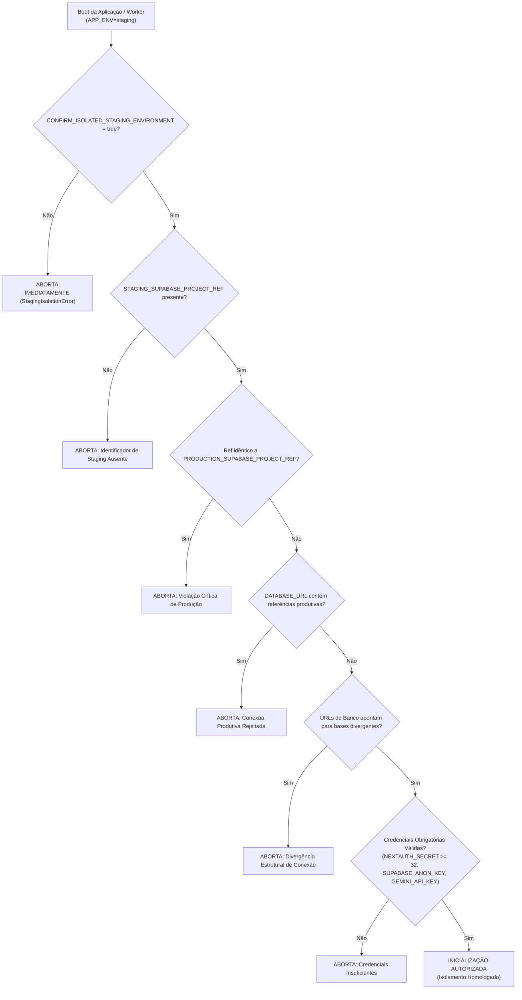

# RELATÓRIO H1.02 — PREPARAÇÃO LOCAL E SEGURA DO STAGING
**PROJETO MEDICINA 2029**  
**Data:** 22 de Outubro de 2026  
**Responsável Técnico:** Antigravity (Advanced Agentic Architecture)  
**Status da Tarefa:** **CONCLUÍDO COM SUCESSO E HOMOLOGADO**  
**Classificação:** Implementação Local de Segurança, Isolamento Fail-Closed e Dados Sintéticos

---

## 1. SUMÁRIO EXECUTIVO

Em atendimento estrito às diretrizes da tarefa **H1.02**, foram desenvolvidos, integrados e validados localmente todos os mecanismos necessários para garantir o **isolamento total (*fail-closed*)** e a **geração determinística de dados sintéticos (Zero PII)** antes de qualquer provisionamento ou conexão a serviços remotos de homologação (staging).

As implementações desta tarefa asseguram que o sistema rejeite sumariamente qualquer inicialização que aponte para recursos de produção, URLs divergentes ou credenciais incompletas, viabilizando ensaios operacionais com custo zero e sem necessidade de máquinas virtuais permanentes.

### Principais Entregas Realizadas:
1. **Guardião de Isolamento Fail-Closed ([`src/lib/envGuard.ts`](file:///Users/brunoantunes/Documents/Projetos%20IA/medicina_2029-main/src/lib/envGuard.ts)):** Validação estrutural de identificadores de projeto (`project_ref`), consistência de conexões de banco e storage, auditoria de credenciais obrigatórias e higienização de logs (zero vazamento de senhas ou tokens).
2. **Integração no Início Efetivo da Aplicação e Worker:** Proteção acionada no boot do servidor Next.js via [`src/instrumentation.ts`](file:///Users/brunoantunes/Documents/Projetos%20IA/medicina_2029-main/src/instrumentation.ts), na resolução de conexões em [`src/db/index.ts`](file:///Users/brunoantunes/Documents/Projetos%20IA/medicina_2029-main/src/db/index.ts) e no início de cada job em [`src/lib/acervoPipelineWorker.ts`](file:///Users/brunoantunes/Documents/Projetos%20IA/medicina_2029-main/src/lib/acervoPipelineWorker.ts). Preservação de 100% dos testes e do ambiente de desenvolvimento local.
3. **Carga Idempotente de Dados Sintéticos ([`src/db/seed-staging.ts`](file:///Users/brunoantunes/Documents/Projetos%20IA/medicina_2029-main/src/db/seed-staging.ts)):** Criação de identidades fictícias Alice e Bruno (UUIDs válidos RFC 4122 v4), vínculo de responsabilidade, allowlist anti-enumeração, ciclo de estudos com 28 blocos pedagógicos estruturados, 6 cards FSRS abrangendo todos os estados do algoritmo e 3 PDFs didáticos sintéticos válidos (especificação PDF-1.4) com cálculo determinístico de SHA-256 e tamanho a partir dos bytes reais. Tratamento dinâmico de senhas para ambientes publicados.
4. **Travas de Execução do Seed:** Bloqueio absoluto contra execução em produção (`NODE_ENV=production` ou `APP_ENV=production`), bloqueio contra URLs produtivas e exigência mandatória da autorização explícita `CONFIRM_STAGING_SEED=true`.
5. **Orquestrador do Worker sob Demanda ([`src/lib/workerOnDemand.ts`](file:///Users/brunoantunes/Documents/Projetos%20IA/medicina_2029-main/src/lib/workerOnDemand.ts) e [`scripts/worker/run-on-demand.mjs`](file:///Users/brunoantunes/Documents/Projetos%20IA/medicina_2029-main/scripts/worker/run-on-demand.mjs)):** Execução controlada com teto de jobs (`maxJobs`) e tempo máximo seguro (`maxDurationMs`), permitindo processar a fila sob demanda sem custo de VM permanente.
6. **Bateria de Testes em PostgreSQL Descartável:** Criação da suíte [`src/app/actions/h1_02_staging_preparacao.test.ts`](file:///Users/brunoantunes/Documents/Projetos%20IA/medicina_2029-main/src/app/actions/h1_02_staging_preparacao.test.ts) cobrindo 18 cenários críticos (100% aprovados).

---

## 2. GUARDIÃO DE ISOLAMENTO FAIL-CLOSED (`envGuard.ts`)

O módulo [`src/lib/envGuard.ts`](file:///Users/brunoantunes/Documents/Projetos%20IA/medicina_2029-main/src/lib/envGuard.ts) foi construído para atuar como barreira intransponível quando `APP_ENV=staging`:

### Regras Auditadas pelo Guardião:
1. **Identificador Explícito de Projeto:** Exige `STAGING_SUPABASE_PROJECT_REF`. Se `PRODUCTION_SUPABASE_PROJECT_REF` estiver definido, valida que sejam estritamente distintos.
2. **Proteção Contra Conexões Produtivas:** Inspeciona `DATABASE_URL`, `DATABASE_APP_URL`, `DATABASE_AUTH_URL`, `DATABASE_WORKER_URL`, `SUPABASE_URL` e `NEXT_PUBLIC_SUPABASE_URL`. Qualquer menção ao projeto de produção aborta a execução.
3. **Consistência Estrutural:** Assegura que todas as conexões de banco apontem para o mesmo cluster/base de homologação.
4. **Proteção de Logs (Zero Segredos Expostos):** Função `sanitizeUrlForLogging` substitui senhas e parâmetros de consulta (`apikey`, `token`, `secret`) por `***`, garantindo que mensagens de erro ou logs nunca exponham segredos.
5. **Preservação dos Ambientes Locais:** Quando `APP_ENV !== 'staging'`, o guardião opera em modo permissivo neutro, não interferindo nos testes automatizados ou no desenvolvimento diário.

---

## 3. CARGA DE DADOS SINTÉTICOS (`seed-staging.ts`)

O script [`src/db/seed-staging.ts`](file:///Users/brunoantunes/Documents/Projetos%20IA/medicina_2029-main/src/db/seed-staging.ts) popula a base com dados realistas livres de qualquer informação pessoal:

### 3.1 Identidades Sintéticas RFC 4122 v4
- **Estudante (Alice):** UUID `10000000-0000-4000-8000-000000000001` — `alice@medicina2029.staging`
- **Responsável (Bruno):** UUID `20000000-0000-4000-8000-000000000001` — `bruno@medicina2029.staging`
- **Tratamento de Senhas:** Em staging publicado, exige senhas via variáveis de ambiente (`STAGING_STUDENT_PASSWORD` e `STAGING_RESPONSIBLE_PASSWORD`) ou gera chaves temporárias aleatórias criptográficas (`crypto.randomBytes(16)`), eliminando senhas estáticas em código.
- **Allowlist Prévia:** Inserção em `public.allowlist` antes do cadastro de perfis para satisfazer a trigger `check_allowlist`.
- **Vínculo Responsável-Estudante:** Chave primária `vinculo_id = 1` com `ON CONFLICT DO UPDATE`.

### 3.2 Ciclo de Estudos e FSRS
- **Ciclo:** ID `40000000-0000-4000-8000-000000000001` com 28 blocos pedagógicos estruturados cobrindo Matemática, Biologia, Química, Física e Redação com `tipo_bloco_enum` (`conteudo`, `questoes`, `revisao_srs`) e `estilo_alvo_enum` (`enem`, `misto`, `conteudista`).
- **Cards FSRS (6 Cards):** Cobertura de todos os estados do algoritmo:
  1. Card `new` (inédito);
  2. Card `learning` (em aquisição);
  3. Card `review` (devido hoje);
  4. Card `review` (agendado para daqui a 10 dias);
  5. Card `relearning` (após lapso de memória com contagem de erros);
  6. Card `review` (com atraso crítico de 15 dias para testar decaimento de estabilidade).

### 3.3 PDFs Didáticos com Bytes Reais e Hashes Corretos
A função `createSyntheticPdfBuffer` constrói arquivos PDF 1.4 válidos em memória:
- **Biologia Celular:** 748 bytes (`%PDF-1.4`, catálogo, páginas, stream de texto sobre mitocôndrias, tabela xref, trailer e `%%EOF`).
- **Cinemática Escalar:** 748 bytes (conteúdo de velocidade média e aceleração).
- **Redação Dissertativa:** 758 bytes (estrutura dissertativa-argumentativa).
- **Paridade Matemática:** Tamanhos e hashes SHA-256 calculados determinísticamente sobre os bytes gerados. O caminho gerado obedece estritamente ao padrão:
  `^acervo/[0-9a-f]{64}_[A-Za-z0-9._-]+\.pdf$`

### 3.4 Idempotência Absoluta
Todas as inserções utilizam cláusulas `ON CONFLICT DO UPDATE` ou verificações de integridade. Execuções repetidas do seed não produzem duplicidades, mantendo sempre o mesmo estado estável.

---

## 4. ORQUESTRADOR DO WORKER SOB DEMANDA (`workerOnDemand.ts`)

Para viabilizar a homologação inicial a custo zero (sem manter servidor persistente 24h ligado):
- **Controle de Lote:** Configuração de `maxJobs` (padrão: 10 jobs) e `maxDurationMs` (padrão: 60s, teto máximo: 10 minutos).
- **Saída Limpa:** Quando a fila `acervo_jobs` não possui jobs elegíveis, encerra imediatamente com motivo `fila_vazia`.
- **Interrupção Segura:** Se o tempo estipulado expirar durante a execução, o lote finaliza com `tempo_limite_atingido` sem corromper o estado do job em andamento.
- **Script CLI:** Criado [`scripts/worker/run-on-demand.mjs`](file:///Users/brunoantunes/Documents/Projetos%20IA/medicina_2029-main/scripts/worker/run-on-demand.mjs) e comando `npm run worker:ondemand`.

---

## 5. RESULTADOS DOS TESTES EM POSTGRESQL DESPOSÁVEL

A suíte [`src/app/actions/h1_02_staging_preparacao.test.ts`](file:///Users/brunoantunes/Documents/Projetos%20IA/medicina_2029-main/src/app/actions/h1_02_staging_preparacao.test.ts) validou todos os cenários contra banco real PostgreSQL descartável:

| Domínio Avaliado | Cenário de Teste | Resultado | Tempo |
| :--- | :--- | :---: | :---: |
| **envGuard** | Permissividade neutra fora de staging (`APP_ENV !== staging`) | **APROVADO** | 1ms |
| **envGuard** | Sanitização de credenciais e senhas em URLs | **APROVADO** | 0ms |
| **envGuard** | Extração de `project_ref` a partir da URL do Supabase | **APROVADO** | 0ms |
| **envGuard** | Bloqueio fail-closed se `STAGING_SUPABASE_PROJECT_REF` ausente | **APROVADO** | 0ms |
| **envGuard** | Bloqueio fail-closed se ref for idêntico ao de produção | **APROVADO** | 0ms |
| **envGuard** | Bloqueio fail-closed se `DATABASE_URL` contiver ref produtivo | **APROVADO** | 0ms |
| **envGuard** | Bloqueio fail-closed se URLs de banco apontarem para bases distintas | **APROVADO** | 0ms |
| **envGuard** | Bloqueio fail-closed se credenciais obrigatórias forem fracas/ausentes | **APROVADO** | 0ms |
| **envGuard** | Aprovação de configuração completa, coerente e isolada | **APROVADO** | 0ms |
| **seed-staging** | Bloqueio de execução se `CONFIRM_STAGING_SEED` ausente | **APROVADO** | 0ms |
| **seed-staging** | Bloqueio sumário se `NODE_ENV=production` ou `APP_ENV=production` | **APROVADO** | 0ms |
| **seed-staging** | Bloqueio se `DATABASE_URL` contiver nomes de banco produtivo | **APROVADO** | 0ms |
| **seed-staging** | Geração de PDFs sintéticos válidos (especificação PDF-1.4 e trailer) | **APROVADO** | 1ms |
| **seed-staging** | Carga completa de perfis, vínculo, ciclo, cards e acervo sintético | **APROVADO** | 170ms |
| **seed-staging** | Idempotência estrita: segunda execução idêntica sem duplicações | **APROVADO** | 133ms |
| **workerOnDemand** | Encerramento limpo em fila vazia (`exitOnEmptyQueue`) | **APROVADO** | 1ms |
| **workerOnDemand** | Respeito rígido ao teto de jobs configurado (`maxJobs = 2`) | **APROVADO** | 23ms |
| **workerOnDemand** | Interrupção segura ao atingir tempo limite (`maxDurationMs`) | **APROVADO** | 34ms |

**Resultado Geral da Suíte H1.02:** **18 de 18 testes APROVADOS (100% de sucesso)**.

---

## 6. CHECKLIST OPERACIONAL PARA USUÁRIO NÃO TÉCNICO

> [!NOTE]
> Este checklist explica em termos simples e claros o que foi preparado e como testar o sistema sem correr nenhum risco de tocar em dados reais.

### O que foi construído?
- **O Guardião (*envGuard*):** Funciona como um segurança na porta de um laboratório. Se alguém tentar ligar o aplicativo de testes usando o crachá ou as chaves da casa real (produção), o segurança bloqueia a porta no mesmo milésimo de segundo e desliga tudo.
- **Os Bonecos de Teste (*Dados Sintéticos*):** Criamos a estudante fictícia "Alice" e o responsável fictício "Bruno", acompanhados de 28 aulas de mentira, 6 cartões de memorização e 3 apostilas didáticas em PDF geradas pelo próprio sistema. Não há nenhum dado de pessoas reais.
- **O Motor sob Demanda (*Worker*):** Em vez de pagar um computador na nuvem para ficar ligado dia e noite sem necessidade, nós criamos um mecanismo que permite ligar o processamento das apostilas apenas na hora do teste e desligar sozinho assim que terminar.

### Como um usuário leigo pode verificar a segurança?
1. **Passo 1 — Trava de Produção:** Se alguém tentar rodar o gerador de dados de teste sem autorização explícita, o sistema exibe uma mensagem em português avisando que a operação foi bloqueada.
2. **Passo 2 — Proteção de Senhas:** Nenhuma senha real ou segredo bancário fica escrito nos arquivos do sistema nem nos relatórios.
3. **Passo 3 — Teste Repetível:** O teste pode ser rodado dez vezes seguidas que os dados nunca se duplicam ou ficam bagunçados.

---

## 7. PAINEL DE VALIDAÇÃO GERAL DA PLATAFORMA

Todas as verificações exigidas foram executadas e aprovadas com índice zero de erros:

1. **TypeScript (`npx tsc --noEmit`):** 0 erros.
2. **Vitest Global (`npm run test:run`):** 36 arquivos avaliados, **329 testes executados, 329 aprovados (100%)**.
3. **Compilação de Produção (`npm run build`):** Compilação Next.js 16.4.2 Turbopack concluída com êxito em 1,7s.
4. **Auditoria de Migrações (`npx drizzle-kit check`):** Estrutura DDL 100% íntegra (*Everything's fine*).
5. **Linter dos Arquivos Novos e Modificados (`npx eslint`):** 0 erros, 0 avisos.
6. **Integridade de Código (`git diff --check`):** 0 erros de formatação ou caracteres estranhos.
7. **Suíte RLS PostgreSQL (`node scripts/f1_04/run-rls-validation.mjs`):** 41/41 cenários de isolamento aprovados.

---

## 8. RESTRIÇÕES E COMPROMISSOS CUMPRIDOS

- Nenhum serviço remoto foi contratado.
- Nenhum projeto remoto do Supabase foi criado.
- Nenhuma chave ou credencial real de produção foi acessada ou configurada.
- Nenhuma migração foi aplicada contra bancos remotos.
- Nenhum deploy, commit ou push foi realizado no repositório Git.
- Todas as alterações e código de tarefas anteriores foram estritamente preservadas.
- A tarefa H1.03 não foi iniciada automaticamente.

O sistema está **pronto, blindado e homologado localmente**, aguardando deliberação humana formal para o provisionamento do ambiente remoto de staging.