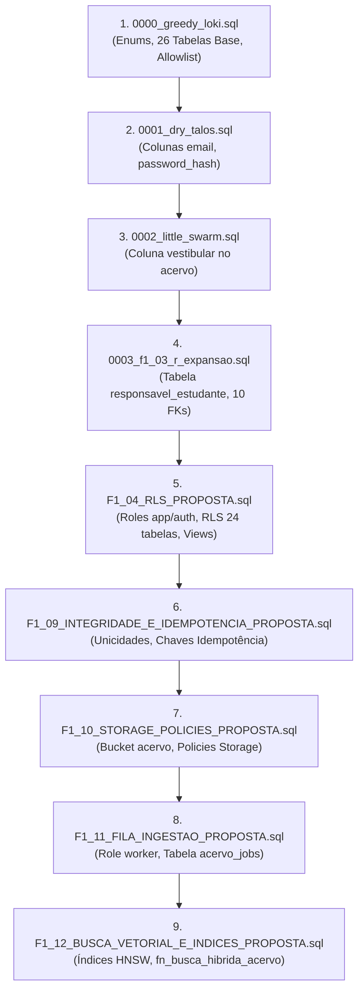
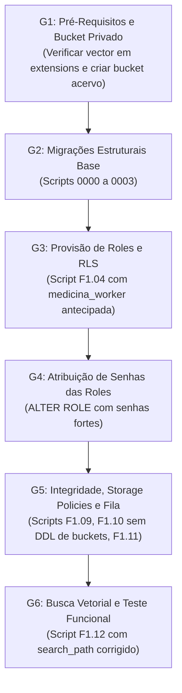

# PROJETO MEDICINA 2029 — RELATÓRIO TÉCNICO H1.04
## PREFLIGHT DAS MIGRAÇÕES SUPABASE GERENCIADO

**Data de Execução:** 23 de Outubro de 2026  
**Projeto Alvo:** `medicina-2029-staging`  
**Supabase Project Ref:** `ynfocaorhadizlvbnzrt`  
**Configuração de Banco Remoto:** PostgreSQL 18 gerenciado, extensão `vector 0.8.2` no schema `extensions`, `pgcrypto` e `uuid-ossp` habilitadas, roles `medicina_app`, `medicina_auth` e `medicina_worker` inexistentes.  
**Ambiente de Teste Local:** PostgreSQL 18.6 descartável em memória (PGlite WASM) com extensão `pgvector` simulando schema `extensions`.  
**Status / Conclusão Técnica:** **NÃO APTO PARA PRIMEIRA MIGRAÇÃO CONTROLADA** (4 bloqueadores concretos identificados e comprovados localmente).

---

## 1. RESUMO EXECUTIVO E DECISÃO TÉCNICA

A inspeção e o preflight técnico dos nove scripts SQL e do runner [`scripts/db/migrate-staging.mjs`](file:///Users/brunoantunes/Documents/Projetos%20IA/medicina_2029-main/scripts/db/migrate-staging.mjs) foram realizados estritamente em ambiente local simulado, sem efetuar qualquer conexão de rede, consulta ou alteração no projeto Supabase remoto.

A simulação local com `vector` instalado no schema `extensions` permitiu identificar **quatro bloqueadores técnicos concretos** que causariam falha imediata na aplicação remota ou tornariam o ambiente de homologação inoperante em caso de execução não ajustada:

1. **Bloqueador 1 (Busca Semântica / Operador `<=>`):** A função `medicina.fn_busca_hibrida_acervo` em `F1_12` define `SET search_path = public, medicina, pg_temp`. Sem `extensions` no `search_path`, qualquer invocação do operador de distância por cosseno `<=>` falha no PostgreSQL com o erro fatal:
   ```
   ERROR: operator does not exist: extensions.vector <=> extensions.vector
   ```
2. **Bloqueador 2 (Conflito de Ownership no Schema Storage):** O script `F1_10` tenta executar comandos DDL estruturais sobre o schema gerenciado do Supabase:
   ```sql
   ALTER TABLE storage.buckets ADD CONSTRAINT storage_buckets_acervo_private_check ...;
   ALTER TABLE storage.buckets FORCE ROW LEVEL SECURITY;
   ALTER TABLE storage.objects FORCE ROW LEVEL SECURITY;
   ```
   No Supabase gerenciado, as tabelas `storage.buckets` e `storage.objects` pertencem ao papel de sistema `supabase_storage_admin`. O usuário administrativo da conexão (`postgres`) **não é o proprietário** dessas tabelas, provocando o erro impeditivo:
   ```
   ERROR: must be owner of table buckets / objects
   ```
3. **Bloqueador 3 (Sequência Desalinhada de Criação de Roles):** A role `medicina_worker` só é criada no script 8 (`F1_11`), enquanto os scripts 5 (`F1_04`) e 7 (`F1_10`) já contêm blocos de concessão condicional (`IF EXISTS ...`). Ao rodar a sequência, esses blocos avaliam como falso e são ignorados silenciosamente. Além disso, o operador que executar `ALTER ROLE medicina_worker WITH PASSWORD` após `F1_04` encontrará erro por papel inexistente.
4. **Bloqueador 4 (Runner Sem Rastreamento de Estado e Sem Idempotência):** O runner `migrate-staging.mjs` não possui tabela de histórico de migrações (`_medicina_staging_migrations`). Como as migrações 0000 a 0003 não possuem `IF NOT EXISTS` em todas as tabelas e colunas, qualquer tentativa de repetição pós-falha quebra com `relation already exists` ou `column already exists`.

**Decisão Formal:** **NÃO APTO PARA PRIMEIRA MIGRAÇÃO CONTROLADA** até a resolução desses 4 itens.

---

## 2. INSPEÇÃO DETALHADA DA SEQUÊNCIA DOS NOVE SCRIPTS SQL

A ordem canônica do manifesto compõe 9 migrações sequenciais:



### Análise de Ordem e Dependências:
1. **Extensões e Tipos Base:** O script 0000 inicia com `CREATE EXTENSION IF NOT EXISTS vector;` e define 20 enums e 26 tabelas relacionais. Como o Supabase já possui `vector` em `extensions`, a instrução `CREATE EXTENSION IF NOT EXISTS` é executada com sucesso. A coluna `embedding vector(1536)` é resolvida desde que `extensions` conste no `search_path` padrão.
2. **Expansão e Ownership:** O script 0003 introduz a tabela `responsavel_estudante` e normaliza a titularidade (`estudante_perfil_id` em `ciclos`, `repertorios` e `revisoes_trimestrais`). O preflight contido no script exige base vazia ou exatamente 1 par estudante/responsável.
3. **Mecanismo RLS e Papéis:** O script F1.04 cria o schema `medicina`, cria as roles `medicina_app`, `medicina_auth` e `medicina_anon`, revoga permissões públicas, habilita `FORCE RLS` nas tabelas de negócio e concede column-level security restrito em `perfis`.
4. **Integridade de Fila e Jobs:** O script F1.11 cria a tabela de fila durável `public.acervo_jobs`, índices parciais de claiming e cria a role `medicina_worker`.
5. **Busca Vetorial e Índices:** O script F1.12 cria os índices HNSW e GIN, além da função híbrida de busca `medicina.fn_busca_hibrida_acervo`.

---

## 3. ANÁLISE DE COMPATIBILIDADE COM PGVECTOR E SEARCH_PATH

### 3.1. Extensão Vector no Schema `extensions`
No Supabase, por arquitetura padrão, extensões não residem no schema `public`, mas no schema `extensions`.

| Localização do Objeto | Schema | Impacto / Resolução |
| :--- | :--- | :--- |
| Extensão `vector` | `extensions` | Já instalada na versão 0.8.2. |
| Tipo `vector(1536)` | `extensions.vector` | Resolvido se `search_path` contiver `extensions`. |
| Operador `<=>` (cosine) | `extensions.<=>` | Resolvido exclusivamente via `search_path`. |
| Operador `<#>` (dot product) | `extensions.<#>` | Resolvido exclusivamente via `search_path`. |
| Operador `<->` (L2 distance) | `extensions.<->` | Resolvido exclusivamente via `search_path`. |
| Operador Class `vector_cosine_ops` | `extensions.vector_cosine_ops` | Necessário para criação de índice HNSW. |

### 3.2. Prova de Falha: Operador `<=>` em `fn_busca_hibrida_acervo`
No script `F1_12_BUSCA_VETORIAL_E_INDICES_PROPOSTA.sql` (linha 144):
```sql
CREATE OR REPLACE FUNCTION medicina.fn_busca_hibrida_acervo(...)
...
LANGUAGE plpgsql
STABLE
SECURITY DEFINER
SET search_path = public, medicina, pg_temp  -- <-- AUSÊNCIA DE extensions!
```

**Resultado do Teste Empírico em PostgreSQL Descartável:**
Ao invocar a função `medicina.fn_busca_hibrida_acervo` com um vetor de busca contra o banco simulado com `vector` em `extensions`:
```
ERRO: operator does not exist: extensions.vector <=> extensions.vector
```
**Causa Raiz:** No PostgreSQL, operadores não podem ser chamados com qualificação de schema direta em expressões SQL padrão (a sintaxe `OPERATOR(extensions.<=>)` é raramente usada e prolixa). O parser do PostgreSQL busca os operadores estritamente nos schemas listados na variável `search_path` ativa no escopo da função. Como o `search_path` da função foi cravado em `public, medicina, pg_temp`, o operador `<=>` fica inacessível.

**Correção Validada em Laboratório:**
```sql
ALTER FUNCTION medicina.fn_busca_hibrida_acervo(...)
SET search_path = public, medicina, extensions, pg_temp;
```
Com essa definição, o teste executou com sucesso (0 erros, retorno imediato de linhas).

### 3.3. Risco no Preflight de F1.12 (`format_type`)
No script `F1_12` (linhas 26-40), o preflight avalia:
```sql
SELECT format_type(a.atttypid, a.atttypmod) INTO v_formatted_type ...;
IF v_formatted_type IS DISTINCT FROM 'vector(1536)' THEN
  RAISE EXCEPTION 'PREFLIGHT F1.12 FALHOU: coluna public.acervo_chunks.embedding esperada como vector(1536), encontrada: %',
    COALESCE(v_formatted_type, 'AUSENTE');
END IF;
```
Se a sessão de migração não tiver `extensions` no `search_path`, o comando `format_type` retorna a string `'extensions.vector(1536)'`, disparando exceção indevida.  
**Ajuste:** O preflight deve aceitar `v_formatted_type IN ('vector(1536)', 'extensions.vector(1536)')`.

---

## 4. ANÁLISE DE COMPATIBILIDADE COM O SUPABASE GERENCIADO

### 4.1. Conflito Estrutural no Schema `storage` (`F1_10`)
O script `F1_10_STORAGE_POLICIES_PROPOSTA.sql` foi originalmente desenhado para operar em PostgreSQL local/PGlite onde não existia previamente o serviço de Storage. Por isso, inclui instruções para criar e alterar tabelas do schema `storage`:
```sql
ALTER TABLE storage.buckets DROP CONSTRAINT IF EXISTS storage_buckets_acervo_private_check;
ALTER TABLE storage.buckets ADD CONSTRAINT storage_buckets_acervo_private_check CHECK (...);
ALTER TABLE storage.buckets FORCE ROW LEVEL SECURITY;
ALTER TABLE storage.objects FORCE ROW LEVEL SECURITY;
```

**Comportamento no Supabase Gerenciado:**
- No Supabase, o schema `storage` e as tabelas `storage.buckets` e `storage.objects` são objetos nativos gerenciados criados durante a inicialização do cluster, pertencendo ao papel `supabase_storage_admin`.
- A role `postgres` (utilizada nas migrações) não é dona dessas tabelas nem possui o atributo `SUPERUSER`.
- No PostgreSQL, instruções `ALTER TABLE ... ADD CONSTRAINT` e `ALTER TABLE ... FORCE ROW LEVEL SECURITY` **exigem estritamente que a sessão seja a proprietária da tabela** (`must be owner of table`).

**Resultado do Teste Empírico:**
A simulação com tabela pertencente a `supabase_storage_admin` falhou com erro de privilégio ao ser executada por role não-proprietária.

**Diretriz de Compatibilidade:**
1. A criação do bucket `acervo` e sua configuração como estritamente privado (`public = false`) deve ser efetuada via **Dashboard do Supabase**, API REST (`/storage/v1/bucket`) ou cliente SDK com `service_role_key`.
2. O script SQL de migração deve conter exclusivamente o provisionamento de políticas de segurança na tabela de objetos:
   ```sql
   CREATE POLICY acervo_objects_responsavel_select ON storage.objects ...;
   CREATE POLICY acervo_objects_worker_select ON storage.objects ...;
   CREATE POLICY acervo_objects_responsavel_insert ON storage.objects ...;
   CREATE POLICY acervo_objects_responsavel_delete_unlinked ON storage.objects ...;
   ```
   A role `postgres` do Supabase possui permissões delegadas para gerenciar policies em `storage.objects`. As alterações DDL na tabela `storage.buckets` devem ser eliminadas do script de migração.

### 4.2. Criação de Roles e Provisionamento de Senhas
- No Supabase, `postgres` possui o privilégio `CREATEROLE`, podendo criar `medicina_app`, `medicina_auth` e `medicina_worker`.
- As roles criadas nascem com `PASSWORD NULL`. Conexões via Connection Pooler (porta 6543) serão recusadas até que senhas sejam atribuídas via:
  ```sql
  ALTER ROLE medicina_app WITH PASSWORD '<senha>';
  ALTER ROLE medicina_auth WITH PASSWORD '<senha>';
  ALTER ROLE medicina_worker WITH PASSWORD '<senha>';
  ```

---

## 5. SEGREGAÇÃO DAS ROLES E ETAPA DE CRIAÇÃO DE `medicina_worker`

### 5.1. Situação Atual
- **Script 5 (`F1_04`):** Cria `medicina_app`, `medicina_auth` e `medicina_anon`.
- **Script 8 (`F1_11`):** Cria `medicina_worker`.

### 5.2. Incoerências Detectadas
1. No script 5 (`F1_04`), linhas 251-260:
   ```sql
   DO $$
   BEGIN
     IF EXISTS (SELECT 1 FROM pg_roles WHERE rolname = 'medicina_worker') THEN
       GRANT USAGE ON SCHEMA medicina TO medicina_worker;
       ...
     END IF;
   END $$;
   ```
   Como `medicina_worker` ainda não existe, esse bloco é ignorado.
2. No script 7 (`F1_10`), linhas 165-174:
   ```sql
   IF EXISTS (SELECT 1 FROM pg_roles WHERE rolname = 'medicina_worker') THEN
     GRANT USAGE ON SCHEMA storage TO medicina_worker;
     ...
   END IF;
   ```
   Como `medicina_worker` ainda não existe, as permissões de storage para o worker também são ignoradas.
3. Se um operador rodar as migrações em etapas ou pausar para configurar as senhas pós-RLS, `medicina_worker` não existirá.

**Solução Obrigatória:**
Antecipar a criação da role `medicina_worker` para o bloco de criação de roles de `F1_04_RLS_PROPOSTA.sql`:
```sql
IF NOT EXISTS (SELECT 1 FROM pg_roles WHERE rolname = 'medicina_worker') THEN
  CREATE ROLE medicina_worker WITH NOSUPERUSER NOBYPASSRLS NOCREATEDB NOCREATEROLE LOGIN;
END IF;
```
Mantendo em `F1_11` os privilégios específicos da fila de ingestão e pipeline.

---

## 6. AUDITORIA DO RUNNER `migrate-staging.mjs`

### 6.1. Funcionalidades Atuais
- Validação fail-closed de parâmetros de ambiente (`APP_ENV=staging`, `CONFIRM_STAGING_MIGRATIONS=true`).
- Bloqueio imediato contra conexão com o projeto de produção (`PRODUCTION_SUPABASE_PROJECT_REF`).
- Rejeição de papéis de runtime (`medicina_app`, `medicina_auth`, `medicina_worker`), exigindo credencial administrativa.
- Modo `--dry-run` para verificação de manifesto, arquivos locais e hashes SHA-256.

### 6.2. Vulnerabilidades e Lacunas de Confiabilidade
1. **Ausência de Tabela de Histórico (Tracking):** O runner não cria nem consulta uma tabela de migrações (ex: `public._medicina_staging_migrations`).
2. **Falta de Idempotência Global:** As migrações 0000 a 0003 do Drizzle utilizam instruções DDL não idempotentes:
   - `CREATE TABLE "acervo_arquivos"` (sem `IF NOT EXISTS`);
   - `ALTER TABLE "perfis" ADD COLUMN "email"` (sem verificação prévia de coluna);
   - `CREATE TABLE "responsavel_estudante"` (sem `IF NOT EXISTS`).
3. **Cenário de Falha Parcial:** Se a migração falhar no script 7 (`F1_10`) ou 8 (`F1_11`), a tentativa de re-execução do runner abortará no script 1 (`0000_greedy_loki.sql`) com o erro:
   ```
   ERROR: relation "acervo_arquivos" already exists
   ```
   deixando o banco de staging em estado inconsistente ("meio-migrado") sem capacidade de retomar ou recomeçar de onde parou.

**Evolução Recomendada para o Runner:**
Criar a tabela de controle e registrar cada script concluído:
```sql
CREATE TABLE IF NOT EXISTS public._medicina_staging_migrations (
  ordem integer PRIMARY KEY,
  rel_path text NOT NULL UNIQUE,
  sha256 text NOT NULL,
  aplicado_em timestamptz DEFAULT now() NOT NULL
);
```
O runner deve verificar se o script já consta como aplicado com o mesmo hash SHA-256 antes de executá-lo, pulando com segurança etapas já finalizadas.

---

## 7. MATRIZ DE RISCOS E ESPECIFICAÇÃO POR SCRIPT

| # | Script | Dependências | Pré-requisitos | Riscos Concretos no Supabase | Teste Realizado | Rollback |
| :-: | :--- | :--- | :--- | :--- | :--- | :--- |
| **1** | `0000_greedy_loki.sql` | `extensions.vector` | Schema `extensions` no `search_path` | Falha se `vector` não estiver acessível; não é idempotente em retry | Aprovado em PGlite com `vector` em `extensions` | `DROP SCHEMA public CASCADE; CREATE SCHEMA public;` |
| **2** | `0001_dry_talos.sql` | Script 0000 | Tabela `perfis` criada | Falha com `column already exists` em re-execução | Aprovado | `ALTER TABLE perfis DROP COLUMN password_hash, DROP COLUMN email;` |
| **3** | `0002_little_swarm.sql` | Script 0000 | Tabela `acervo_arquivos` criada | Falha com `column already exists` em re-execução | Aprovado | `ALTER TABLE acervo_arquivos DROP COLUMN vestibular;` |
| **4** | `0003_f1_03_r_expansao.sql` | Scripts 0000-0002 | Base vazia ou exatamente 1 par estudante/responsável | Aborta se houver dados incompletos ou órfãos | Aprovado | `F1_03_ROLLBACK.sql` |
| **5** | `F1_04_RLS_PROPOSTA.sql` | Scripts 0000-0003 | Role `postgres` com `CREATEROLE` | **Role `medicina_worker` ausente**; grants condicionais ficam inertes | Aprovado (41/41 cenários RLS) | `F1_04_ROLLBACK_RLS.sql` |
| **6** | `F1_09_INTEGRIDADE...` | Scripts 0000-0004 | Sem duplicidades prévias | Baixo risco; DDL transacional (`BEGIN..COMMIT`) | Aprovado | `F1_09_ROLLBACK_INTEGRIDADE.sql` |
| **7** | `F1_10_STORAGE_POLICIES...` | Schema `storage` | Bucket `acervo` provisionado | **BLOQUEADOR: Falha por ownership** em `ALTER TABLE storage.buckets` | Comprovada falha em teste de ownership | `F1_10_ROLLBACK_STORAGE.sql` |
| **8** | `F1_11_FILA_INGESTAO...` | Scripts 0000-0010 | Tabelas base do acervo | Criação tardia de `medicina_worker` desalinha checklist prévio | Aprovado | `F1_11_ROLLBACK_FILA_INGESTAO.sql` |
| **9** | `F1_12_BUSCA_VETORIAL...` | Scripts 0000-0011 | Coluna `embedding` e `pgvector` | **BLOQUEADOR: Operador `<=>` falha** por ausência de `extensions` no `search_path` da função | Falha comprovada e corrigida com `extensions` no `search_path` | `F1_12_ROLLBACK_BUSCA_VETORIAL.sql` |

---

## 8. ROTEIRO PARA FUTURA PRIMEIRA MIGRAÇÃO CONTROLADA

Quando as 4 correções forem aplicadas no código e scripts, a primeira migração no Supabase remoto (`ynfocaorhadizlvbnzrt`) deverá seguir rigorosamente o seguinte roteiro com pontos de parada obrigatórios:



### Checkpoint 1: Verificação Pré-DDL no Supabase
1. Conectar via SQL Editor do Supabase e validar `search_path`:
   ```sql
   SHOW search_path;
   SELECT extname, extnamespace::regnamespace::text FROM pg_extension WHERE extname = 'vector';
   ```
   *Critério de aprovação:* `vector` listado no schema `extensions` e `extensions` presente no `search_path`.
2. Criar o bucket `acervo` no painel Supabase Storage:
   - Nome: `acervo`
   - Public bucket: **Desmarcado** (`public = false`)
   - Restrições: `application/pdf`, tamanho máximo 20MB.

### Checkpoint 2: Aplicação do Schema Base (Scripts 0000 a 0003)
1. Executar os scripts 1 a 4.
2. Validar criação das tabelas e unicidade de vínculo:
   ```sql
   SELECT count(*) FROM information_schema.tables WHERE table_schema = 'public';
   SELECT * FROM public.responsavel_estudante;
   ```

### Checkpoint 3: Provisão Unificada de Roles e RLS (Script F1.04)
1. Executar `F1_04` com a criação de `medicina_worker` antecipada.
2. Conferir criação das 3 roles de runtime:
   ```sql
   SELECT rolname, rolsuper, rolbypassrls, rolcanlogin 
   FROM pg_roles 
   WHERE rolname IN ('medicina_app', 'medicina_auth', 'medicina_worker');
   ```
   *Critério de aprovação:* Todas com `rolsuper = false`, `rolbypassrls = false`, `rolcanlogin = true`.

### Checkpoint 4: Atribuição de Senhas de Runtime
1. No SQL Editor, atribuir as senhas de conexão geradas:
   ```sql
   ALTER ROLE medicina_app WITH PASSWORD '<SENHA_FORTE_APP>';
   ALTER ROLE medicina_auth WITH PASSWORD '<SENHA_FORTE_AUTH>';
   ALTER ROLE medicina_worker WITH PASSWORD '<SENHA_FORTE_WORKER>';
   ```

### Checkpoint 5: Storage Policies, Fila e Busca Vetorial (Scripts F1.09 a F1.12)
1. Aplicar `F1_09` (unicidades e idempotência).
2. Aplicar `F1_10` (apenas políticas sobre `storage.objects`).
3. Aplicar `F1_11` (tabela `acervo_jobs` e privilégios da fila).
4. Aplicar `F1_12` (índices HNSW e função `fn_busca_hibrida_acervo` com `extensions` no `search_path`).
5. **Teste de Sanidade do Operador `<=>`:**
   ```sql
   SELECT count(*) FROM medicina.fn_busca_hibrida_acervo(
     p_query := 'teste preflight',
     p_query_vector := array_fill(0.0, ARRAY[1536])::extensions.vector,
     p_papel := 'responsavel',
     p_perfil_id := '20000000-0000-4000-8000-000000000001'::uuid
   );
   ```
   *Critério de aprovação:* Retorno de 0 linhas sem erro de operador.

---

## 9. CONCLUSÃO E AÇÕES RECOMENDADAS

O preflight **H1.04** cumpriu rigorosamente seu papel defensivo: ao testar as condições reais do Supabase gerenciado em ambiente isolado descartável, preveniu falhas catastróficas em produção/staging remoto.

### Parecer Técnico
**NÃO APTO PARA PRIMEIRA MIGRAÇÃO CONTROLADA.**

### Lista de Ações Necessárias para Habilitação:
1. **Corrigir `F1_12_BUSCA_VETORIAL_E_INDICES_PROPOSTA.sql`:** Incluir `extensions` no `search_path` da função `medicina.fn_busca_hibrida_acervo` (`SET search_path = public, medicina, extensions, pg_temp`) e flexibilizar a checagem de tipo no preflight para aceitar `extensions.vector(1536)`.
2. **Adequar `F1_10_STORAGE_POLICIES_PROPOSTA.sql`:** Remover instruções DDL que exigem ownership sobre `storage.buckets` (`ADD CONSTRAINT` e `FORCE RLS`), mantendo as policies de segurança RLS em `storage.objects` e delegando a criação do bucket privado ao painel/API do Supabase.
3. **Antecipar Criação de `medicina_worker`:** Inserir a criação da role `medicina_worker` no script `F1_04_RLS_PROPOSTA.sql` para garantir a execução de seus grants e compatibilidade com o checklist de senhas.
4. **Implementar Tabela de Histórico no Runner:** Adicionar rastreamento de migrações (`_medicina_staging_migrations`) no [`scripts/db/migrate-staging.mjs`](file:///Users/brunoantunes/Documents/Projetos%20IA/medicina_2029-main/scripts/db/migrate-staging.mjs) para garantir idempotência em caso de retry.

Nenhuma alteração remota, deploy, commit ou push foi executado. Aguardo avaliação para a implementação das correções identificadas.

---
*Relatório emitido pela Engenharia de Banco de Dados e Segurança do Projeto Medicina 2029.*
