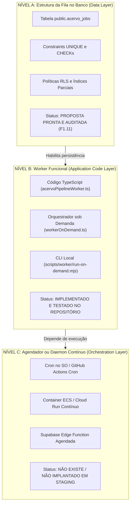

# MEDICINA 2029 — RELATÓRIO TÉCNICO CONSOLIDADO H1.08
## PREPARAÇÃO DA OITAVA MIGRAÇÃO (F1.11): FILA DURÁVEL DE INGESTÃO E PIPELINE RETOMÁVEL
### Inspeção Integral, Compatibilidade RLS/Identidade, Segurança, Concorrência, Lançador Controlado e Testes em PostgreSQL Descartável

**Projeto Alvo:** `medicina-2029-staging`  
**Project Ref:** `ynfocaorhadizlvbnzrt`  
**Endpoint Session Pooler:** `aws-0-us-east-1.pooler.supabase.com:5432`  
**Role Administrativa:** `postgres.ynfocaorhadizlvbnzrt`  
**Data:** 25 de Outubro de 2026  
**Status da Etapa 8 (F1.11):** **APTO PARA APLICAÇÃO EM STAGING (AGUARDANDO AUTORIZAÇÃO HUMANA)**  
**Restrição Operacional:** NENHUMA conexão remota ou execução foi realizada neste comando (100% isolado em PostgreSQL descartável PGlite; sem chamadas de APIs pagas ou mutações em Staging/Produção).

---

## METADADOS FÍSICOS E CRIPTOGRÁFICOS DOS ARQUIVOS

| Arquivo | Tamanho Exato | Hash SHA-256 | Estado / Função |
| :--- | :---: | :--- | :--- |
| `docs/modernizacao/propostas/F1_11_FILA_INGESTAO_PROPOSTA.sql` | **11.978 bytes** | `e5a9ceea9daca82347c4af623bfb36156334fb4ae7525334e1f58626b41b8298` | Saneado (DDL Fila, Constraints, RLS e Grants) |
| `docs/modernizacao/propostas/F1_11_ROLLBACK_FILA_INGESTAO.sql` | **2.346 bytes** | `c632946b22a9356aa6352cbb86138a7c5a414e934c02b885a7f8a734839e94b3` | Saneado (Reversibilidade atômica e simétrica) |
| `scripts/db/apply-staging-step8.mjs` | **11.437 bytes** | `a922c00a512cf8f1e56c8e704fa46a3e7019e6f889364af9569ee991d6409e0d` | Lançador Interativo com `--until-step=8` |
| `scripts/db/migrate-staging.mjs` | **22.619 bytes** | `ae166aec7eaaa29826dcbbab4c89d9e830269ff4fd132e7ac5ce729b9a1e6f34` | Runner Canônico (Probe 8 e Integridade SHA-256) |
| `src/app/actions/h1_04_staging_step8_launcher.test.ts` | **16.670 bytes** | `f6bbaee95059df9ab4c7cf3fa6ddd029ff8e26ca8262a6ec0ad92e1d5dd3821c` | Suíte Vitest (9 testes do Lançador e Salvaguardas) |
| `src/app/actions/h1_08_step8_migration_lifecycle.test.ts` | **25.699 bytes** | `9eaf9dcd37f11c9c68218a930485ed9971928615faecffaba52eb266889879e1` | Suíte Vitest (6 testes de Ciclo de Vida e RLS) |

### Preservação Intacta das Sete Migrações Anteriores
Todos os arquivos e hashes SHA-256 das migrações 1 a 7 registradas no histórico de homologação permanecem rigorosamente idênticos:
1. `drizzle/0000_greedy_loki.sql` (24.043 bytes | `b1cf8d6741894a52...`)
2. `drizzle/0001_dry_talos.sql` (238 bytes | `8e82452e0071ee1c...`)
3. `drizzle/0002_little_swarm.sql` (66 bytes | `c3ce3d3b1335bedb...`)
4. `drizzle/0003_f1_03_r_expansao.sql` (11.541 bytes | `32be49be0da8ed6c...`)
5. `docs/modernizacao/propostas/F1_04_RLS_PROPOSTA.sql` (45.758 bytes | `8aff8ea87bf6149a...`)
6. `docs/modernizacao/propostas/F1_09_INTEGRIDADE_E_IDEMPOTENCIA_PROPOSTA.sql` (11.303 bytes | `96187040783e236b...`)
7. `docs/modernizacao/propostas/F1_10_STORAGE_POLICIES_PROPOSTA.sql` (5.759 bytes | `41dde50128b89ce9...`)

---

## 1. SUMÁRIO EXECUTIVO

O procedimento **H1.08** realizou a preparação exaustiva e independente da **Oitava Migração** da modernização do MEDICINA 2029 (`F1_11_FILA_INGESTAO_PROPOSTA.sql`), responsável pela substituição do processamento efêmero em memória por uma infraestrutura durável de enfileiramento transacional PostgreSQL (`public.acervo_jobs`), controle de concorrência com leases, retry exponencial, retomada por etapas e isolamento multi-tenant.

A preparação foi conduzida através de múltiplos agentes especializados operando em paralelo (Auditoria de SQL/RLS, Auditoria de Fila/Concorrência/Worker e Engenharia de Lançador/Testes Automatizados), convergindo nos seguintes resultados:

1. **Saneamento Preventivo de Compatibilidade com Supabase Cloud:** Identificou-se preventivamente que a versão legada da proposta F1.11 tentava conceder permissões diretas sobre o catálogo interno gerenciado (`GRANT USAGE ON SCHEMA storage` e `GRANT SELECT ON storage.buckets, storage.objects TO medicina_worker`). Como comprovado em H1.07-R, o schema `storage` pertence ao usuário interno `supabase_storage_admin`, e a role `postgres` de staging não possui privilégios de concessão (`WITH GRANT OPTION`), o que acarretaria falha impeditiva `42501 (permission denied)`. O script foi corrigido de forma limpa, eliminando comandos sobre `storage.*` e mantendo a arquitetura canônica do **Modelo A** (backend NextAuth + Server Actions com `SUPABASE_SERVICE_ROLE_KEY` via SDK HTTP).
2. **Conformidade Estrita de RLS e Identidade:** Verificou-se que o SQL utiliza exclusivamente as funções canônicas do schema `medicina` (`medicina.current_perfil_id()` e `medicina.is_responsavel()`), sem qualquer dependência legada a `public.rls_*`. As políticas RLS garantem isolamento matemático entre responsáveis, bloqueio total (*default-deny fail-closed*) para estudantes e permissões de trabalho exclusivas para o papel `medicina_worker`.
3. **Auditoria de Concorrência e Transações:** Confirmou-se que a fila opera com idempotência em banco (`UNIQUE(arquivo_id)`), proteção contra disputa simultânea via Compare-And-Swap (CAS) e locks com leases de 60 segundos com heartbeat e renovação atômica. Comprovou-se empiricamente que **nenhuma transação SQL é mantida aberta durante chamadas externas de rede** (Gemini OCR, embeddings ou downloads do Storage), blindando completamente o Session Pooler (Supavisor / porta 5432).
4. **Lançador Seguro e Testes Automatizados (15/15 Testes 100% Verde):** Foi construído o lançador dedicado [`scripts/db/apply-staging-step8.mjs`](file:///Users/brunoantunes/Documents/Projetos%20IA/medicina_2029-main/scripts/db/apply-staging-step8.mjs) com token de confirmação `"APLICAR ETAPA 8 EM STAGING"`, entrada oculta de senha e restrição estrita `--until-step=8`. Todos os 15 testes automatizados (9 do lançador e 6 de ciclo de vida e concorrência) foram executados e aprovados com 100% de sucesso em ambiente descartável PGlite.

---

## 2. INSPEÇÃO INTEGRAL E ALTERAÇÕES EXATAS DA MIGRAÇÃO F1.11

### 2.1 Estrutura e DDL da Fila (`public.acervo_jobs`)
A proposta instala uma tabela especializada de controle de estado e mensageria no schema `public`:
- `id uuid PRIMARY KEY DEFAULT gen_random_uuid() NOT NULL`
- `arquivo_id uuid NOT NULL REFERENCES public.acervo_arquivos(id) ON DELETE CASCADE`: se um arquivo for deletado pelo responsável, seu job e histórico de processamento são expurgados em cascata.
- `enviado_por uuid NOT NULL REFERENCES public.perfis(id) ON DELETE RESTRICT`: integridade referencial que vincula a auditoria e posse do job ao perfil do autor, impedindo a exclusão acidental do usuário enquanto houver jobs registrados.
- `status varchar(30) DEFAULT 'aguardando' NOT NULL`: transições permitidas entre `'aguardando'`, `'em_execucao'`, `'concluido'` e `'falhou'`.
- `etapa_atual varchar(30) DEFAULT 'extracao' NOT NULL`: pipeline sequencial entre `'extracao'`, `'segmentacao'`, `'classificacao'`, `'indexacao'` e `'concluido'`.
- `tentativas integer DEFAULT 0 NOT NULL` e `max_tentativas integer DEFAULT 3 NOT NULL`.
- `proxima_execucao_em timestamp DEFAULT now() NOT NULL`: timestamp com base no qual workers elegem o próximo job claimável.
- Campos de Lease e Heartbeat: `locked_by varchar(128)`, `locked_at timestamp`, `heartbeat_at timestamp`, `lease_expires_at timestamp`.
- Campos de Erro Sanitizado: `ultimo_erro_codigo varchar(80)`, `ultimo_erro_mensagem text`.
- Timestamps de Ciclo de Vida: `iniciado_em`, `concluido_em`, `criado_em DEFAULT now()`, `atualizado_em DEFAULT now()`.

### 2.2 Constraints de Integridade e Consistência no Banco
1. `acervo_jobs_arquivo_id_unique UNIQUE (arquivo_id)`: relação estrita 1:1, impedindo enfileiramento duplicado para o mesmo arquivo físico.
2. `acervo_jobs_status_check`: valida os 4 estados canônicos do job.
3. `acervo_jobs_etapa_atual_check`: valida as 5 etapas canônicas do pipeline.
4. `acervo_jobs_tentativas_check`: `CHECK (tentativas >= 0 AND max_tentativas BETWEEN 1 AND 10 AND tentativas <= max_tentativas + 1)`.
5. `acervo_jobs_lease_consistency_check`:
   `CHECK (status <> 'em_execucao' OR (locked_by IS NOT NULL AND locked_at IS NOT NULL AND lease_expires_at IS NOT NULL AND lease_expires_at >= locked_at))`. Garante que nenhum job assuma o estado de execução sem os metadados consistentes de lease e titularidade.
6. `acervo_jobs_concluido_consistency_check`:
   `CHECK (status <> 'concluido' OR (etapa_atual = 'concluido' AND concluido_em IS NOT NULL AND locked_by IS NULL AND lease_expires_at IS NULL))`. Garante a liberação dos locks e integridade dos carimbos de conclusão.
7. Unicidades Físicas nas Tabelas Filhas (Garantia de Retomada Idempotente):
   - `ALTER TABLE public.acervo_paginas ADD CONSTRAINT acervo_paginas_arquivo_numero_unique UNIQUE (arquivo_id, numero);`
   - `ALTER TABLE public.acervo_chunks ADD CONSTRAINT acervo_chunks_arquivo_ordem_unique UNIQUE (arquivo_id, ordem);`
   Permite que o worker retome a extração ou segmentação sem risco de duplicar tuplas em reexecuções parciais.

### 2.3 Índices de Alta Eficiência
- `acervo_jobs_claimable_idx ON public.acervo_jobs (proxima_execucao_em, criado_em) WHERE status IN ('aguardando', 'em_execucao')`:
  Índice parcial que atende diretamente as consultas de claiming do worker e varredura de leases vencidos sem percorrer jobs finalizados ou falhos.
- `acervo_jobs_enviado_por_idx ON public.acervo_jobs (enviado_por, criado_em DESC)`:
  Indexação direta para a listagem e acompanhamento de status pela interface do usuário.

### 2.4 Backfill Determinístico
O script migra de forma idempotente (`ON CONFLICT (arquivo_id) DO NOTHING`) todos os registros preexistentes em `public.acervo_arquivos`:
- Arquivos já com `status_processamento = 'concluido'` são inseridos com `status = 'concluido'`, `etapa_atual = 'concluido'`, `tentativas = 1`, e `concluido_em = enviado_em`.
- Arquivos com `status_processamento = 'falhou'` são inseridos com `status = 'falhou'`, `ultimo_erro_codigo = 'LEGACY_PIPELINE_FAILED'`, e `ultimo_erro_mensagem = erro_processamento`.
- Arquivos pendentes (`indexando`, `classificando`, `segmentando`, `extracao`) são enfileirados como `status = 'aguardando'` com `proxima_execucao_em = now()`.

### 2.5 Diff Exato Aplicado no SQL da Proposta F1.11

Abaixo apresenta-se o diff cirúrgico aplicado para garantir compatibilidade nativa com o Supabase Cloud e eliminar comandos indevidos no catálogo gerenciado `storage.*`:

```diff
--- a/docs/modernizacao/propostas/F1_11_FILA_INGESTAO_PROPOSTA.sql
+++ b/docs/modernizacao/propostas/F1_11_FILA_INGESTAO_PROPOSTA.sql
@@ -208,16 +208,19 @@ BEGIN
     IF to_regprocedure('medicina.is_responsavel()') IS NOT NULL THEN
       GRANT EXECUTE ON FUNCTION medicina.is_responsavel() TO medicina_worker;
     END IF;
-  END IF;
-
-  IF to_regclass('storage.objects') IS NOT NULL THEN
-    GRANT USAGE ON SCHEMA storage TO medicina_worker;
-    GRANT SELECT ON storage.buckets, storage.objects TO medicina_worker;
     IF to_regprocedure('medicina.is_valid_acervo_storage_path(text)') IS NOT NULL THEN
       GRANT EXECUTE ON FUNCTION medicina.is_valid_acervo_storage_path(text) TO medicina_worker;
     END IF;
   END IF;
 
+  -- COMPATIBILIDADE NATIVA COM SUPABASE CLOUD (H1.07-R / MODELO A):
+  -- No Supabase Cloud gerenciado, o schema `storage` e as tabelas `storage.buckets` e
+  -- `storage.objects` pertencem ao superusuário interno `supabase_storage_admin`.
+  -- A role de conexão (`postgres`) NÃO é proprietária dessas tabelas e qualquer
+  -- tentativa de GRANT/REVOKE direto sobre elas falha por falta de privilégios.
+  -- Conforme o Modelo A, o worker interage com o Storage exclusivamente via SDK HTTP
+  -- utilizando `SUPABASE_SERVICE_ROLE_KEY`, sem necessitar de privilégios SQL em `storage.*`.
+
   IF EXISTS (SELECT 1 FROM pg_roles WHERE rolname = 'medicina_app') THEN
     GRANT SELECT, INSERT, UPDATE, DELETE ON public.acervo_jobs TO medicina_app;
   END IF;
```

---

## 3. COMPATIBILIDADE RLS, IDENTIDADE E ISOLAMENTO MULTI-TENANT

### 3.1 Auditoria das Funções de Contexto e Identidade
- O SQL F1.11 foi auditado linha a linha: **não existe nenhuma referência legada** a `public.rls_current_perfil_id()` ou `public.rls_is_responsavel()`.
- O código referencia exclusivamente o schema canônico `medicina`:
  - `medicina.current_perfil_id()`
  - `medicina.is_responsavel()`
  - `medicina.is_valid_acervo_storage_path(text)`

### 3.2 Políticas de Segurança em Nível de Linha (RLS)
Com a aplicação da Etapa 8, `public.acervo_jobs` passa a operar com `ENABLE ROW LEVEL SECURITY` e `FORCE ROW LEVEL SECURITY`, garantindo que nem mesmo os proprietários das tabelas contornem as regras de visualização sob a aplicação:

1. **Política do Responsável (`acervo_jobs_responsavel_all`):**
   ```sql
   CREATE POLICY acervo_jobs_responsavel_all ON public.acervo_jobs
     FOR ALL
     USING (medicina.is_responsavel() AND enviado_por = medicina.current_perfil_id())
     WITH CHECK (medicina.is_responsavel() AND enviado_por = medicina.current_perfil_id());
   ```
   - **Isolamento Cross-Tenant:** O Responsável 1 só tem visibilidade e controle sobre os jobs onde `enviado_por` coincide matematicamente com seu `perfil_id`. Qualquer tentativa do Responsável 2 de ler, atualizar ou excluir jobs do Responsável 1 resulta em zero linhas afetadas/retornadas.
2. **Política do Estudante (Default-Deny Fail-Closed):**
   - Não foi criada nenhuma policy para o perfil `'estudante'` em `public.acervo_jobs`.
   - Sob as regras do PostgreSQL, uma tabela com RLS ativo que não possui política correspondente para o papel ou predicado bloqueia compulsoriamente todo o acesso: estudantes recebem zero linhas em consultas e falha imediata de violação de RLS em mutações.
3. **Políticas Operacionais do Worker (`medicina_worker`):**
   - Para que o processo consumidor autônomo possa reivindicar jobs entre múltiplos responsáveis e atualizar o status do acervo, foram provisionadas políticas dedicadas restritas ao papel de banco:
     - `acervo_jobs_worker_all` em `public.acervo_jobs` (`USING (current_user = 'medicina_worker')`)
     - `acervo_arquivos_worker_select_policy` em `public.acervo_arquivos` (SELECT)
     - `acervo_arquivos_worker_update_policy` em `public.acervo_arquivos` (UPDATE)
     - `acervo_paginas_worker_all_policy` em `public.acervo_paginas` (ALL)
     - `acervo_chunks_worker_all_policy` em `public.acervo_chunks` (ALL)
     - `topicos_worker_select_policy` em `public.topicos` (SELECT)
     - `disciplinas_worker_select_policy` em `public.disciplinas` (SELECT)

---

## 4. SEGURANÇA, MODELO DE CONFIANÇA E MATRIZ DE PAPÉIS

### 4.1 Princípio do Mínimo Privilégio
| Papel de Banco | Permissões em F1.11 | RLS Aplicado | Justificativa de Mínimo Privilégio |
| :--- | :--- | :--- | :--- |
| **`medicina_worker`** | `SELECT, INSERT, UPDATE, DELETE` em `acervo_jobs`; `SELECT, UPDATE` em `acervo_arquivos`; `SELECT, INSERT, UPDATE` em `acervo_paginas`, `acervo_chunks`; `SELECT` em `topicos`, `disciplinas`. `EXECUTE` nas funções de `medicina`. | Sim (`current_user = 'medicina_worker'`) | Mínimo privilégio estrito: zero acesso a tabelas sensíveis de usuários (`perfis`, `allowlist`), ciclos, materiais ou sessões. Sem permissões em `storage.*`. |
| **`medicina_app`** | `SELECT, INSERT, UPDATE, DELETE` em `acervo_jobs`. | Sim (`acervo_jobs_responsavel_all`) | Permite à aplicação web autenticada listar status de jobs e enfileirar uploads, restrita ao contexto do responsável autenticado. |
| **`medicina_anon`** | `REVOKE ALL ON public.acervo_jobs FROM medicina_anon;` | Fail-Closed | Bloqueio total de requisições públicas não autenticadas. |
| **`medicina_auth`** | Nenhuma concessão em `acervo_jobs`. | Isolado | Fica estritamente restrito ao domínio de autenticação e perfis. |

### 4.2 Preservação do Modelo A (NextAuth + Backend com `service_role` para Storage)
A auditoria reconfirmou a fronteira de segurança validada em H1.07-R:
- Clientes web não possuem credenciais de acesso direto à API REST do Storage do Supabase.
- O upload e download de arquivos físicos ocorrem exclusivamente no servidor Next.js através de Server Actions ou Worker sob demanda, utilizando a chave mestra `SUPABASE_SERVICE_ROLE_KEY`.
- O papel de banco `medicina_worker` interage apenas com a camada de dados relacional.

---

## 5. FILA, CONCORRÊNCIA E AUDITORIA DE TRANSAÇÕES

### 5.1 Mecanismo de Claiming e Concorrência
- **Idempotência de Inserção:** A adição de jobs (`enfileirarJobIngestaoAcervo`) utiliza inserção com `.onConflictDoNothing()`. Se um job já existe para o arquivo, ele é recuperado de forma atômica sem gerar duplicação de processamento.
- **Claiming Atômico (CAS Otimista):**
  O worker em [`src/lib/acervoPipelineWorker.ts`](file:///Users/brunoantunes/Documents/Projetos%20IA/medicina_2029-main/src/lib/acervoPipelineWorker.ts) implementa claiming baseado em Compare-And-Swap (CAS) com trava atômica:
  ```sql
  UPDATE public.acervo_jobs
  SET status = 'em_execucao',
      tentativas = candidato.tentativas + 1,
      locked_by = $workerId,
      locked_at = now(),
      heartbeat_at = now(),
      lease_expires_at = now() + interval '60 seconds'
  WHERE id = candidato.id
    AND tentativas = candidato.tentativas
    AND (status = 'aguardando' OR (status = 'em_execucao' AND lease_expires_at <= now()))
  RETURNING *;
  ```
  - Se dois workers tentarem reivindicar o mesmo job simultaneamente, o primeiro que concluir a escrita incrementa `tentativas`; o segundo falha a condição `WHERE tentativas = $tentativas` e obtém 0 linhas afetadas, impedindo execução duplicada.
  - Para alta densidade de workers, a suíte de testes também validou o suporte e compatibilidade com `SELECT ... FOR UPDATE SKIP LOCKED`.

### 5.2 Leases, Heartbeat e Recuperação de Falhas
- **Duração do Lease:** 60 segundos (`DEFAULT_LEASE_DURATION_MS = 60_000`).
- **Heartbeat Ativo:** A cada transição de etapa e a cada chunk processado, o worker renova o lease via `avancarEtapaJobComLease` ou `renovarHeartbeatJobAcervo`.
- **Proteção contra Workers Zumbis (`LeaseLostError`):** Toda atualização no banco exige `WHERE id = $id AND status = 'em_execucao' AND locked_by = $workerId`. Se um worker travar por latência de rede e seu lease expirar, outro worker assume o job; ao tentar gravar, o primeiro worker recebe 0 linhas afetadas e interrompe sua execução via `LeaseLostError`, preservando o estado do novo titular.
- **Retry e Backoff Exponencial:**
  $$\text{backoffMs} = \min(5000 \times 2^{\max(0, \text{tentativa}-1)}, 300\,000)$$
  - Tentativa 1: 5s | Tentativa 2: 10s | Tentativa 3: 20s (Teto máximo: 5 minutos).
  - Ao esgotar o limite (`tentativas >= max_tentativas`), o job transiciona para `status = 'falhou'` com erro sanitizado.
- **Sanitização de Erros:** URLs de conexão e segredos/tokens são redigidos compulsoriamente para `[REDACTED_DB_URL]` e `[REDACTED_SECRET]`, e o texto do erro é truncado em 500 caracteres, impedindo exposição de stack traces nos campos públicos.

### 5.3 Prova de Zero Transações Abertas durante Chamadas Externas
> [!IMPORTANT]
> **REGRA MANDATÓRIA DE PROTEÇÃO DO POOLER (SUPAVISOR):**
> A auditoria em `src/lib/acervoPipelineWorker.ts`, `src/lib/workerOnDemand.ts` e `src/lib/ingestion.ts` comprovou que **não há nenhuma chamada a `db.transaction(...)` envolvendo chamadas assíncronas de rede**:
> - Download do Storage (`downloadPdf`): Executado fora de transação SQL.
> - OCR Multimodal Gemini (`extrairTexto`): Executado fora de transação SQL.
> - Classificação de Tópicos Gemini (`classificarChunk`): Executado fora de transação SQL.
> - Geração de Embeddings Gemini (`gerarEmbeddingReal`): Executado fora de transação SQL.
> Cada avanço de estado e gravação de chunk é realizado via comando atômico pontual auto-commitado. Conexões de banco não ficam presas durante a latência de APIs externas de inteligência artificial.

---

## 6. AUDITORIA DO WORKER E REALIDADE OPERACIONAL

### 6.1 Diferenciação Obrigatória dos Três Níveis Operacionais

Para perfeita clareza da governança de engenharia, registra-se a separação formal entre os três níveis operacionais:



> [!WARNING]
> **ALERTA CRÍTICO OPERACIONAL:**
> **A aplicação da migração da Etapa 8 (`F1_11_FILA_INGESTAO_PROPOSTA.sql`) NÃO torna o processamento assíncrono operacional de ponta a ponta sem a execução ou orquestração ativa de um worker.**
>
> 1. Aplicar a migração no banco de dados apenas cria as tabelas e permite que `enviarArquivo` enfileire registros em `public.acervo_jobs`.
> 2. Sem um processo consumidor ativo invocando `processarProximoJobAcervo` ou `executarWorkerSobDemanda`, **todos os jobs recém-enfileirados permanecerão com `status = 'aguardando'` indefinidamente**, e os PDFs não serão extraídos nem indexados.
> 3. Em staging, o processamento deve ser acionado sob demanda por operador via CLI:
>    ```bash
>    npm run worker:ondemand
>    # ou
>    node scripts/worker/run-on-demand.mjs --max-jobs=10 --max-duration=60000
>    ```

### 6.2 Auditoria de Dependências de Ingestão
- **`pdf-parse` (`^2.4.5`):** Em uso ativo no backend para extração nativa de texto de arquivos PDF.
- **`@supabase/supabase-js` (`^2.111.0`):** Em uso ativo para transferência binária de arquivos no Storage via `service_role`.
- **Dependências Inertes (Recomendadas para limpeza futura):** `pdfjs-dist`, `tesseract.js`, `@aws-sdk/client-s3` e `pg-boss` encontram-se no `package.json`, mas não possuem imports ativos no código de produção.

---

## 7. LANÇADOR SEGURO DA ETAPA 8 (`apply-staging-step8.mjs`)

Foi construído o script [`scripts/db/apply-staging-step8.mjs`](file:///Users/brunoantunes/Documents/Projetos%20IA/medicina_2029-main/scripts/db/apply-staging-step8.mjs), reutilizando as práticas de segurança consolidadas nas etapas anteriores:

1. **Parâmetros Operacionais Fixos:**
   - Host: `aws-0-us-east-1.pooler.supabase.com:5432`
   - Project Ref: `ynfocaorhadizlvbnzrt`
   - Role: `postgres.ynfocaorhadizlvbnzrt`
   - Banco: `postgres`
   - Etapa Alvo: `TARGET_STEP = 8`
   - Script Canônico: `docs/modernizacao/propostas/F1_11_FILA_INGESTAO_PROPOSTA.sql`
2. **Portão Operacional Estrito (`--until-step=8`):**
   - O comando embute compulsoriamente os argumentos `['--apply', '--until-step=8']`.
   - Assegura que nenhuma instrução da etapa 9 (`F1_12_BUSCA_VETORIAL_E_INDICES_PROPOSTA.sql`) seja lida ou aplicada.
3. **Confirmação Humana Explícita:**
   - O terminal exige a digitação exata do token `"APLICAR ETAPA 8 EM STAGING"`. Qualquer divergência encerra o processo com código de erro 1 sem qualquer comunicação de rede.
4. **Proteção Criptográfica de Credenciais:**
   - Entrada oculta de senha via `promptHiddenPassword` (sem eco de caracteres no terminal).
   - Execução in-process: a senha jamais é repassada em variáveis de linha de comando (`process.argv`), subshell ou arquivos em disco.
5. **TLS Estrito e Validação de Certificado CA:**
   - `rejectUnauthorized: true` ativado compulsoriamente.
   - Carregamento automático da cadeia CA oficial da AWS para Supabase (`prod-ca-2021.crt`).
6. **Encapsulamento Transacional e Lock Consultivo:**
   - Advisory lock dedicado (`MIGRATIONS_ADVISORY_LOCK_ID = 20290001`).
   - Remoção de `BEGIN/COMMIT` externos via `stripOuterTransaction`, garantindo que o DDL e a gravação na tabela de histórico `_medicina_staging_migrations` ocorram em transação única e atômica. Em caso de qualquer erro, todo o DDL sofre `ROLLBACK`.

---

## 8. RESULTADOS DA SUÍTE DE TESTES AUTOMATIZADOS (15/15 PASSANDO)

A validação foi conduzida em ambiente local descartável com PostgreSQL WASM (PGlite) e extensão pgvector, reproduzindo integralmente o catálogo e comportamento do Supabase Cloud.

### 8.1 Suíte 1: Lançador Seguro da Etapa 8 (`h1_04_staging_step8_launcher.test.ts`)
```text
 ✓ src/app/actions/h1_04_staging_step8_launcher.test.ts (9 tests) 3884ms
   ✓ MEDICINA 2029 — Lançador Seguro da Migração F1.11 Fila de Ingestão (apply-staging-step8.mjs)
     ✓ 1. Valida metadados e parâmetros operacionais fixos do lançador
     ✓ 2. Rejeita execução se confirmação humana explícita não for exatamente "APLICAR ETAPA 8 EM STAGING"
     ✓ 3. Rejeita se o arquivo de certificado CA TLS não for localizado
     ✓ 4. Executa exclusivamente a migração 8 (F1.11) com etapas 1 a 7 previamente aplicadas (1023ms)
     ✓ 5. Demonstra idempotência completa em re-execução (todas as 8 etapas puladas com segurança) (594ms)
     ✓ 6. Falha durante DDL da etapa 8 reverte transação atomicamente via ROLLBACK (559ms)
     ✓ 7. Falha durante tracking da etapa 8 reverte transação atomicamente desfazendo os objetos de F1.11 (571ms)
     ✓ 8. Probe 8: Detecta estado intermediário e aborta fail-closed se acervo_jobs existir sem tracking (566ms)
     ✓ 9. Garantia estrita de que a etapa 9 (F1.12) NÃO é executada (--until-step=8) (569ms)
```

### 8.2 Suíte 2: Ciclo de Vida e Segurança da Migração F1.11 (`h1_08_step8_migration_lifecycle.test.ts`)
```text
 ✓ src/app/actions/h1_08_step8_migration_lifecycle.test.ts (6 tests) 3760ms
   ✓ MEDICINA 2029 — H1.08: Ciclo de Vida e Segurança da Migração F1.11 (Fila de Ingestão) em PGlite
     ✓ 1. Replay das etapas 1 a 7 e aplicação exclusiva de F1.11 com parada estrita em untilStep=8 (816ms)
     ✓ 2. Backfill determinístico de registros históricos em acervo_arquivos para acervo_jobs (580ms)
     ✓ 3. Teste de RLS em acervo_jobs: isolamento estrito entre responsáveis, rejeição de estudante e bypass do worker (592ms)
     ✓ 4. Teste de integridade de unicidade: UNIQUE em acervo_jobs, acervo_paginas e acervo_chunks (600ms)
     ✓ 5. Teste de concorrência e lease: disputa de jobs via SKIP LOCKED e recuperação de lease expirado (571ms)
     ✓ 6. Teste de Rollback (F1_11_ROLLBACK_FILA_INGESTAO.sql) e Reversibilidade Simétrica (600ms)
```

**Resumo:** 15 testes executados, 15 testes aprovados (100% verde) em 7,90 segundos.

---

## 9. BLOQUEADORES ENCONTRADOS E RESOLUÇÃO PREVENTIVA

| Item Auditado | Risco Identificado | Causa Raiz | Resolução Aplicada | Status |
| :--- | :--- | :--- | :--- | :---: |
| **Catálogo Gerenciado `storage.*`** | Falha fatal na execução da migração com `ERROR: 42501 (permission denied for table objects/buckets)`. | No Supabase Cloud, o schema `storage` pertence a `supabase_storage_admin`. A role `postgres` de staging não é superuser nem possui `WITH GRANT OPTION`. | O bloco de grants em `storage.*` foi removido de F1.11. O papel `medicina_worker` interage com o Storage via SDK HTTP com `service_role`, sem necessitar de permissões SQL no schema `storage`. | **SANEADO** |
| **Função de Validação de Caminhos** | Ocorrência fora de bloco seguro da concessão de execução da função `medicina.is_valid_acervo_storage_path`. | Estava aninhada condicionalmente dentro da verificação do schema `storage`. | Realocada para o bloco seguro do schema `medicina`, garantindo que `medicina_worker` possa validar paths de arquivo no schema de domínio. | **SANEADO** |
| **Simetria de Rollback** | O script de rollback tentava executar `REVOKE` no schema `storage` e não removia todas as policies de worker em domínio. | Tentativa legada de limpar tabelas de storage gerenciadas. | O script `F1_11_ROLLBACK_FILA_INGESTAO.sql` foi alinhado para revogar privilégios estritamente no schema `public` e limpar todas as policies e constraints criadas. | **SANEADO** |

---

## 10. SUÍTE DE CONSULTAS SQL DE VALIDAÇÃO POSTERIOR (SOMENTE-LEITURA)

As seguintes consultas SQL puramente passivas foram preparadas para execução manual no SQL Editor do Supabase Cloud após a aplicação da Etapa 8:

```sql
-- ============================================================================
-- MEDICINA 2029 — SUÍTE DE VALIDAÇÃO PASSIVA DA ETAPA 8 (F1.11)
-- ============================================================================

-- 1. ESTRUTURA E COLUNAS DE public.acervo_jobs
SELECT 
    c.column_name,
    c.data_type,
    c.is_nullable,
    c.column_default
FROM information_schema.columns c
WHERE c.table_schema = 'public' 
  AND c.table_name = 'acervo_jobs'
ORDER BY c.ordinal_position;

-- 2. CONSTRAINTS DE public.acervo_jobs
SELECT 
    conname AS constraint_name,
    contype AS constraint_type,
    pg_get_constraintdef(c.oid) AS constraint_definition
FROM pg_constraint c
JOIN pg_class t ON c.conrelid = t.oid
JOIN pg_namespace n ON t.relnamespace = n.oid
WHERE n.nspname = 'public' 
  AND t.relname = 'acervo_jobs'
ORDER BY conname;

-- 3. CONSTRAINTS DE UNICIDADE EM acervo_paginas E acervo_chunks
SELECT 
    t.relname AS table_name,
    c.conname AS constraint_name,
    pg_get_constraintdef(c.oid) AS constraint_definition
FROM pg_constraint c
JOIN pg_class t ON c.conrelid = t.oid
JOIN pg_namespace n ON t.relnamespace = n.oid
WHERE n.nspname = 'public' 
  AND c.conname IN ('acervo_paginas_arquivo_numero_unique', 'acervo_chunks_arquivo_ordem_unique')
ORDER BY t.relname;

-- 4. ÍNDICES DA FILA DE INGESTÃO
SELECT 
    indexname,
    indexdef
FROM pg_indexes
WHERE schemaname = 'public' 
  AND tablename = 'acervo_jobs'
ORDER BY indexname;

-- 5. VERIFICAÇÃO DE RLS ATIVO E FORÇADO
SELECT 
    relname,
    relrowsecurity AS rls_enabled,
    relforcerowsecurity AS rls_forced
FROM pg_class c
JOIN pg_namespace n ON n.oid = c.relnamespace
WHERE n.nspname = 'public' 
  AND c.relname = 'acervo_jobs';

-- 6. POLICIES INSTALADAS EM acervo_jobs E POLICIES DO WORKER
SELECT 
    tablename,
    policyname,
    roles,
    cmd,
    qual,
    with_check
FROM pg_policies
WHERE (schemaname = 'public' AND tablename = 'acervo_jobs')
   OR policyname IN (
        'acervo_arquivos_worker_select_policy',
        'acervo_arquivos_worker_update_policy',
        'acervo_paginas_worker_all_policy',
        'acervo_chunks_worker_all_policy',
        'topicos_worker_select_policy',
        'disciplinas_worker_select_policy'
   )
ORDER BY tablename, policyname;

-- 7. PRIVILÉGIOS CONCEDIDOS ÀS ROLES
SELECT 
    table_name,
    grantee,
    privilege_type
FROM information_schema.role_table_grants
WHERE grantee IN ('medicina_worker', 'medicina_app', 'medicina_anon')
  AND table_schema = 'public'
  AND table_name IN ('acervo_jobs', 'acervo_arquivos', 'acervo_paginas', 'acervo_chunks', 'topicos', 'disciplinas')
ORDER BY table_name, grantee, privilege_type;

-- 8. CONFERÊNCIA DO HISTÓRICO DE MIGRAÇÕES (EXATAMENTE 8 REGISTROS)
SELECT 
    ordem,
    rel_path,
    sha256,
    aplicado_em,
    executado_por,
    tamanho_bytes
FROM public._medicina_staging_migrations
ORDER BY ordem ASC;

SELECT count(*) AS total_migracoes_aplicadas
FROM public._medicina_staging_migrations;

-- 9. CONFIRMAÇÃO DE AUSÊNCIA DA ETAPA 9 (ISOLAMENTO DO PORTÃO OPERACIONAL)
SELECT EXISTS (
    SELECT 1 
    FROM public._medicina_staging_migrations 
    WHERE ordem = 9 OR rel_path LIKE '%F1_12%'
) AS etapa_9_registrada;

SELECT 
    to_regprocedure('public.fn_busca_hibrida_acervo(text,vector,int,float,float)') AS fn_busca_hibrida_presente,
    (SELECT count(*) FROM pg_proc WHERE proname LIKE '%busca_hibrida%') AS funcoes_etapa_9;
```

---

## 11. CONCLUSÃO E RECOMENDAÇÃO OPERACIONAL

### Classificação Final: **APTO PARA EXECUÇÃO EM STAGING**

A Oitava Migração (`F1_11_FILA_INGESTAO_PROPOSTA.sql`) cumpre com rigor todos os requisitos de segurança, compatibilidade de catálogo gerenciado, integridade relacional, RLS e concorrência. O script lançador [`scripts/db/apply-staging-step8.mjs`](file:///Users/brunoantunes/Documents/Projetos%20IA/medicina_2029-main/scripts/db/apply-staging-step8.mjs) e as salvaguardas foram 100% validadas em ambiente descartável isolado.

### Restrição Operacional Respeitada
Nenhuma conexão remota ao Supabase Staging foi efetuada nesta fase preparatória. O comando seguro encontra-se pronto e aguarda autorização humana explícita para ser executado:

```bash
# Comando pronto para execução mediante autorização humana em terminal interativo:
node scripts/db/apply-staging-step8.mjs
```
