# MEDICINA 2029 — RELATÓRIO TÉCNICO CONSOLIDADO H1.09
## PREPARAÇÃO DA NONA MIGRAÇÃO (F1.12): BUSCA VETORIAL, ÍNDICES HÍBRIDOS E PROVENIÊNCIA
### Inspeção Integral, Compatibilidade com Supabase Cloud (pgvector 0.8.2), Dimensionalidade 1536, Segurança RLS, Lançador Controlado e Testes em PostgreSQL Descartável

**Projeto Alvo:** `medicina-2029-staging`  
**Project Ref:** `ynfocaorhadizlvbnzrt`  
**Endpoint Session Pooler:** `aws-0-us-east-1.pooler.supabase.com:5432`  
**Role Administrativa:** `postgres.ynfocaorhadizlvbnzrt`  
**Data:** 25 de Outubro de 2026  
**Status da Etapa 9 (F1.12):** **APTO PARA APLICAÇÃO EM STAGING (AGUARDANDO AUTORIZAÇÃO HUMANA)**  
**Restrição Operacional:** NENHUMA conexão remota ou execução foi realizada neste comando (100% isolado em PostgreSQL descartável PGlite; sem chamadas de APIs pagas ou mutações em Staging/Produção).

---

## METADADOS FÍSICOS E CRIPTOGRÁFICOS DOS ARQUIVOS

| Arquivo | Tamanho Exato | Hash SHA-256 | Estado / Função |
| :--- | :---: | :--- | :--- |
| `docs/modernizacao/propostas/F1_12_BUSCA_VETORIAL_E_INDICES_PROPOSTA.sql` | **11.730 bytes** | `d2af8897116c380ec670cd9293f162acb4fb0a0f4fb9818fc2e1518d88e46062` | Proposta DDL (Índices HNSW, GIN FTS, Função Híbrida e Constraints) |
| `docs/modernizacao/propostas/F1_12_ROLLBACK_BUSCA_VETORIAL_E_INDICES.sql` | **980 bytes** | `ec1d8066dbccc09d2aa5877cd00ccb22500fbe3fcbc2a45dd903d42c25a94702` | Saneado (Reversibilidade atômica e simétrica com search_path defensivo) |
| `scripts/db/apply-staging-step9.mjs` | **10.847 bytes** | `faa730e405180330bcc8eec25ee605c6e8b58a9b472d7ebd17b887e3535a06d4` | Lançador Interativo (`--until-step=9` / Conclusão da Cadeia) |
| `scripts/db/migrate-staging.mjs` | **22.619 bytes** | `ae166aec7eaaa29826dcbbab4c89d9e830269ff4fd132e7ac5ce729b9a1e6f34` | Runner Canônico (Probe 9 e Integridade SHA-256) |
| `src/app/actions/h1_04_staging_step9_launcher.test.ts` | **15.351 bytes** | `5b96476d7b24ec975c90c4b743be9b13550005a4279984c36a0383e256ecdc27` | Suíte Vitest (9 testes do Lançador e Salvaguardas) |
| `src/app/actions/h1_09_step9_migration_lifecycle.test.ts` | **22.434 bytes** | `3f4857742291635aa67effdaf0c216033a3b95ec799c5df80244f5a23622d121` | Suíte Vitest (6 testes de Ciclo de Vida, RLS e Busca) |

### Preservação Intacta das Oito Migrações Anteriores
Todos os arquivos e hashes SHA-256 das migrações 1 a 8 registradas no histórico de homologação do Supabase Staging permanecem rigorosamente inalterados:
1. `drizzle/0000_greedy_loki.sql` (24.043 bytes | `b1cf8d6741894a52...`)
2. `drizzle/0001_dry_talos.sql` (238 bytes | `8e82452e0071ee1c...`)
3. `drizzle/0002_little_swarm.sql` (66 bytes | `c3ce3d3b1335bedb...`)
4. `drizzle/0003_f1_03_r_expansao.sql` (11.541 bytes | `32be49be0da8ed6c...`)
5. `docs/modernizacao/propostas/F1_04_RLS_PROPOSTA.sql` (45.758 bytes | `8aff8ea87bf6149a...`)
6. `docs/modernizacao/propostas/F1_09_INTEGRIDADE_E_IDEMPOTENCIA_PROPOSTA.sql` (11.303 bytes | `96187040783e236b...`)
7. `docs/modernizacao/propostas/F1_10_STORAGE_POLICIES_PROPOSTA.sql` (5.759 bytes | `41dde50128b89ce9...`)
8. `docs/modernizacao/propostas/F1_11_FILA_INGESTAO_PROPOSTA.sql` (11.978 bytes | `e5a9ceea9daca823...`)

---

## 1. SUMÁRIO EXECUTIVO

O procedimento **H1.09** concluiu a preparação da **Nona Migração** da modernização do MEDICINA 2029 (`F1_12_BUSCA_VETORIAL_E_INDICES_PROPOSTA.sql`), responsável pela infraestrutura de inteligência artificial de busca semântica no acervo, indexação HNSW em cosseno, indexação full-text em português (GIN), constraints de rastreabilidade/proveniência de novos artefatos e pela função central de busca híbrida com isolamento multi-tenant (`medicina.fn_busca_hibrida_acervo`).

**Principais Conclusões:**
1. **Compatibilidade com Supabase Cloud e pgvector 0.8.2:**
   - A extensão `vector` versão 0.8.2 já se encontra pré-instalada no schema `extensions`.
   - O SQL não tenta recriar a extensão (`CREATE EXTENSION` ausente); o preflight verifica passivamente `SELECT 1 FROM pg_extension WHERE extname = 'vector'`.
   - O preflight valida estritamente a dimensionalidade da coluna `acervo_chunks.embedding` aceitando tanto `vector(1536)` quanto `extensions.vector(1536)`.
   - Custo de construção do índice HNSW: na infraestrutura Nano de staging (com acervo pequeno), a criação do índice consome menos de 1 segundo de CPU e memória insignificante (< a poucos megabytes), utilizando lock `SHARE` que permite leitura concorrente normal.
2. **Harmonia Dimensional com Modelo Gemini:**
   - O modelo canônico de embeddings configurado em `src/lib/gemini.ts` é `gemini-embedding-001` com `outputDimensionality = 1536` e normalização L2 de cosseno.
   - A coluna `acervo_chunks.embedding vector(1536)` e o parâmetro `p_query_vector vector(1536)` são matematicamente perfeitamente alinhados. Vetores com dimensões incorretas (ex: 768 ou 3072) são rejeitados de forma fail-closed pelo PostgreSQL.
3. **Busca Híbrida e Relevância:**
   - Combinação linear robusta: `similaridade = 0.85 * score_vetorial + 0.15 * score_textual`.
   - O índice HNSW (`vector_cosine_ops`) atende à busca semântica e o índice GIN (`to_tsvector('portuguese', texto)`) atende à busca lexical exata com lematização em língua portuguesa.
   - Retorno estruturado com metadados completos de proveniência (chunk_id, arquivo_id, título, autor, tipo_material, disciplina_id, tópico_id, páginas inicial/final, texto e scores).
   - Acervo vazio ou parâmetros nulos retornam 0 linhas com zero erros, sem falso-positivos.
4. **Segurança e Isolamento RLS:**
   - A função `medicina.fn_busca_hibrida_acervo` é `SECURITY DEFINER` com `search_path = pg_catalog, extensions, medicina, public, pg_temp` fixo e auditado.
   - Permite que estudantes vinculados busquem chunks de arquivos pertencentes ao seu responsável sem abrir `SELECT` direto na tabela `public.acervo_arquivos`.
   - Responsáveis só pesquisam arquivos que eles próprios enviaram (`enviado_por = perfil_id`).
   - Tentativas de spoofing de identidade ou papel resultam em erro `42501 (Forbidden)` ou retorno nulo imediato. Trechos de PDFs de outros perfis são matematicamente inacessíveis.
5. **Lançador Seguro e Testes Automatizados (15/15 Testes 100% Verde):**
   - Construiu-se o lançador seguro [`scripts/db/apply-staging-step9.mjs`](file:///Users/brunoantunes/Documents/Projetos%20IA/medicina_2029-main/scripts/db/apply-staging-step9.mjs) com token `"APLICAR ETAPA 9 EM STAGING"`, TLS CA estrito, senha mascarada e trava operacional `--until-step=9`.
   - Executaram-se 15 testes automatizados (9 do lançador e 6 de ciclo de vida e busca híbrida) com 100% de sucesso em ambiente descartável PGlite.

---

## 2. INSPEÇÃO INTEGRAL E ALTERAÇÕES DA MIGRAÇÃO F1.12

### 2.1 Índices Especializados de Busca Híbrida
1. **Índice Vetorial HNSW (Hierarchical Navigable Small World):**
   ```sql
   CREATE INDEX IF NOT EXISTS acervo_chunks_embedding_hnsw_idx
     ON public.acervo_chunks
     USING hnsw (embedding vector_cosine_ops);
   ```
   - Operador: `vector_cosine_ops` (distância de cosseno `<=>`).
   - Otimizado para buscas vetoriais de vizinhos mais próximos em espaços de alta dimensão ($d = 1536$).
   - Conforme configurado em `src/lib/gemini.ts`, todos os embeddings são normalizados pelo comprimento euclidiano ($L_2$), garantindo que a distância de cosseno reflita fielmente a proximidade semântica angular.
2. **Índice Textual Invertido (GIN Full-Text Search):**
   ```sql
   CREATE INDEX IF NOT EXISTS acervo_chunks_texto_fts_idx
     ON public.acervo_chunks
     USING gin (to_tsvector('portuguese', texto));
   ```
   - Utiliza o dicionário linguístico `'portuguese'` nativo do PostgreSQL (com remoção de stopwords e stemming de verbos/plurais).
   - Acelera consultas lexicais via `plainto_tsquery('portuguese', query)` e ranqueamento por densidade de termos via `ts_rank_cd`.

### 2.2 Constraints de Proveniência para Artefatos Sintéticos Gerados por IA
Para assegurar a rastreabilidade de materiais, questões e flashcards gerados por IA, foram adicionadas constraints que exigem a vinculação obrigatória aos `fonte_chunk_ids` de origem:
1. `materiais_gerado_proveniencia_check` em `public.materiais`:
   `CHECK (origem <> 'gerado' OR (fonte_chunk_ids IS NOT NULL AND jsonb_typeof(fonte_chunk_ids) = 'array' AND jsonb_array_length(fonte_chunk_ids) > 0)) NOT VALID;`
2. `questoes_gerada_proveniencia_check` em `public.questoes`:
   `CHECK (procedencia <> 'gerada' OR (arquivo_origem_id IS NOT NULL AND fonte_chunk_ids IS NOT NULL AND jsonb_typeof(fonte_chunk_ids) = 'array' AND jsonb_array_length(fonte_chunk_ids) > 0)) NOT VALID;`
3. `cards_gerado_proveniencia_check` em `public.cards`:
   `CHECK (origem <> 'gerado' OR (fonte_chunk_ids IS NOT NULL AND jsonb_typeof(fonte_chunk_ids) = 'array' AND jsonb_array_length(fonte_chunk_ids) > 0)) NOT VALID;`

> [!NOTE]
> O uso de `NOT VALID` garante que os registros legados preexistentes não bloqueiem a migração, ao mesmo tempo em que qualquer novo artefato gerado ou atualizado após a migração 9 seja estritamente validado.

### 2.3 Função de Busca Híbrida (`medicina.fn_busca_hibrida_acervo`)
- **Assinatura:**
  ```sql
  CREATE OR REPLACE FUNCTION medicina.fn_busca_hibrida_acervo(
    p_query text,
    p_query_vector vector(1536),
    p_disciplina_id uuid DEFAULT NULL,
    p_limit integer DEFAULT 5,
    p_min_similaridade double precision DEFAULT 0.2,
    p_papel text DEFAULT NULL,
    p_perfil_id uuid DEFAULT NULL
  )
  RETURNS TABLE (...)
  LANGUAGE plpgsql
  STABLE
  SECURITY DEFINER
  SET search_path = pg_catalog, extensions, medicina, public, pg_temp
  ```
- **Operações nos Dados:**
  - A migração **NÃO realiza nenhuma mutação de dados** (zero comandos INSERT, UPDATE ou DELETE em dados de usuários).
  - A função opera em modo `STABLE` somente-leitura.

---

## 3. COMPATIBILIDADE COM SUPABASE CLOUD (STAGING NANO)

### 3.1 pgvector 0.8.2 no Schema `extensions`
No Supabase Cloud gerenciado, a extensão `vector` é provisionada pela infraestrutura no schema `extensions`.
- A proposta F1.12 inclui `CREATE SCHEMA IF NOT EXISTS extensions;` e define `SET LOCAL search_path = pg_catalog, extensions, public, medicina, pg_temp;`.
- A extensão **não é recriada**. O preflight verifica:
  ```sql
  IF NOT EXISTS (SELECT 1 FROM pg_extension WHERE extname = 'vector') THEN
    RAISE EXCEPTION 'PREFLIGHT F1.12 FALHOU: extensão pgvector não está instalada.'
      USING ERRCODE = 'P0001';
  END IF;
  ```
- A checagem de tipo da coluna `embedding` suporta tanto o alias `vector(1536)` quanto o nome totalmente qualificado `extensions.vector(1536)`, evitando falhas espúrias de catálogo.

### 3.2 Impacto de Memória, Locks e Custo de Construção na Instância Nano
- **Tamanho do Vetor:** $1536 \times 4 \text{ bytes} = 6.144 \text{ bytes}$ por chunk.
- **Memória de Construção:** A criação do índice HNSW utiliza `maintenance_work_mem` (padrão de 64 MB em instâncias Nano do Supabase). No ambiente de staging (com algumas dezenas de chunks), o consumo de memória durante o `CREATE INDEX` é inferior a 5 MB e o tempo de execução é inferior a 500 ms.
- **Nível de Lock:** `CREATE INDEX IF NOT EXISTS` adquire lock do tipo `SHARE` na tabela `acervo_chunks`. Esse lock permite leituras concorrentes normais (`SELECT`) durante a construção, bloqueando apenas escritas (`INSERT`/`UPDATE`). Como a migração é executada sob janela controlada pelo lançador com advisory lock, o impacto concorrencial é nulo.

---

## 4. EMBEDDINGS E DIMENSIONALIDADE (1536)

### 4.1 Cadeia de Tipos Ponta a Ponta

```mermaid
flowchart LR
    A["API Gemini (gemini-embedding-001)"] -->|outputDimensionality: 1536| B["Runtime TypeScript (EXPECTED_EMBEDDING_DIMENSION)"]
    B -->|Normalização L2 de Cosseno| C["Query SQL ($vector::vector(1536))"]
    C -->|Parâmetro p_query_vector| D["medicina.fn_busca_hibrida_acervo"]
    D -->|Índice HNSW vector_cosine_ops| E["public.acervo_chunks.embedding vector(1536)"]
```


### 4.2 Rejeição Fail-Closed de Vetores Incompatíveis
1. **No Código TypeScript (`src/lib/gemini.ts`):**
   Caso a API retorne um vetor com número de elementos diferente de 1536, o método `gerarEmbeddingGemini` rejeita imediatamente disparando `GeminiEmbeddingError('DIMENSION_MISMATCH')`.
2. **No Motor do PostgreSQL:**
   A coluna `acervo_chunks.embedding` e o parâmetro `p_query_vector` foram definidos estritamente como `vector(1536)`. Caso o cliente tente injetar vetores com dimensões incorretas (ex: 768 ou 3072), o motor do PostgreSQL aborta a operação no momento do cast de tipo com erro dimensional.
3. **Tratamento de Resultados Vazios:**
   Caso nenhum trecho atinja o patamar de similaridade (`p_min_similaridade`), ou a query seja vazia (`p_query IS NULL OR btrim(p_query) = ''`), a função retorna zero linhas de forma limpa, não gerando exceções nem falsos erros de conexão.

---

## 5. BUSCA HÍBRIDA E RELEVÂNCIA

### 5.1 Mecanismo de Ranqueamento Combinado
A função calcula a pontuação híbrida através da fórmula:
$$\text{similaridade} = \min\left(1.0, \, 0.85 \times \text{score\_vetorial} + 0.15 \times \text{score\_textual}\right)$$
onde:
- $\text{score\_vetorial} = \max\left(0.0, \, \min\left(1.0, \, 1.0 - (\text{embedding} \iff \text{p\_query\_vector})\right)\right)$
- $\text{score\_textual} = \min\left(1.0, \, \text{ts\_rank\_cd}(\text{to\_tsvector}('portuguese', \text{texto}), \, \text{plainto\_tsquery}('portuguese', \text{p\_query}))\right)$

A ponderação de **85% semântica e 15% lexical** prioriza o significado conceitual e sinônimos médicos, ao mesmo tempo em que bonifica trechos que contêm correspondências exatas dos termos pesquisados.

### 5.2 Ordenação e Proveniência
- **Critério de Ordenação:** `ORDER BY similaridade DESC, score_vetorial DESC, c.ordem ASC LIMIT v_limit;`
- **Metadados de Proveniência Retornados:**
  - `chunk_id`, `arquivo_id`, `arquivo_titulo`, `autor_fonte`, `tipo_material`, `disciplina_id`, `topico_id`.
  - Localização no PDF: `pagina_inicial`, `pagina_final` e `ordem` do trecho.
  - Conteúdo e Métricas: `texto`, `score_vetorial`, `score_textual` e `similaridade`.

---

## 6. SEGURANÇA E AUDITORIA DE RLS MULTI-TENANT

### 6.1 Auditoria da Função `SECURITY DEFINER`
A função `medicina.fn_busca_hibrida_acervo` foi declarada como `SECURITY DEFINER` por um motivo arquitetural estrito:
- No modelo RLS (F1.04), a tabela `public.acervo_arquivos` só é visível ao Responsável que enviou o arquivo. Estudantes não possuem permissão de `SELECT` direto na tabela de arquivos.
- Para permitir que estudantes vinculados busquem nos materiais do seu responsável sem expor o catálogo bruto de arquivos, a função atua como um **portão de acesso escopado e seguro**.
- **Mitigação de Riscos de Escalação de Privilégios:**
  - `SET search_path = pg_catalog, extensions, medicina, public, pg_temp`: imutabilidade de search_path, eliminando riscos de substituição de funções por schemas maliciosos.
  - Acesso público revogado: `REVOKE ALL ON ALL FUNCTIONS IN SCHEMA medicina FROM PUBLIC;`.
  - Usuários não-autenticados bloqueados: `REVOKE ALL ON ALL FUNCTIONS IN SCHEMA medicina FROM medicina_anon;`.
  - Permissão concedida exclusivamente a `medicina_app`.

### 6.2 Validação de Identidade e Isolamento Multi-Tenant
A função implementa dupla validação de contexto e regras de posse:
```sql
-- 1. Se executado sob medicina_app ou com contexto definido, obtém identidade RLS
IF current_user = 'medicina_app' OR v_ctx_perfil_id IS NOT NULL OR v_ctx_papel IS NOT NULL THEN
  IF v_ctx_perfil_id IS NULL OR v_ctx_papel IS NULL THEN RETURN; END IF;
  -- Aborta em caso de divergência com os parâmetros passados (tentativa de spoofing)
  IF p_perfil_id IS NOT NULL AND p_perfil_id <> v_ctx_perfil_id THEN
    RAISE EXCEPTION 'Conflito de identidade RLS na busca do acervo.' USING ERRCODE = '42501';
  END IF;
  v_effective_perfil_id := v_ctx_perfil_id;
  v_effective_papel := v_ctx_papel;
ELSE
  v_effective_perfil_id := p_perfil_id;
  v_effective_papel := p_papel;
END IF;

-- 2. Filtro estrito de isolamento na consulta
AND (
  (v_effective_papel = 'responsavel' AND a.enviado_por = v_effective_perfil_id)
  OR (
    v_effective_papel = 'estudante'
    AND EXISTS (
      SELECT 1 FROM public.responsavel_estudante re
      WHERE re.estudante_perfil_id = v_effective_perfil_id
        AND re.responsavel_perfil_id = a.enviado_por
    )
  )
)
```
- **Cenário Negativo 1 (Responsável A vs Responsável B):** O Responsável A pesquisa e obtém exclusivamente os trechos de seus próprios arquivos. Chunks enviados pelo Responsável B são omitidos (0 linhas).
- **Cenário Negativo 2 (Estudante B vs Arquivos do Responsável A):** Uma estudante vinculada ao Responsável B recebe 0 registros ao pesquisar termos contidos no acervo do Responsável A.
- **Filtro de Processamento Concluído:** Apenas arquivos com `status_processamento = 'concluido'` são pesquisáveis (`a.status_processamento = 'concluido'`). Arquivos em processamento ou com falha não vazam trechos.

---

## 7. LANÇADOR SEGURO DA ETAPA 9 (`apply-staging-step9.mjs`)

Foi construído o script [`scripts/db/apply-staging-step9.mjs`](file:///Users/brunoantunes/Documents/Projetos%20IA/medicina_2029-main/scripts/db/apply-staging-step9.mjs), completando a esteira de lançadores controlados:

1. **Parâmetros Operacionais Fixos:**
   - Host: `aws-0-us-east-1.pooler.supabase.com:5432`
   - Project Ref: `ynfocaorhadizlvbnzrt`
   - Role: `postgres.ynfocaorhadizlvbnzrt`
   - Banco: `postgres`
   - Etapa Alvo: `TARGET_STEP = 9` (Conclusão da Cadeia Canônica)
   - Script Canônico: `docs/modernizacao/propostas/F1_12_BUSCA_VETORIAL_E_INDICES_PROPOSTA.sql`
2. **Portão Operacional Estrito (`--until-step=9`):**
   - Executa estritamente com os argumentos `['--apply', '--until-step=9']`.
   - As etapas 1 a 8 já aplicadas recebem compulsoriamente `[SKIP]`.
3. **Confirmação Humana Explícita:**
   - O terminal exige a digitação exata do token `"APLICAR ETAPA 9 EM STAGING"`.
4. **Proteção de Senha e Validação TLS:**
   - Senha mascarada no terminal TTY (sem eco).
   - Validação TLS estrita com CA oficial da AWS para Supabase (`prod-ca-2021.crt`).
   - Execução in-process direta: credenciais nunca gravadas em arquivos temporários ou repassadas via `argv`.
5. **Transação Atômica e Advisory Lock:**
   - Advisory lock dedicado (`MIGRATIONS_ADVISORY_LOCK_ID = 20290001`).
   - Encapsulamento transacional atômico (DDL + registro no histórico). Em caso de falha, todo o DDL sofre `ROLLBACK`.

---

## 8. RESULTADOS DA SUÍTE DE TESTES AUTOMATIZADOS (15/15 PASSANDO)

A validação foi conduzida em ambiente local descartável com PostgreSQL WASM (PGlite) e extensão pgvector:

### 8.1 Suíte 1: Lançador Seguro da Etapa 9 (`h1_04_staging_step9_launcher.test.ts`)
```text
 ✓ src/app/actions/h1_04_staging_step9_launcher.test.ts (9 tests) 3683ms
   ✓ MEDICINA 2029 — Lançador Seguro da Migração F1.12 Busca Vetorial (apply-staging-step9.mjs)
     ✓ 1. Valida metadados e parâmetros operacionais fixos do lançador (1ms)
     ✓ 2. Rejeita execução se confirmação humana explícita não for exatamente "APLICAR ETAPA 9 EM STAGING" (1ms)
     ✓ 3. Rejeita se o arquivo de certificado CA TLS não for localizado (0ms)
     ✓ 4. Executa exclusivamente a migração 9 (F1.12) com etapas 1 a 8 previamente aplicadas (853ms)
     ✓ 5. Demonstra idempotência completa em re-execução (todas as 9 etapas puladas com segurança) (582ms)
     ✓ 6. Falha durante DDL da etapa 9 reverte transação atomicamente via ROLLBACK (545ms)
     ✓ 7. Falha durante tracking da etapa 9 reverte transação atomicamente desfazendo os objetos de F1.12 (573ms)
     ✓ 8. Probe 9: Detecta estado intermediário e aborta fail-closed se fn_busca_hibrida_acervo existir sem tracking (553ms)
     ✓ 9. Conclusão da cadeia: total de 9 migrações registradas e sem pendências (574ms)
```

### 8.2 Suíte 2: Ciclo de Vida e Segurança da Migração F1.12 (`h1_09_step9_migration_lifecycle.test.ts`)
```text
 ✓ src/app/actions/h1_09_step9_migration_lifecycle.test.ts (6 tests) 3698ms
   ✓ MEDICINA 2029 — H1.09: Ciclo de Vida e Segurança da Migração F1.12 (Busca Vetorial) em PGlite
     ✓ 1. Replay das etapas 1 a 8 e aplicação exclusiva de F1.12 com 9 registros no histórico (821ms)
     ✓ 2. Verifica criação dos índices HNSW e GIN FTS e constraints de proveniência (591ms)
     ✓ 3. Validação de Dimensionalidade de Embeddings (1536) e Rejeição de Incompatíveis (571ms)
     ✓ 4. Teste de Busca Híbrida Real: Pontuação Vetorial + Textual e Tratamento de Vazio (567ms)
     ✓ 5. Teste de RLS e Isolamento Multi-Tenant: Responsável vs Estudante vs Outro Responsável (575ms)
     ✓ 6. Teste de Rollback (F1_12_ROLLBACK_BUSCA_VETORIAL_E_INDICES.sql) e Reversibilidade Simétrica (571ms)
```

**Resumo:** 15 testes executados, 15 testes aprovados (100% verde) em 7,57 segundos.

---

## 9. RISCOS, BLOQUEADORES E DEPENDÊNCIAS DE OPERAÇÃO REAL

### 9.1 Bloqueadores Pré-Execução Saneados
- **Search Path no Rollback:** O script `F1_12_ROLLBACK_BUSCA_VETORIAL_E_INDICES.sql` dependia do search_path padrão para resolver o tipo `vector`. Foi corrigido adicionando `SET LOCAL search_path = pg_catalog, extensions, public, medicina, pg_temp;` e usando `DROP FUNCTION IF EXISTS medicina.fn_busca_hibrida_acervo;` sem parâmetros, garantindo que o rollback execute sem falhas em qualquer sessão.

### 9.2 Alerta Operacional: Dependências de Indexação e Busca Real
> [!IMPORTANT]
> **A BUSCA SEMÂNTICA NÃO FICA OPERACIONAL DE IMEDIATO APENAS COM A MIGRAÇÃO DDL:**
> Aplicar a migração 9 instala a estrutura matemática (índices, constraints e função). No entanto, para que uma consulta retorne resultados reais em staging ou produção, a seguinte cadeia física de ingestão precisa ser concluída:
> 1. **Upload no Storage:** O responsável deve fazer upload de arquivos PDF válidos no bucket `acervo`.
> 2. **Execução do Worker:** Um operador ou worker sob demanda (`npm run worker:ondemand`) deve ser executado.
> 3. **Extração de Texto:** O worker executa OCR (via Gemini) ou extração nativa de páginas.
> 4. **Geração de Embeddings Reais:** O worker chama `gemini-embedding-001` gerando os vetores de 1536 dimensões.
> 5. **Persistência em Chunks:** Os vetores são gravados na coluna `acervo_chunks.embedding` e o status do arquivo transiciona para `'concluido'`.
> Sem arquivos processados pelo worker com embeddings populados, a busca híbrida retornará legitimamente 0 resultados.

---

## 10. SUÍTE DE CONSULTAS SQL DE VALIDAÇÃO POSTERIOR (SOMENTE-LEITURA)

As seguintes consultas foram elaboradas para execução no SQL Editor do Supabase Cloud Staging após a aplicação da Etapa 9:

```sql
-- ============================================================================
-- SUÍTE DE VALIDAÇÃO PASSIVA SOMENTE-LEITURA — ETAPA 9 (F1.12)
-- ============================================================================

-- 1. CONFERÊNCIA DA EXTENSÃO PGVECTOR E SCHEMA
SELECT 
    extname AS extensao,
    extversion AS versao,
    nspname AS schema_instalacao
FROM pg_extension e
JOIN pg_namespace n ON e.extnamespace = n.oid
WHERE extname = 'vector';

-- 2. EXISTÊNCIA DOS ÍNDICES DE BUSCA VETORIAL E TEXTUAL
SELECT 
    schemaname,
    tablename,
    indexname,
    indexdef
FROM pg_indexes
WHERE schemaname = 'public' 
  AND tablename = 'acervo_chunks'
  AND indexname IN ('acervo_chunks_embedding_hnsw_idx', 'acervo_chunks_texto_fts_idx')
ORDER BY indexname;

-- 3. VALIDAÇÃO DAS CONSTRAINTS DE PROVENIÊNCIA
SELECT 
    t.relname AS tabela,
    c.conname AS constraint_nome,
    c.convalidated AS validada,
    pg_get_constraintdef(c.oid) AS definicao
FROM pg_constraint c
JOIN pg_class t ON c.conrelid = t.oid
JOIN pg_namespace n ON t.relnamespace = n.oid
WHERE n.nspname = 'public' 
  AND c.conname IN (
    'materiais_gerado_proveniencia_check',
    'questoes_gerada_proveniencia_check',
    'cards_gerado_proveniencia_check'
  )
ORDER BY t.relname;

-- 4. FUNÇÃO DE BUSCA HÍBRIDA (SECURITY DEFINER E SEARCH_PATH)
SELECT 
    p.proname AS nome_funcao,
    n.nspname AS schema_funcao,
    p.prosecdef AS is_security_definer,
    p.provolatile AS volatilidade,
    pg_get_function_arguments(p.oid) AS argumentos,
    p.proconfig AS configuracoes_search_path
FROM pg_proc p
JOIN pg_namespace n ON p.pronamespace = n.oid
WHERE n.nspname = 'medicina' 
  AND p.proname = 'fn_busca_hibrida_acervo';

-- 5. PERMISSÕES DE EXECUÇÃO DA FUNÇÃO
SELECT 
    routine_schema,
    routine_name,
    grantee,
    privilege_type
FROM information_schema.routine_privileges
WHERE routine_schema = 'medicina'
  AND routine_name = 'fn_busca_hibrida_acervo'
ORDER BY grantee;

-- 6. INTEGRIDADE DO HISTÓRICO DE MIGRAÇÕES (EXATAMENTE 9 REGISTROS)
SELECT 
    ordem,
    rel_path,
    sha256,
    aplicado_em,
    executado_por,
    tamanho_bytes
FROM public._medicina_staging_migrations
ORDER BY ordem ASC;

SELECT count(*) AS total_migracoes_aplicadas
FROM public._medicina_staging_migrations;

-- 7. TESTE DE CONSULTA PASSIVA DE BUSCA HÍBRIDA (BUSCA VAZIA / SEM EFEITOS COLATERAIS)
SELECT * FROM medicina.fn_busca_hibrida_acervo(
  p_query := '',
  p_query_vector := NULL,
  p_disciplina_id := NULL,
  p_limit := 1,
  p_min_similaridade := 0.2,
  p_papel := 'responsavel',
  p_perfil_id := '00000000-0000-0000-0000-000000000000'::uuid
);
```

---

## 11. CONCLUSÃO E RECOMENDAÇÃO OPERACIONAL

### Classificação Final: **APTO PARA EXECUÇÃO EM STAGING**

A Nona Migração (`F1_12_BUSCA_VETORIAL_E_INDICES_PROPOSTA.sql`) cumpre com rigor todos os requisitos de segurança, compatibilidade de infraestrutura no Supabase Cloud, integridade dimensional de embeddings, isolamento RLS multi-tenant e reversibilidade transacional.

O script lançador [`scripts/db/apply-staging-step9.mjs`](file:///Users/brunoantunes/Documents/Projetos%20IA/medicina_2029-main/scripts/db/apply-staging-step9.mjs) e todas as suas salvaguardas foram 100% testados e validados em ambiente descartável isolado (15/15 testes aprovados).

### Restrição Operacional Respeitada
Nenhuma conexão remota ao Supabase Staging foi efetuada nesta fase preparatória. O comando seguro encontra-se pronto e aguarda autorização humana explícita para ser executado:

```bash
# Comando pronto para execução mediante autorização humana em terminal interativo:
node scripts/db/apply-staging-step9.mjs
```
