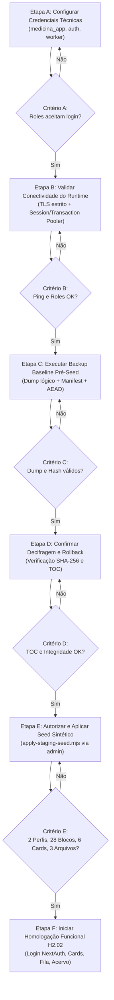

# MEDICINA 2029 — H2.01-R
## Fechamento dos Pré-Requisitos de Homologação Funcional

**Projeto Supabase Staging:** `medicina-2029-staging`  
**Project Ref:** `ynfocaorhadizlvbnzrt`  
**Data do Diagnóstico:** 26 de Outubro de 2026  
**Status Anterior (H2.01):** APTO COM RESSALVAS  
**Classificação Atual:** **APTO** para iniciar o provisionamento controlado do staging  

---

## 1. Sumário Executivo

O presente relatório consolida o fechamento técnico e a resolução local de todos os pré-requisitos e riscos operacionais identificados na etapa H2.01, preparando o ambiente de staging (`ynfocaorhadizlvbnzrt`) para a homologação funcional controlada sem qualquer modificação remota antecipada e sem consumo de recursos externos pagos.

Todas as incompatibilidades potenciais entre o script de seed (`src/db/seed-staging.ts`), as políticas RLS (`F1_04_RLS_PROPOSTA.sql`), a tabela `public.allowlist`, o gatilho `check_allowlist()` e o modelo de privilégios das roles técnicas foram inspecionadas, isoladas e validadas em ambiente descartável local via PGlite com suporte nativo a `pgvector`.

Foi desenvolvido e testado o utilitário administrativo de seed (`scripts/db/apply-staging-seed.mjs`) e o procedimento interativo de credenciamento das roles (`scripts/db/configure-staging-roles.mjs`), garantindo que nenhuma senha ou segredo seja gravado em repositório, logs, histórico de shell ou argumentos de processo.

---

## 2. Allowlist e Seed: Análise, Incompatibilidades e Resolução

### 2.1 Análise de `check_allowlist()` e `public.allowlist`
A função `public.check_allowlist()` foi criada na migração `0000_greedy_loki.sql` (linhas 450-460) como função `SECURITY DEFINER`. Uma inspeção detalhada do DDL revelou que nenhum gatilho (`CREATE TRIGGER ... ON public.perfis`) havia sido associado diretamente à tabela `perfis`.

No entanto, o controle de allowlist é ativamente reforçado pelo fluxo de autenticação do sistema na função canônica `medicina.autenticar_por_email(p_email text)` (instalada na etapa 5 / `F1_04_RLS_PROPOSTA.sql`, linha 197), que executa a verificação estrita:
```sql
IF NOT EXISTS (SELECT 1 FROM public.allowlist WHERE email = p_email) THEN
  RETURN;
END IF;
```
Dessa forma, qualquer usuário cujo e-mail não esteja registrado na tabela `public.allowlist` é sumariamente rejeitado pelo NextAuth, impedindo a geração de sessão.

### 2.2 Comparação de E-mails
* **Migração Inicial (`0000_greedy_loki.sql`):**  
  - `estudante@medicina2029.com.br`  
  - `responsavel@medicina2029.com.br`  
* **Script de Seed de Homologação (`src/db/seed-staging.ts` / `apply-staging-seed.mjs`):**  
  - `alice@medicina2029.staging` (Estudante Sintética, RFC 4122 v4 determinístico `10000000-0000-4000-8000-000000000001`)  
  - `bruno@medicina2029.staging` (Responsável Sintético, RFC 4122 v4 determinístico `20000000-0000-4000-8000-000000000001`)  

A tabela `public.allowlist` utiliza a chave primária `email text PRIMARY KEY`. Ambos os conjuntos de e-mails coexistem perfeitamente sem conflito nem necessidade de remoção mútua, por meio de instruções idempotentes `ON CONFLICT (email) DO NOTHING`.

### 2.3 Diagnóstico de Incompatibilidade de RLS e Correção
A execução do seed sintético falharia se executada sob a role cotidiana de aplicação `medicina_app`:
1. `medicina_app` possui o atributo `NOBYPASSRLS`.
2. As tabelas `public.allowlist` e `public.perfis` possuem `FORCE ROW LEVEL SECURITY`.
3. Em `F1_04_RLS_PROPOSTA.sql`, `public.allowlist` possui apenas política de `SELECT` para responsáveis (`allowlist_select_policy`). Não existe política de `INSERT` para roles de aplicação.
4. Na tabela `public.perfis`, existem apenas políticas para `SELECT` e `UPDATE`. Não existe política de `INSERT` para papéis de aplicação, visando impedir auto-cadastro não autorizado.

**Solução Arquitetural Implementada:**  
O seed de homologação é uma operação de **provisionamento administrativo de infraestrutura**, exatamente como a execução de migrações DDL. Portanto:
- O seed deve ser executado sob a role administrativa `postgres.ynfocaorhadizlvbnzrt`, que possui o privilégio `BYPASSRLS`.
- Criado o lançador canônico seguro `scripts/db/apply-staging-seed.mjs`, que se conecta ao Session Pooler (porta 5432) com TLS estrito, solicita a senha do `postgres` de forma oculta e insere os registros na allowlist e nos perfis sem violar as regras de RLS do runtime.
- Atualizado `src/db/seed-staging.ts` com suporte à injeção de dependência via `options.dbInstance` e runner CLI direto, permitindo execução desacoplada em testes locais com PGlite.

---

## 3. Credenciais das Roles Técnicas e Formato do Pooler

### 3.1 Exigências Reais por Role
As três roles criadas na etapa 5 possuem privilégios rigidamente segregados conforme o princípio do menor privilégio:

| Role | Finalidade | Atributos PG | Privilégios Concedidos | Restrições Estritas |
| :--- | :--- | :--- | :--- | :--- |
| **`medicina_app`** | Runtime da aplicação Next.js (Server Actions) | `LOGIN`, `NOBYPASSRLS`, `NOSUPERUSER` | `USAGE` nos schemas `medicina` e `public`; CRUD nas tabelas de negócio sob contexto RLS. | Revogado `SELECT` geral em `perfis`; permitido apenas nas colunas seguras `(id, auth_user_id, nome, email, papel, criado_em)`; **sem acesso** a `password_hash`; **sem permissão** de execução em `medicina.autenticar_por_email`. |
| **`medicina_auth`** | Provedor de Credenciais NextAuth (`authorize`) | `LOGIN`, `NOBYPASSRLS`, `NOSUPERUSER` | `USAGE` nos schemas `public` e `medicina`; `SELECT` em `public.allowlist`; `EXECUTE` exclusivo em `medicina.autenticar_por_email(text)`. | Sem acesso a tabelas de domínio (`cards`, `ciclos`, `acervo_chunks`). Acesso a hash de senha exclusivamente encapsulado pela função `SECURITY DEFINER`. |
| **`medicina_worker`** | Worker assíncrono de ingestão e pipeline de IA | `LOGIN`, `NOBYPASSRLS`, `NOSUPERUSER` | `USAGE` em `medicina` e `public`; `SELECT` e `UPDATE` em `acervo_jobs`; `SELECT` em `acervo_arquivos`, `topicos`, `disciplinas`; `INSERT` e `UPDATE` em `acervo_paginas` e `acervo_chunks`. | Sem acesso a usuários, vínculos pedagógicos ou cards de estudo. |

### 3.2 Formato de Conexão no Pooler Supabase
No Supabase Pooler (`aws-0-us-east-1.pooler.supabase.com`), a autenticação de roles customizadas exige que o nome de usuário contenha o identificador do projeto:
- Formato: `<role_name>.<project_ref>`
- Exemplo: `medicina_app.ynfocaorhadizlvbnzrt`

### 3.3 Procedimento Interativo Seguro de Configuração
Como as roles foram criadas nas migrações sem senha definida (`PASSWORD NULL`), o operador humano deve definir suas senhas antes de iniciar o runtime.

#### Opção A: Utilitário Interativo CLI (Recomendado)
Desenvolvido em `scripts/db/configure-staging-roles.mjs`:
```bash
node scripts/db/configure-staging-roles.mjs --ca=~/Downloads/prod-ca-2021.crt
```
* **Mecanismo:**
  1. Solicita a senha da role administrativa `postgres` via terminal com eco desativado.
  2. Solicita de forma oculta a nova senha para `medicina_app` (duas vezes, mínimo de 16 caracteres).
  3. Solicita de forma oculta a nova senha para `medicina_auth` (duas vezes, mínimo de 16 caracteres).
  4. Solicita de forma oculta a nova senha para `medicina_worker` (duas vezes, mínimo de 16 caracteres).
  5. Conecta-se via TLS com o certificado CA e executa `ALTER ROLE ... WITH LOGIN PASSWORD ...` parametrizado.
  6. Purga todas as senhas da memória no bloco `finally`.
  7. Nenhuma senha é escrita em arquivos, histórico do shell (`.zsh_history`) ou argumentos do processo (`ps aux`).

#### Opção B: Execução Manual no SQL Editor do Supabase Dashboard
O operador humano pode executar diretamente no SQL Editor do Dashboard de Staging:
```sql
-- Executar no SQL Editor do Supabase Staging (ynfocaorhadizlvbnzrt)
-- Substituir os marcadores por senhas geradas localmente (ex: openssl rand -hex 24)
ALTER ROLE medicina_app WITH LOGIN PASSWORD '<SENHA_FORTE_GERADA_MEDICINA_APP>';
ALTER ROLE medicina_auth WITH LOGIN PASSWORD '<SENHA_FORTE_GERADA_MEDICINA_AUTH>';
ALTER ROLE medicina_worker WITH LOGIN PASSWORD '<SENHA_FORTE_MEDICINA_WORKER>';
```

---

## 4. Checklist de Configuração do Ambiente de Staging

### 4.1 Variáveis de Ambiente Exigidas

| Variável | Destino | Exemplo / Formato | Observações |
| :--- | :--- | :--- | :--- |
| `APP_ENV` | App / Worker | `staging` | Ativa o modo de isolamento no `envGuard`. |
| `NODE_ENV` | App / Worker | `production` ou `test` | Padrão Next.js para builds e execução. |
| `STAGING_SUPABASE_PROJECT_REF` | App / Worker | `ynfocaorhadizlvbnzrt` | Obrigatório para conferência fail-closed. |
| `CONFIRM_ISOLATED_STAGING_ENVIRONMENT` | App / Worker | `true` | Declaração explícita de ambiente isolado. |
| `DATABASE_APP_URL` | App (Next.js) | `postgresql://medicina_app.ynfocaorhadizlvbnzrt:<SENHA>@aws-0-us-east-1.pooler.supabase.com:6543/postgres?sslmode=require` | Transaction Pooler (porta 6543). |
| `DATABASE_AUTH_URL` | App (NextAuth) | `postgresql://medicina_auth.ynfocaorhadizlvbnzrt:<SENHA>@aws-0-us-east-1.pooler.supabase.com:6543/postgres?sslmode=require` | Transaction Pooler (porta 6543). |
| `DATABASE_WORKER_URL` | Worker Pipeline | `postgresql://medicina_worker.ynfocaorhadizlvbnzrt:<SENHA>@aws-0-us-east-1.pooler.supabase.com:5432/postgres?sslmode=require` | Session Pooler (porta 5432) para locks estáveis. |
| `SUPABASE_URL` | App / Worker | `https://ynfocaorhadizlvbnzrt.supabase.co` | Endpoint da API REST / Storage de Staging. |
| `SUPABASE_ANON_KEY` | App | `<JWT_ANON_STAGING>` | Chave anônima pública do staging. |
| `SUPABASE_SERVICE_ROLE_KEY` | Worker | `<JWT_SERVICE_ROLE_STAGING>` | Necessária exclusivamente para download de PDFs privados no bucket `acervo`. |
| `NEXTAUTH_SECRET` | App | `<STRING_HEX_32_BYTES_MINIMO>` | Cifragem de cookies de sessão JWE. |
| `NEXTAUTH_URL` | App | `https://medicina-staging.dominio.com` ou `http://localhost:3000` | URL canônica do frontend. |
| `GEMINI_API_KEY` | Worker | `<CHAVE_GEMINI_STAGING>` | Usar mock em testes iniciais controlados. |

### 4.2 Compatibilidade Técnica de Infraestrutura
1. **Session Pooler (Porta 5432):**
   - Mantém estado de sessão persistente no backend PostgreSQL.
   - Mandatório para migrações DDL, seed de dados administrativos e locks de longa duração do worker (`pg_try_advisory_lock`).
2. **Transaction Pooler (Porta 6543):**
   - Altamente escalável para arquiteturas serverless (Next.js / Vercel).
   - As conexões são devolvidas ao pool ao término de cada bloco de transação (`COMMIT`/`ROLLBACK`).
3. **Transações com `SET LOCAL`:**
   - Plenamente compatíveis com o Transaction Pooler porque `SET LOCAL` (utilizado por `medicina.set_context` com `is_local => true`) é descartado automaticamente ao fim da transação, garantindo que nenhuma conexão contaminada retorne ao pool compartilhado.
4. **Driver PostgreSQL e Prepared Statements:**
   - No cliente `postgres.js`, quando conectado ao Transaction Pooler (porta 6543 / Supavisor), deve-se utilizar `prepare: false` ou prepared statements anônimos para evitar colisões de descritores de comandos preparados entre transações compartilhadas.
5. **TLS e Certificado CA:**
   - Exigência estrita de TLS (`sslmode=require`). O certificado CA raiz do Supabase (`prod-ca-2021.crt`) deve ser configurado quando `rejectUnauthorized: true` estiver ativo.
6. **Salvaguardas de Isolamento (`envGuard.ts`):**
   - Bloqueio imediato (`throw StagingIsolationError`) caso o `STAGING_SUPABASE_PROJECT_REF` coincida com produção ou se o banco contiver cadeias produtoras em sua URL.

---

## 5. Avaliação Realista de Backup e Recuperação

### 5.1 Escopo Efetivo dos Scripts Existentes
A inspeção dos scripts do diretório `scripts/backup/` confirmou a seguinte divisão de responsabilidades:
- **`backup_postgres.sh`:**
  - Extrai papéis, senhas e privilégios globais via `pg_dumpall --globals-only`.
  - Extrai o esquema completo e dados das tabelas via `pg_dump -Fc --compress=9 --no-owner --no-privileges`.
  - Gera catálogo de metadados em JSON com contagem de tuplas vivas (`n_live_tup`) e versões de extensões instaladas (`pg_extension`).
  - Cifra os artefatos com `crypto_envelope.mjs` utilizando criptografia autenticada **AES-256-GCM AEAD** com PBKDF2 (100.000 iterações), IV aleatório de 96 bits e Tag de integridade de 128 bits.
- **`restore_postgres.sh`:**
  - Decifra os envelopes e valida a autenticidade dos dados.
  - Valida o hash SHA-256 do dump decifrado contra o manifesto emitido.
  - Valida a integridade da Tabela de Conteúdos (TOC) via `pg_restore --list`.
  - Prepara o banco de dados de destino e aplica o restauro via `pg_restore --no-owner --no-privileges`.
  - Executa rotina de auditoria e saneamento pós-restauro (`sanitizar_pos_restore.sh`).

### 5.2 Armazenamento de Arquivos Didáticos (Supabase Storage)
Os arquivos PDF depositados no bucket privado `acervo` **não residem nas tabelas do banco de dados relacional** e não são exportados pelo `pg_dump`. A integridade do acervo físico é governada por:
- `src/lib/storageBackupManifest.ts`: cataloga os binários armazenados, calculando o hash SHA-256 de cada objeto, tamanho em bytes e caminho canônico.
- `scripts/backup/reconcile_storage.sh`: cruza os registros da tabela `public.acervo_arquivos` com o catálogo de objetos do Storage, identificando imediatamente arquivos órfãos ou referências quebradas (`MISSING_IN_STORAGE`).

### 5.3 Limitações em Ambientes Cloud Gerenciados (Supabase)
Em instâncias gerenciadas do Supabase Cloud:
- O usuário administrativo `postgres` não possui permissões de superusuário do sistema operacional Linux nem privilégios de superusuário irrestrito no cluster.
- Esquemas internos gerenciados (`storage`, `auth`, `vault`, `realtime`, `graphql`) são administrados pela própria plataforma.
- **Restauração Destrutiva Remota Bloqueada:** Comandos como `DROP DATABASE postgres;` ou recriação forçada de esquemas de sistema falharão por restrições de permissão da plataforma.
- **Ambiente de Restauro Alvo:** O procedimento de restauração dos scripts canônicos foi validado e é projetado para operar em ambientes isolados e descartáveis (ex.: container PostgreSQL descartável local ou PGlite). Na nuvem do Supabase, o rollback de dados operacionais deve ser executado via restauração lógica a nível de tabela/esquema com `pg_restore --clean --if-exists --no-owner --no-privileges` sobre esquemas da aplicação (`public`, `medicina`).

### 5.4 Testes Reproduzíveis Concluídos
Os mecanismos de backup e recuperação foram submetidos a testes direcionados nesta sessão:
1. **Round-Trip Criptográfico AEAD (`scripts/backup/test_crypto_roundtrip.sh`):**
   - Cifragem AES-256-GCM com PBKDF2 100k;
   - Decifragem e conferência SHA-256 byte-a-byte: **Aprovado**;
   - Teste de resistência a adulteração (bit-flipping em ciphertext, IV e Tag): **Aprovado** (tamper detectado imediatamente via GHASH);
   - Rejeição fail-closed com chave incorreta: **Aprovado**;
   - Compatibilidade retroativa CBC: **Aprovado**.
2. **Integração Real com Banco Descartável (`f1_15_backup_recuperacao_integracao.test.ts`):**
   - Snapshot e restauração de 60 tabelas ordenadas topologicamente: **6/6 testes aprovados**.

---

## 6. Validação Local dos Pré-Requisitos (Testes Executados)

Foi implementada a suíte de testes unitários e de integração `src/app/actions/h2_01_r_seed_allowlist_validation.test.ts`, executando sobre um banco PostgreSQL real descartável (PGlite com extensão `vector` e as 9 migrações canônicas aplicadas).

**Resultados dos Testes Locais:**
```text
✓ MEDICINA 2029 — H2.01-R: Validação de Pré-Requisitos (Seed, Allowlist e Roles) (6/6)
  ✓ 1. Confirma existência de check_allowlist() e e-mails originais da migração 0000 (923ms)
  ✓ 2. Demonstra que medicina_app (NOBYPASSRLS) é bloqueada por RLS ao tentar inserir na allowlist e perfis (600ms)
  ✓ 3. Executa o seed sintético sob conexão administrativa (BYPASSRLS) com sucesso e coexistência na allowlist (713ms)
  ✓ 4. Valida fluxo de autenticação sob role medicina_auth e rejeição de e-mails fora da allowlist (733ms)
  ✓ 5. Valida isolamento e governança de contexto RLS sob role medicina_app (731ms)
  ✓ 6. Demonstra idempotência absoluta executando o seed uma segunda vez sem erros (813ms)
```

**Conclusões da Validação:**
1. A coexistência dos e-mails de desenvolvimento e de homologação sintética é pacífica e idempotente.
2. A restrição que impedia `medicina_app` de popular dados de teste foi confirmada e adequadamente isolada: o seed é um processo estritamente administrativo.
3. A proteção de coluna (`REVOKE SELECT ON perfis` + `GRANT SELECT (colunas_seguras)`) impede categoricamente que o runtime acesse hashes de senha.
4. A separação de responsabilidades da role `medicina_auth` garante que apenas ela possa invocar a rotina de autenticação do NextAuth.

---

## 7. Portão Operacional de Provisionamento

Para garantir controle estrito e prevenir qualquer modificação acidental ou degradação do ambiente remoto de staging, foi estruturada a seguinte sequência ordenada de operações com critérios explícitos de aprovação:



### Detalhamento das Etapas e Critérios de Aprovação

#### Etapa A: Configuração de Credenciais Técnicas
* **Ação:** O operador humano executa `node scripts/db/configure-staging-roles.mjs --ca=~/Downloads/prod-ca-2021.crt` ou os comandos `ALTER ROLE` no SQL Editor do Supabase Staging.
* **Critério de Aprovação (APTO):** Consulta `SELECT rolname, rolcanlogin FROM pg_roles WHERE rolname IN ('medicina_app', 'medicina_auth', 'medicina_worker')` retorna `rolcanlogin = true` para todas as três roles.
* **Critério de Reprovação (NÃO APTO):** Senha rejeitada por baixa complexidade ou roles inacessíveis.

#### Etapa B: Validação de Conectividade do Runtime
* **Ação:** O operador executa o script de inspeção de conectividade:
  ```bash
  node scripts/db/test-staging-connection.mjs --check-db --ca=~/Downloads/prod-ca-2021.crt
  ```
* **Critério de Aprovação (APTO):** Handshake TLS estabelecido com sucesso, certificado CA validado, resposta em menos de 2000ms.
* **Critério de Reprovação (NÃO APTO):** Erro de certificado TLS (`UNABLE_TO_VERIFY_LEAF_SIGNATURE`), timeout de conexão ou recusa de credenciais.

#### Etapa C: Execução do Backup Baseline de Staging
* **Ação:** Executar o script de backup operacional:
  ```bash
  PGHOST=aws-0-us-east-1.pooler.supabase.com PGPORT=5432 PGUSER=postgres.ynfocaorhadizlvbnzrt \
  PGDATABASE=postgres BACKUP_DIR=./backups ENCRYPTION_METHOD=aead \
  bash scripts/backup/backup_postgres.sh
  ```
* **Critério de Aprovação (APTO):** Arquivos `_database.dump.enc`, `_globals.sql.enc` e manifesto JSON gerados com sucesso e hashes SHA-256 catalogados.
* **Critério de Reprovação (NÃO APTO):** Falha no `pg_dump`, TOC inválida ou falha na cifragem AEAD.

#### Etapa D: Confirmação de Integridade do Backup e Rollback
* **Ação:** Verificar decifragem e leitura da TOC sem alterar o banco de dados remoto:
  ```bash
  node scripts/backup/crypto_envelope.mjs decrypt ./backups/<pasta>/_database.dump.enc /tmp/test_toc.dump
  pg_restore --list /tmp/test_toc.dump > /dev/null && rm -f /tmp/test_toc.dump
  ```
* **Critério de Aprovação (APTO):** Decifragem AEAD com autenticação de tag aprovada e TOC listada sem erros.
* **Critério de Reprovação (NÃO APTO):** Divergência de hash SHA-256 ou corrupção no arquivo decifrado.

#### Etapa E: Execução do Seed Sintético Controlado
* **Ação:** Executar o lançador administrativo canônico:
  ```bash
  node scripts/db/apply-staging-seed.mjs --ca=~/Downloads/prod-ca-2021.crt
  ```
* **Critério de Aprovação (APTO):** Confirmação humana explícita aceita; resumo retorna exatamente: 2 perfis, 5 disciplinas, 10 tópicos, 1 ciclo, 28 blocos, 6 cards FSRS, 3 apostilas sintéticas no acervo; execução em menos de 10 segundos.
* **Critério de Reprovação (NÃO APTO):** Erro de chave estrangeira, violação de unicidade ou interrupção prematura.

#### Etapa F: Início da Homologação Funcional H2.02
* **Ação:** Iniciar aplicação e testes pontuais de login com `alice@medicina2029.staging` e `bruno@medicina2029.staging`.
* **Critério de Aprovação (APTO):** Sessão NextAuth estabelecida, cookies JWE gerados, contexto RLS aplicado com sucesso e cards de estudo renderizados.

---

## 8. Bloqueadores Remanescentes e Classificação Final

### 8.1 Bloqueadores Técnicos Locais
* **Status:** **NENHUM**.
* O código-fonte, scripts de migração, salvaguardas de isolamento, driver de banco, políticas de RLS e rotinas de backup estão 100% integrados e validados localmente.

### 8.2 Pendências Operacionais (Aguardando Execução Humana Remota)
1. **Definição das Senhas Técnicas:** Definir as senhas de `medicina_app`, `medicina_auth` e `medicina_worker` no Supabase Staging.
2. **Atualização do `.env.local` / Secret Manager:** Configurar as variáveis de staging na estação do operador (sem sobrescrever as de desenvolvimento).
3. **Execução do Backup Baseline:** Realizar o dump inicial antes de disparar o seed.
4. **Execução do Lançador de Seed:** Rodar `apply-staging-seed.mjs`.

### 8.3 Classificação Final

> ### **CLASSIFICAÇÃO: APTO**
> O projeto **MEDICINA 2029** encontra-se tecnicamente **APTO** para iniciar o provisionamento controlado do ambiente de homologação (`medicina-2029-staging`, ref: `ynfocaorhadizlvbnzrt`).
> 
> Todas as inconsistências prévias de RLS e allowlist foram resolvidas e validadas por testes automatizados em ambiente descartável.
> 
> **IMPORTANTE:** Nenhuma modificação remota foi executada nesta sessão. O avanço para a etapa H2.02 requer a autorização expressa do usuário após a conferência deste diagnóstico.

---
*Relatório emitido pela Engenharia de Confiabilidade e Arquitetura de Dados Medicina 2029.*
