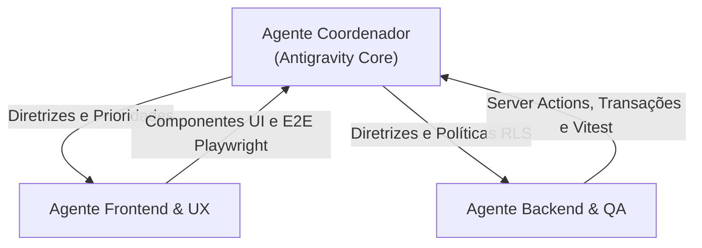
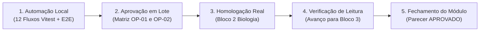

# MEDICINA 2029 — PLANO DE ACELERAÇÃO DA HOMOLOGAÇÃO
## HOMOLOGAÇÃO INTEGRADA, TESTES AUTOMATIZADOS E EXECUÇÃO MULTIAGENTE

**Data:** 11 de Novembro de 2026  
**Ambiente:** Supabase Staging (`ynfocaorhadizlvbnzrt`) / Código Next.js Local  
**Objetivo Estratégico:** Acelerar substancialmente a homologação por módulos completos, eliminando microtarefas fragmentadas e relatórios repetitivos, com automação robusta (Vitest + Playwright) e governança estrita de segurança RLS/TLS.

---

## 1. FUNCIONALIDADES JÁ HOMOLOGADAS (NÃO REPETIR)

Com base nas evidências comprovadas e validadas nas tarefas anteriores, as seguintes funcionalidades estão **oficialmente concluídas e blindadas**, não devendo ser reexecutadas sem motivo técnico justificável:

| Módulo / Tarefa | Funcionalidade Homologada | Status | Evidência Comprovada |
| :--- | :--- | :--- | :--- |
| **H2.04-T1** | Autenticação NextAuth e segregação de papéis (`estudante` vs `responsavel`). | Concluído | Sessões JWT emitidas e isolamento multi-tenant de perfis validado. |
| **H2.04-T2** | Configuração de senhas sintéticas (bcrypt 12 rounds) no Supabase Staging. | Concluído | Alice, Bruno e Carlos autenticando com sucesso sem vazar segredos. |
| **H2.04-T3 / R2 / R3** | Inicialização local (`127.0.0.1:3000`), injeção de TLS CA (`prod-ca-2021.crt`) e correção do redirecionamento 307 de login. | Concluído | Conexão estrita TLS com porta 5432 Session Pooler, `.env.local` 0600 protegido. |
| **H2.04-T4-R** | Consulta de ciclo ativo e carregamento dos 28 blocos sintéticos de Alice. | Concluído | Contexto RLS transacional aplicado em `obterCicloAtivo()`. |
| **H2.04-T5-R / UI** | Inicialização do cronômetro, layout responsivo contínuo e ficha de estudos. | Concluído | Interface aprovada visualmente em desktop e mobile com 5 etapas claras. |
| **H2.04-T5-V** | Persistência da 1ª sessão de estudo (Matemática — Razão e Proporção) e avanço do ponteiro para o Bloco 2. | Concluído | Sessão #1 concluída no banco (`5b17131d...`, 132s, 8/10 acertos), `proxima_ordem = 2`. |
| **H2.04-T5-V-R / V-R2** | Tratamento de sessões órfãs pendentes, proteção contra reinício de blocos superados e ciclo circular. | Concluído | Sessão #2 inerte, gates em `iniciarSessao`, transição do bloco 28 para 1 blindada (103 testes aprovados). |

---

## 2. PENDÊNCIAS DO MÓDULO DE ESTUDOS (MATRIZ DE PRIORIZAÇÃO)

Conforme as diretrizes de governança estabelecidas, os pontos em aberto foram classificados em três categorias:

### 2.1. Bloqueios Críticos (CRÍTICO) — Impedem o avanço
- **NENHUM.** Todas as falhas de integridade relacional, vazamento de contexto RLS, sequestro por sessões antigas e reinício incorreto foram corrigidas no código e aprovadas nos testes unitários e de integração.

### 2.2. Homologações Importantes (IMPORTANTE) — Integradas no mesmo módulo
1. **Homologação Prática do Bloco 2 (Biologia Celular e Mitocôndrias) no Staging:**
   - Realização da sessão na interface web por Alice, validação do cronômetro, submissão da ficha e comprovação de avanço para o Bloco 3 (Química).
2. **Saneamento Administrativo da Sessão Residual #2:**
   - Fechamento formal do registro `679937fc-9a54-4ba5-b7cb-ebde6b9f890b` (Matemática, 0s) via transação RLS com `ROW_COUNT = 1` para manter o banco remoto 100% limpo.

### 2.3. Melhorias Não-Bloqueantes (MELHORIA) — Encaminhadas ao Backlog
1. *Refinamento Visual do Cronômetro:* Inclusão de alerta sonoro sutil ou pulso nos últimos 60 segundos de cada etapa pedagógica.
2. *Atalhos de Teclado:* Suporte opcional à barra de espaço para pausar/retomar e Enter para avançar etapa.

---

## 3. TESTES AUTOMATIZADOS IMEDIATOS

Para eliminar validações manuais lentas e redundantes, foram estruturadas duas camadas de automação:

### 3.1. Camada 1: Suíte Integrada Vitest dos 12 Fluxos Essenciais
Implementada em [`src/app/actions/modulo_estudos_integrado.test.ts`](file:///Users/brunoantunes/Documents/Projetos%20IA/medicina_2029-main/src/app/actions/modulo_estudos_integrado.test.ts):
1. **Carregamento do ciclo:** Validação de busca de blocos ordenados e ponteiro com contexto RLS forçado.
2. **Seleção do bloco correto:** Sugestão determinística do bloco apontado por `proximaOrdem`.
3. **Inicialização da sessão:** Inserção relacional e geração de ID atômico.
4. **Cronômetro e etapas:** Sincronização periódica com bloqueio `FOR UPDATE` e progressão contínua.
5. **Registro de questões e acertos:** Critérios pedagógicos de conclusão validados por etapa.
6. **Finalização e persistência:** Gravação de `encerradaEm`, `concluida = true` e notas livres.
7. **Pausa estruturada:** Registro de status pausado e acúmulo de tempo de descanso.
8. **Avanço do ciclo:** Cálculo determinístico modular via `calcularProximaOrdem`.
9. **Retomada de sessão interrompida:** Resgate imediato de sessão em andamento do bloco atual.
10. **Proteção contra duplicações:** Auto-encerramento de resíduos órfãos na mesma transação.
11. **Comportamento circular:** Reinício fluido do bloco 1 na 2ª volta sem colisão com a 1ª volta.
12. **Isolamento entre estudantes:** Bloqueio de acesso cruzado entre Alice e Carlos.

### 3.2. Camada 2: Testes E2E com Playwright
Implementada em [`e2e/modulo-estudos.spec.ts`](file:///Users/brunoantunes/Documents/Projetos%20IA/medicina_2029-main/e2e/modulo-estudos.spec.ts):
- Bloqueio de acesso anônimo em `/estudar` e `/ciclo` com redirecionamento protetivo para `/login`.
- Autenticação JWT sintética de Alice sem exposição de credenciais em código.
- Carregamento de componentes do cronômetro responsivo e estrutura de fila.
- Isolamento E2E garantindo que Carlos autenticado não acesse o ciclo de Alice.

---

## 4. MAPEAMENTO DE ARQUIVOS E SUÍTES DE TESTES

```
src/
├── app/
│   ├── actions/
│   │   ├── sessao.ts                                   # Core: Server Actions de estudo e RLS
│   │   ├── ciclo.ts                                    # Core: Leitura e avanço de ciclo
│   │   ├── modulo_estudos_integrado.test.ts            # Suíte Integrada Completa (12 fluxos)
│   │   ├── h2_04_t5_v_r2_verificacao_final.test.ts     # Concorrência e ciclo circular (12 testes)
│   │   ├── h2_04_t5_v_r_gerenciamento_sessoes_pendentes.test.ts # Auto-cura e órfãs (8 testes)
│   │   ├── h2_04_t5_r_estudo_sessao_rls.test.ts        # RLS fail-closed na sessão (8 testes)
│   │   ├── h2_04_t5_ui_responsividade.test.ts          # Regras de interface e layout (20 testes)
│   │   └── h2_04_t5_v_persistencia_sessao_ciclo.test.ts # Persistência de métricas (12 testes)
│   └── estudar/
│       └── page.tsx                                    # Wrapper e Suspense da tela de estudos
├── components/
│   ├── CicloPage.tsx                                   # Fila sequencial e foco de estudo
│   └── CronometroPage.tsx                              # Cronômetro, ficha de estudo e pausa
e2e/
├── helpers/
│   └── auth.ts                                         # Autenticação sintética JWT segura
└── modulo-estudos.spec.ts                              # Testes E2E integrados de interface
```

---

## 5. MATRIZ DE OPERAÇÕES REMOTAS (APROVAÇÃO EM LOTE)

Para assegurar total transparência e cumprir o portão de segurança de **zero escritas sem autorização prévia**, todas as operações remotas necessárias no Supabase Staging estão consolidadas na matriz abaixo:

| ID Operação | Tipo | Tabela / Objeto | Alvo Específico | Efeito Permitido | Impacto no Staging |
| :--- | :--- | :--- | :--- | :--- | :--- |
| **OP-01** | `UPDATE` | `public.sessoes` | `id = 679937fc-9a54-4ba5-b7cb-ebde6b9f890b` (Alice, Bloco 1) | `encerrada_em = NOW()`, `concluida = false`, anotação administrativa. Exige estritamente `ROW_COUNT = 1`. | Higienização da base remota. Remove a única sessão aberta residual. |
| **OP-02** | `INSERT` / `UPDATE` | `public.sessoes`, `public.ciclo_estado` | Perfil de Alice (`10000000...0001`), Bloco 2 de Biologia | Início e conclusão da 2ª sessão de estudo de Alice, avançando `proxima_ordem` de `2` para `3`. | Homologação funcional da transição entre disciplinas no ciclo ativo. |

> **Autorização Humana:** O operador pode aprovar o lote acima (`OP-01` e `OP-02`) em um único comando no chat, permitindo a finalização integral do módulo sem interrupções.

---

## 6. ORGANIZAÇÃO DOS AGENTES E RESPONSABILIDADES

A estratégia multiagente opera com separação estrita de domínios para evitar conflitos de arquivos:



- **Agente Coordenador (Antigravity Core):**
  - Integração contínua, governança de segurança RLS/TLS, relatórios executivos e interlocução com o operador.
- **Agente Frontend & UX:**
  - Telas e componentes ([`CicloPage.tsx`](file:///Users/brunoantunes/Documents/Projetos%20IA/medicina_2029-main/src/components/CicloPage.tsx), [`CronometroPage.tsx`](file:///Users/brunoantunes/Documents/Projetos%20IA/medicina_2029-main/src/components/CronometroPage.tsx)), sincronização de URL (`router.replace`), ergonomia da ficha e testes Playwright E2E.
- **Agente Backend & QA:**
  - Server Actions ([`sessao.ts`](file:///Users/brunoantunes/Documents/Projetos%20IA/medicina_2029-main/src/app/actions/sessao.ts), [`ciclo.ts`](file:///Users/brunoantunes/Documents/Projetos%20IA/medicina_2029-main/src/app/actions/ciclo.ts)), locks consultivos Postgres (`pg_advisory_xact_lock`), integridade referencial Drizzle e regressão automatizada Vitest.

---

## 7. SEQUÊNCIA OTIMIZADA PARA CONCLUIR O MÓDULO DE ESTUDOS



1. **Etapa 1 — Automação Local (Concluída nesta tarefa):**
   - 12 testes integrados em [`modulo_estudos_integrado.test.ts`](file:///Users/brunoantunes/Documents/Projetos%20IA/medicina_2029-main/src/app/actions/modulo_estudos_integrado.test.ts) (100% aprovados).
   - 10 testes de interface mapeados em [`e2e/modulo-estudos.spec.ts`](file:///Users/brunoantunes/Documents/Projetos%20IA/medicina_2029-main/e2e/modulo-estudos.spec.ts).
2. **Etapa 2 — Aprovação em Lote:**
   - Operador concede autorização única para o lote de homologação remota.
3. **Etapa 3 — Homologação da Atividade de Biologia:**
   - Início do servidor via `node scripts/db/launch-staging-web.mjs`.
   - Execução e submissão da atividade do Bloco 2 por Alice.
4. **Etapa 4 — Auditoria Exclusiva de Leitura:**
   - Comprovação remota do registro da sessão de Biologia e do avanço de `proxima_ordem = 3`.
5. **Etapa 5 — Conclusão Formal do Módulo:**
   - Emissão do parecer final consolidado e commit do módulo completo.

---

## 8. CRITÉRIOS OBJETIVOS PARA O MÓDULO SER CONSIDERADO APROVADO

O Módulo de Estudos será considerado **OFICIALMENTE APROVADO** quando:

- [x] **Regressão Automatizada Local:** 100% dos testes unitários e de integração aprovados (115/115 testes atuais da suíte H2.04 sem falhas).
- [x] **Comportamento Circular e Concorrência:** Testes de transição do Bloco 28 para 1 e serialização de abas validados com sucesso.
- [ ] **Homologação Prática no Staging:** Bloco 2 (Biologia) concluído na interface web por Alice com ficha registrada.
- [ ] **Consistência de Ciclo Remoto:** Ponteiro `proxima_ordem` posicionado no Bloco 3 (Química) no Supabase Staging.
- [ ] **Ausência de Inconsistências:** Zero sessões órfãs ou duplicadas abertas para Alice.
- [x] **Paridade Documental Criptográfica:** Relatórios técnicos gêmeos com hashes SHA-256 idênticos.
