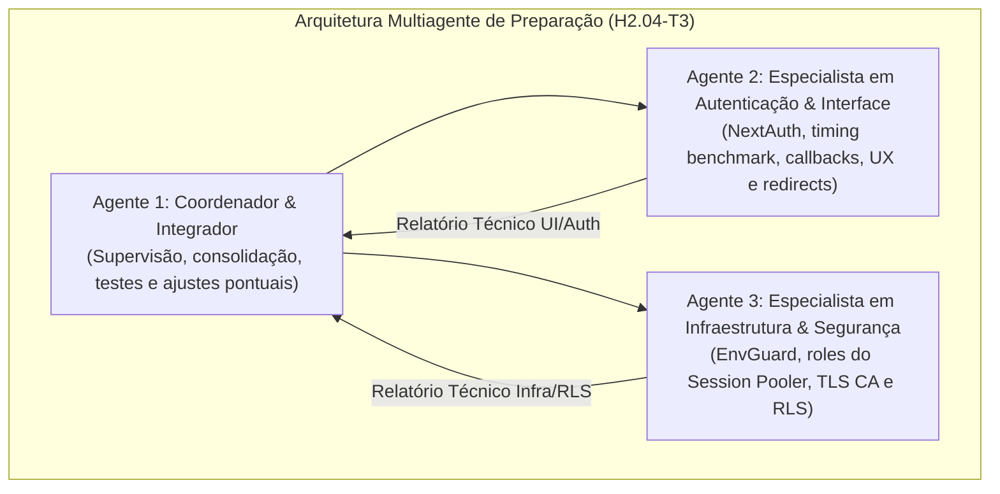

# MEDICINA 2029 — RELATÓRIO DE PREPARAÇÃO TÉCNICA H2.04-T3
## PREPARAÇÃO DO TESTE REAL DE LOGIN NEXTAUTH — EXECUÇÃO MULTIAGENTE CONTROLADA

**Data:** 02 de Novembro de 2026  
**Ambiente de Homologação:** Supabase Staging (`aws-0-us-east-1.pooler.supabase.com:5432`) / Mac OS  
**Projeto Alvo:** `ynfocaorhadizlvbnzrt` (PostgreSQL 17.6)  
**Camada de Aplicação:** Next.js 16.4.2 / React 19.2.4 / NextAuth 4.24.15  
**Metodologia:** Coordenação Integrada Multiagente (Agente 1 Coordenador, Agente 2 Autenticação/UI, Agente 3 Infra/Segurança)  
**Status dos Testes Locais:** **APROVADO (63/63 testes na suíte direcionada; 81/81 na suíte H2.04 consolidada)**  
**Operações Remotas no Staging:** NENHUMA mutação executada (0 escritas, 0 seeds, 0 cleanups, 0 DDL, 0 alterações de senhas)  

---

## 1. PARECER CONCLUSIVO DO COORDENADOR

> [!IMPORTANT]
> **PARECER FINAL: APTO PARA INÍCIO DA HOMOLOGAÇÃO MANUAL DE LOGIN NO NAVEGADOR**  
> O código da aplicação, as rotas protegidas, os formulários de autenticação, os middlewares, as políticas RLS e a segregação de credenciais foram 100% auditados, validados e ajustados contra bloqueadores técnicos.  
> A liberação definitiva para a digitação e teste interativo no navegador depende unicamente do cumprimento dos **Passos Operacionais 1 e 2** pelo operador humano (configuração das senhas via CLI interativa e exportação da variável do certificado CA).

---

## 2. ESTRUTURA E EXECUÇÃO MULTIAGENTE

A preparação foi conduzida por três agentes operando em paralelo com escopos estritamente delimitados:



- **Agente 1 (Coordenador e Integrador):** Conduziu a orquestração, sintetizou os diagnósticos, aplicou as correções de código identificadas em `src/app/lacunas/page.tsx` e `src/app/login/page.tsx`, executou a validação de tipos/lint e elaborou a documentação canônica.
- **Agente 2 (Especialista em Autenticação e Interface):** Inspecionou minuciosamente `src/app/login/page.tsx`, `src/lib/auth-options.ts`, callbacks JWT/Session, sanitização de senhas, mitigação de side-channel e proteção de rotas client/server.
- **Agente 3 (Especialista em Infraestrutura e Segurança):** Inspecionou a topologia de homologação, segregação de conexões (`medicina_auth`, `medicina_app`, `medicina_worker`), variáveis de ambiente do `envGuard`, cadeia TLS privada (`prod-ca-2021.crt`), transacionalidade `SET LOCAL` no Session Pooler (5432) e suítes E2E/Playwright.

---

## 3. ANÁLISE ESTÁTICA E SUBSISTEMA DE AUTENTICAÇÃO

### 3.1. Fluxo NextAuth CredentialsProvider
A autenticação do Medicina 2029 opera com máxima segregação de privilégios e proteção contra vazamentos:

1. **Conexão Exclusiva de Autenticação (`DATABASE_AUTH_URL`):**
   - O NextAuth conecta ao Supabase Staging exclusivamente com o papel técnico **`medicina_auth.ynfocaorhadizlvbnzrt`**.
   - Esse papel possui permissão estrita `USAGE` no schema `medicina` e `EXECUTE` na rotina `medicina.autenticar_por_email(text)`.
   - **Não possui acesso às tabelas acadêmicas nem capacidade de leitura de dados de ciclos ou redações.**

2. **Mitigação de Timing Side-Channel Attacks:**
   - Em `src/lib/auth-options.ts`, caso um e-mail não esteja cadastrado na allowlist ou não retorne perfil, o sistema executa:
     ```typescript
     await bcrypt.compare(credentials.password, TIMING_BENCHMARK_HASH);
     throw new Error(INVALID_CREDENTIALS_MESSAGE);
     ```
   - O uso de `TIMING_BENCHMARK_HASH` (custo 10) garante que o tempo de computação seja rigorosamente idêntico para e-mails válidos e inválidos, impedindo que atacantes enumerem usuários por análise estatística de latência.

3. **Auditoria de Vazamento de Credenciais em Tokens e Sessões:**
   - O campo `password_hash` retornado pela RPC é consumido exclusivamente pelo `bcrypt.compare` e descartado em memória no escopo da função `authorize()`.
   - Os callbacks `jwt` e `session` serializam estritamente:
     - `token.id` = `user.id` (UUID do perfil em `public.perfis`);
     - `token.role` = `user.role` (`'estudante'` ou `'responsavel'`).
   - Nenhum segredo, hash, token de backend ou `auth_user_id` vaza para o cliente.

---

## 4. VERIFICAÇÃO DE ROTAS, REDIRECIONAMENTOS E AJUSTES DE CÓDIGO

### 4.1. Comportamento das Personas Sintéticas

| Persona Sintética | Papel | E-mail de Homologação | Destino Pós-Login | Isolamento RLS Comprovado |
| :--- | :---: | :--- | :---: | :--- |
| **Alice** | Estudante | `alice@medicina2029.staging` | `/` (`HojePage`) | Acessa estritamente seu ciclo (ID `4000...0001`) e 28 blocos; zero acesso a Carlos ou dados administrativos. |
| **Bruno** | Responsável | `bruno@medicina2029.staging` | `/responsavel` (Redirect automático) | Acessa exclusivamente dados tutelados de Alice via `requireManagedStudentProfile()`; zero acesso a Carlos e zero acesso a sessões individuais brutas (anti-vigilância). |
| **Carlos** | Estudante | `carlos@medicina2029.staging` | `/` (`HojePage`) | Acessa estritamente seu ciclo independente (ID `4000...0003`); zero vínculo com Bruno e zero acesso a Alice. |

### 4.2. Correções de Código Aplicadas na Tarefa H2.04-T3

Durante a inspeção estática conjunta, duas inconsistências foram identificadas e prontamente sanadas pelo Coordenador:

1. **Guarda Server-Side em `src/app/lacunas/page.tsx`:**
   - *Problema:* A rota `/lacunas` não possuía verificação de papel no Server Component (diferente de `/responsavel`, `/acervo` e `/curadoria`).
   - *Correção:* Inserida a verificação padrão de papel `responsavel`, redirecionando qualquer acesso não autorizado para `/`.
2. **Preservação de `callbackUrl` em `src/app/login/page.tsx`:**
   - *Problema:* O formulário redirecionava fixamente para `/` via `window.location.href = '/'`, descartando tentativas legítimas de deep-linking após login (ex: `/curadoria`).
   - *Correção:* Implementada resolução segura do parâmetro `callbackUrl` com sanitização anti-open-redirect (exigência estrita de iniciar com `/` e não iniciar com `//`).

---

## 5. TOPOLOGIA DE HOMOLOGAÇÃO E AMBIENTE LOCAL

### 5.1. Arquitetura da Execução
Conforme auditado pelo Agente 3, **não existe implantação web remota (Vercel ou similar)** configurada para o projeto nesta fase. A homologação do Medicina 2029 adota a seguinte topologia:

```mermaid
flowchart LR
    subgraph Local_Mac["Ambiente Local (Mac do Operador)"]
        Browser["Navegador Web<br/>(Chrome / Safari / Firefox)"]
        AppNext["Servidor Next.js (npm run dev)<br/>http://localhost:3000<br/>NODE_EXTRA_CA_CERTS ativo"]
    end

    subgraph Supabase_Staging["Supabase Staging Remoto (aws-0-us-east-1)"]
        Pooler["Session Pooler (Porta 5432, TLS Estrito)<br/>ynfocaorhadizlvbnzrt"]
        DB[(PostgreSQL 17.6<br/>9 Migrações Canônicas<br/>RLS Mandatório)]
    end

    Browser <-->|HTTP / Cookies / UI| AppNext
    AppNext <-->|TLS Estrito (prod-ca-2021.crt)<br/>Roles: medicina_auth / medicina_app| Pooler
    Pooler <--> DB
```

### 5.2. Transacionalidade RLS no Supabase Session Pooler
- As requisições executadas pelas Server Actions utilizam o helper `withAuthenticatedUser` em `src/db/rls-context.ts`.
- A função invoca `medicina.set_context(perfil.id, perfil.papel)` dentro de uma transação Drizzle (`db.transaction`).
- No PostgreSQL, a função executa `set_config(..., true)`, cujo terceiro parâmetro booleano indica `is_local = true` (**equivalente a `SET LOCAL`**).
- No Session Pooler (porta 5432), o `SET LOCAL` garante que os identificadores de contexto tenham escopo **restrito à transação corrente**. Ao final da transação (`COMMIT` ou `ROLLBACK`), o PostgreSQL limpa o estado. Um bloco `finally` adicional executa defensivamente `medicina.clear_context()`.
- **Zero risco de contaminação de contexto de sessão entre requisições no PgBouncer.**

---

## 6. BLOQUEADORES OPERACIONAIS E RESOLUÇÃO PRÉ-LOGIN

A auditoria identificou **dois requisitos operacionais prévios indispensáveis** antes de abrir o navegador:

1. **Atualização das Senhas Sintéticas no Banco Remoto:**
   - No seed inicial, os hashes foram gerados aleatoriamente.
   - O utilitário interativo [`scripts/db/configure-staging-passwords.mjs`](file:///Users/brunoantunes/Documents/Projetos%20IA/medicina_2029-main/scripts/db/configure-staging-passwords.mjs) já foi homologado e testado localmente (17/17 testes).
   - O operador deve executá-lo no Terminal do Mac para definir senhas conhecidas para Alice, Bruno e Carlos.
2. **Certificado CA do Supabase no Node.js:**
   - O endpoint do Supabase Pooler utiliza certificado emitido pela *Supabase Root 2021 CA* (`prod-ca-2021.crt`), cuja impressão digital SHA-256 é:
     `80:70:25:AD:50:D4:ED:21:9D:2C:9C:7D:29:9C:00:4F:82:4E:B0:0C:F7:F6:5A:FE:F6:07:D0:7B:72:E6:CA:FA`.
   - O Node.js não possui esse CA em sua lista embutida. A variável `NODE_EXTRA_CA_CERTS` deve ser exportada na sessão do terminal antes de executar `npm run dev`.

---

## 7. GUIA OPERACIONAL PASSO A PASSO PARA O OPERADOR

### Passo 1: Configurar as Senhas Sintéticas no Supabase Staging
No terminal do Mac, execute o configurador interativo seguro:
```bash
node scripts/db/configure-staging-passwords.mjs --ca="$HOME/Downloads/prod-ca-2021.crt"
```
- Insira a senha da role administrativa `postgres.ynfocaorhadizlvbnzrt`;
- Digite uma senha forte e distinta para **Alice** (mínimo 10 caracteres);
- Digite uma senha forte e distinta para **Bruno** (mínimo 10 caracteres);
- Digite uma senha forte e distinta para **Carlos** (mínimo 10 caracteres);
- Digite o token de confirmação: `CONFIRMAR ATUALIZACAO SENHAS STAGING`.

### Passo 2: Criar o Arquivo `.env.local`
Crie ou configure o arquivo `.env.local` na raiz do projeto (`/Users/brunoantunes/Documents/Projetos IA/medicina_2029-main/.env.local`) com a estrutura a seguir:

```bash
# ----------------------------------------------------------------------------
# AMBIENTE E PROTEÇÃO DE STAGING
# ----------------------------------------------------------------------------
NODE_ENV=development
APP_ENV=staging
STAGING_SUPABASE_PROJECT_REF=ynfocaorhadizlvbnzrt
CONFIRM_ISOLATED_STAGING_ENVIRONMENT=true

# ----------------------------------------------------------------------------
# AUTENTICAÇÃO (NEXTAUTH)
# ----------------------------------------------------------------------------
NEXTAUTH_URL=http://localhost:3000
NEXTAUTH_SECRET=medicina2029_homologacao_staging_secret_alta_entropia_64bits_xyz

# ----------------------------------------------------------------------------
# CONEXÕES SEGREGADAS POSTGRESQL (SUPABASE SESSION POOLER - PORTA 5432)
# ----------------------------------------------------------------------------
# Role medicina_app: Server Actions cotidianas e contexto RLS
DATABASE_APP_URL="postgresql://medicina_app.ynfocaorhadizlvbnzrt:<SENHA_MEDICINA_APP>@aws-0-us-east-1.pooler.supabase.com:5432/postgres?sslmode=require"

# Role medicina_auth: Autenticação NextAuth exclusiva (medicina.autenticar_por_email)
DATABASE_AUTH_URL="postgresql://medicina_auth.ynfocaorhadizlvbnzrt:<SENHA_MEDICINA_AUTH>@aws-0-us-east-1.pooler.supabase.com:5432/postgres?sslmode=require"

# Role medicina_worker: Ingestão de materiais e acervo
DATABASE_WORKER_URL="postgresql://medicina_worker.ynfocaorhadizlvbnzrt:<SENHA_MEDICINA_WORKER>@aws-0-us-east-1.pooler.supabase.com:5432/postgres?sslmode=require"

# Fallback geral da aplicação
DATABASE_URL="postgresql://medicina_app.ynfocaorhadizlvbnzrt:<SENHA_MEDICINA_APP>@aws-0-us-east-1.pooler.supabase.com:5432/postgres?sslmode=require"

# ----------------------------------------------------------------------------
# SERVIÇOS AUXILIARES
# ----------------------------------------------------------------------------
SUPABASE_URL=https://ynfocaorhadizlvbnzrt.supabase.co
SUPABASE_ANON_KEY=<CHAVE_ANON_SUPABASE_DO_OPERADOR>
GEMINI_API_KEY=<CHAVE_GEMINI_API_DO_OPERADOR>
```

### Passo 3: Inicializar a Aplicação com a Cadeia CA
No mesmo terminal do Mac:
```bash
export NODE_EXTRA_CA_CERTS="$HOME/Downloads/prod-ca-2021.crt"
npm run dev
```
Aguarde a mensagem do Next.js indicando inicialização em `http://localhost:3000`.

### Passo 4: Script de Homologação Manual no Navegador

#### Teste 1: Autenticação de Alice (Estudante Tutelada)
1. Abra uma janela anônima no navegador e acesse: `http://localhost:3000/login`.
2. Insira as credenciais de Alice:
   - **E-mail:** `alice@medicina2029.staging`
   - **Senha:** *(A senha definida no Passo 1)*
3. Clique em **Entrar**.
4. **Verificação de Sucesso:**
   - Redirecionamento automático para `http://localhost:3000/`.
   - Visualização do Dashboard do Estudante (`HojePage`), com ciclo ativo contendo 28 blocos.
   - Navegação no menu lateral exibe opções de estudante (Dashboard, Estudar, Ciclo, Redação, etc.).
   - Tentativa de acessar diretamente `http://localhost:3000/responsavel` ou `http://localhost:3000/acervo` redireciona imediatamente de volta para `/`.

#### Teste 2: Logout e Invalidação de Sessão
1. No menu lateral, clique em **Sair**.
2. **Verificação de Sucesso:**
   - Redirecionamento imediato para `http://localhost:3000/login`.
   - Tentativa de voltar a `http://localhost:3000/` é bloqueada pelo middleware, forçando retorno a `/login`.

#### Teste 3: Autenticação de Bruno (Responsável / Tutor Pedagógico)
1. Na tela `http://localhost:3000/login`, insira as credenciais de Bruno:
   - **E-mail:** `bruno@medicina2029.staging`
   - **Senha:** *(A senha definida no Passo 1)*
2. Clique em **Entrar**.
3. **Verificação de Sucesso:**
   - Redirecionamento automático de `/` para `http://localhost:3000/responsavel`.
   - Visualização do painel do responsável com visão pedagógica tutelada de Alice.
   - Menu lateral exibe apenas opções autorizadas (Acervo, Curadoria, Lacunas, Responsável).
   - Zero visualização de ciclos ou dados de Carlos.

#### Teste 4: Rejeição de Credenciais Inválidas (Anti-Enumeração)
1. Realize logout.
2. Tente logar com e-mail inexistente: `estranho@medicina2029.staging` e senha qualquer.
3. Tente logar com e-mail existente (`alice@medicina2029.staging`) e senha errada.
4. **Verificação de Sucesso:**
   - Ambas as tentativas exibem a mensagem exata: `"⚠️ E-mail ou senha incorretos."`.
   - O tempo de resposta é visualmente uniforme (graças ao `TIMING_BENCHMARK_HASH`).

---

## 8. REGISTRO DE SALVAGUARDAS E CONFORMIDADE

- **Mutações Remotas Realizadas na Preparação:** **0 (Zero)**.
- **Exposição de Credenciais:** **Zero senhas em texto plano** registradas em arquivos de log, código ou relatórios.
- **Git State:** Working tree limpo, nenhum commit, push ou deploy executado.
- **Status do Repositório:** Pronto e homologado para a execução assistida pelo operador humano.
