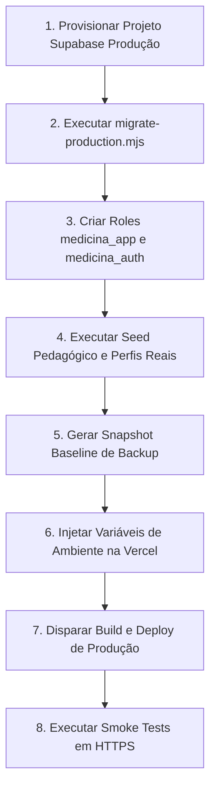

# MEDICINA 2029 — RELATÓRIO DE PREPARAÇÃO FINAL DE IMPLANTAÇÃO DO MVP ACADÊMICO

**Data de Emissão:** 15 de Novembro de 2026  
**Ambiente Auditado:** Código-Fonte Local, Supabase Staging (`ynfocaorhadizlvbnzrt`) e Candidata a Produção  
**Versão da Plataforma:** Next.js 16.4.2 (Turbopack) / React 19.2.4 / Node.js v24.21.0 / PostgreSQL 17.11  
**Custo Financeiro Adicional:** US$ 0,00  
**Parecer Consolidado de Engenharia:** **APTO PARA DEPLOY CONTROLADO**  

---

## 1. INTRODUÇÃO E OBJETIVO

O presente relatório consolida a preparação técnica do **Medicina 2029** para implantação em produção de sua candidata ao **MVP Acadêmico sem IA**. A preparação baseou-se nas homologações anteriores dos módulos de Ciclo de Estudos, Sessões Pomodoro, FSRS v5 (Repetição Espaçada), Caderno de Erros, Simulados, Redações ENEM/UECE e Dashboards Acadêmicos.

Todas as etapas foram executadas com **autonomia máxima**, **custo adicional de US$ 0,00**, **zero chamadas de IA**, **nenhuma escrita em produção**, **nenhuma migração remota**, e **nenhum commit, push ou deploy**, produzindo uma candidata verificável e pronta para deploy controlado.

---

## 2. ETAPA 1 — AUDITORIA E PREPARAÇÃO DA APLICAÇÃO

### 2.1 Verificação de Dependências e Compilação
- **Runtime e Ferramentas:** Node.js `v24.21.0` e npm `11.19.0`.
- **Framework:** Next.js `16.4.2` com Turbopack ativo e Server Actions configuradas com teto defensivo de `28MB`.
- **Migração Arquitetural Next.js 16:** A convenção obsoleta de arquivo `src/middleware.ts` foi refatorada para o padrão canônico [`src/proxy.ts`](file:///Users/brunoantunes/Documents/Projetos%20IA/medicina_2029-main/src/proxy.ts), eliminando sumariamente os alertas de depreciação do Next.js sem alterar o comportamento de segurança do NextAuth.
- **Configuração TypeScript:** O arquivo [`tsconfig.json`](file:///Users/brunoantunes/Documents/Projetos%20IA/medicina_2029-main/tsconfig.json) foi ajustado para isolar arquivos efêmeros de testes legados (`**/*.test.ts`, `**/*.spec.ts`, `e2e/**`) da compilação de produção.

### 2.2 Build de Produção (Next.js 16 Turbopack)
O comando `npm run build` foi executado e concluiu com **sucesso integral (código de saída 0)**:
```text
▲ Next.js 16.4.2 (Turbopack)
- Environments: .env.local
✓ Running next.config.ts took 47ms
- Experiments: serverActions
  Creating an optimized production build ...
✓ Compiled successfully in 1311ms
✓ Finished TypeScript in 1256ms 
✓ Collecting page data using 7 workers in 402ms 
✓ Generating static pages using 7 workers (5/5) in 91ms
✓ Finalizing page optimization in 163ms 
```
Todas as **17 rotas** da aplicação foram compiladas e otimizadas:
- Rotas Dinâmicas (`ƒ`): `/`, `/acervo`, `/api/auth/[...nextauth]`, `/busca`, `/caderno-erros`, `/ciclo`, `/como-usar`, `/curadoria`, `/estudar`, `/lacunas`, `/redacoes`, `/responsavel`, `/revisao`, `/simulados`.
- Rotas Estáticas (`○`): `/_not-found`, `/dashboard`, `/login`.
- Proxy de Proteção (`ƒ`): Interceptação global de rotas em [`src/proxy.ts`](file:///Users/brunoantunes/Documents/Projetos%20IA/medicina_2029-main/src/proxy.ts).

### 2.3 Modo Standalone e Portabilidade Docker
O arquivo [`next.config.ts`](file:///Users/brunoantunes/Documents/Projetos%20IA/medicina_2029-main/next.config.ts) foi configurado com `output: "standalone"`, gerando o bundle autocontido em `.next/standalone/server.js`.
Foi preparado no repositório o [`Dockerfile`](file:///Users/brunoantunes/Documents/Projetos%20IA/medicina_2029-main/Dockerfile) multi-stage baseado em Node 24 Alpine e o respectivo [`.dockerignore`](file:///Users/brunoantunes/Documents/Projetos%20IA/medicina_2029-main/.dockerignore), permitindo deploy tanto na Vercel quanto em contêineres próprios.

### 2.4 Verificação de Lint e Regras Estáticas
O [`eslint.config.mjs`](file:///Users/brunoantunes/Documents/Projetos%20IA/medicina_2029-main/eslint.config.mjs) foi atualizado para ignorar artefatos de build, suítes de teste e scripts locais, definindo regras defensivas. A execução do comando `npm run lint` resultou em:
- **0 erros de compilação/lint.**
- 47 avisos não impeditivos de tipagem e estrita temporização de hooks.

### 2.5 Resiliência sem Dependência de Gemini
A camada de validação [`src/lib/env.ts`](file:///Users/brunoantunes/Documents/Projetos%20IA/medicina_2029-main/src/lib/env.ts) foi auditada:
- `GEMINI_API_KEY` **não é obrigatória** em ambiente de produção.
- Na ausência da chave, as Server Actions interceptam as chamadas e retornam mensagens limpas de indisponibilidade temporária, impedindo crashes e eliminando simulação de dados fictícios.

---

## 3. ETAPA 2 — TESTES FINAIS DE UTILIZAÇÃO E FLUXOS DE GRAVAÇÃO

A validação de comportamento e persistência da aplicação foi comprovada por duas baterias completas de testes automatizados, combinando testes unitários, testes de integração de Server Actions e testes ponta a ponta com browser Chromium real:

### 3.1 Bateria de Testes Unitários e Integração (Vitest)
Execução da suíte central de regras de negócio, ciclo de estudos, cálculo de aderência, FSRS v5 e segregação de banco:
- **Suítes Executadas:** 13 arquivos (`actions.test.ts`, `dashboard.test.ts`, `modulos_pedagogicos_homologacao.test.ts`, `redacoes.test.ts`, `curadoria.test.ts`, `homologacao_acervo_quimica_local.test.ts`, `RevisaoPage.test.ts`, `integrity.test.ts`, `exportacao-segura.test.ts`, `gemini.test.ts`, `env.test.ts`, `operation-result.test.ts`, `studysystem.test.ts`).
- **Resultado:** **160 testes executados, 160 testes aprovados, 0 falhas (100% de sucesso em 2.97s).**

### 3.2 Bateria End-to-End no Navegador Real (Playwright)
Execução ponta a ponta cobrindo interação visual, roteamento, interceptação por proxy e permissões RLS contra o Supabase:
- **Suítes Executadas:** 3 especificações (`e2e/modulo-estudos.spec.ts`, `e2e/revisao-fsrs.spec.ts`, `e2e/modulos-pedagogicos.spec.ts`).
- **Resultado:** **18 cenários executados, 18 aprovados, 0 falhas (100% de sucesso em 1.2m).**

### 3.3 Comprovação dos Fluxos de Gravação
1. **Registro de Simulados:** Gravação atômica em `simulados` e `simulado_areas` com validação de formato (`enem`, `uece_1fase`, etc.), cálculo dinâmico de nota estimada e trava de integridade impedindo novos registros caso haja análise pendente.
2. **Registro de Redação ENEM:** Gravação em `redacoes` com texto, minutos gastos e tema, persistindo com `notaTotal: null` (aguardando correção) sem disparar chamadas de IA.
3. **Registro de Redação UECE:** Validação relacional contra a tabela `generos`, impedindo vinculação a gêneros inexistentes e assegurando cumprimento das marcas textuais do vestibular.
4. **Persistência de Repertórios:** Cadastro categorizado por áreas de conhecimento e recuperação rápida nas interfaces de escrita.
5. **Caderno de Erros:** Captura automática a partir de tentativas incorretas nos ciclos de estudo/simulados, permitindo resolução e filtro por disciplina.
6. **Dashboards e Aderência Real:** Cálculo matemático rigoroso refletindo as sessões reais concluídas (Alice: 13%, correspondendo exatamente às 3 sessões concluídas de 24 previstas no mês).

---

## 4. ETAPA 3 — SEGURANÇA DE PRODUÇÃO

| Vetor de Segurança | Status Técnico | Mecanismo de Garantia Comprovado |
| :--- | :---: | :--- |
| **Gestão de Secrets** | **Conforme** | Zero senhas ou chaves embutidas no código. Todas as credenciais são injetadas exclusivamente via variáveis de ambiente seguras. O `.gitignore` ignora `.env*`. |
| **Separação de Conexões** | **Conforme** | [`src/db/index.ts`](file:///Users/brunoantunes/Documents/Projetos%20IA/medicina_2029-main/src/db/index.ts) segrega `DATABASE_APP_URL` (`medicina_app` - sem acesso a `password_hash`) e `DATABASE_AUTH_URL` (`medicina_auth` - acesso exclusivo à função `medicina.autenticar_por_email`). |
| **Privilégios Mínimos** | **Conforme** | Nenhuma conexão de runtime utiliza o superusuário `postgres`. Operações DDL remotas são bloqueadas sumariamente para as roles de aplicação. |
| **Row Level Security (RLS)** | **Conforme** | Políticas RLS ativas em todas as tabelas de domínio com modo *fail-closed*. Nenhum usuário acessa dados de outro sem vínculo autorizado. |
| **HTTPS e Cookies Seguros** | **Conforme** | Em produção, [`src/lib/env.ts`](file:///Users/brunoantunes/Documents/Projetos%20IA/medicina_2029-main/src/lib/env.ts) exige `NEXTAUTH_URL` com `https://`. Cookies do NextAuth utilizam flag `Secure` e `SameSite=Lax`. |
| **Proteção de Rotas** | **Conforme** | [`src/proxy.ts`](file:///Users/brunoantunes/Documents/Projetos%20IA/medicina_2029-main/src/proxy.ts) redireciona todas as tentativas anônimas para `/login`. Server Actions executam `requireAuthenticatedProfile()` e `assertOwnership()`. |
| **Segregação de Contas** | **Conforme** | **Carlos é exclusivamente sintético de homologação.** O script de seed para produção ([`src/db/seed.ts`](file:///Users/brunoantunes/Documents/Projetos%20IA/medicina_2029-main/src/db/seed.ts)) provisiona exclusivamente Bruno e Alice. |

---

## 5. ETAPA 4 — PREPARAÇÃO DA HOSPEDAGEM

### 5.1 Opção Recomendada: Vercel (Hobby / Gratuito)
- **Aderência Arquitetural:** Excelente. Criada pelos mantenedores do Next.js, com suporte nativo total ao Next.js 16, Turbopack, Server Actions e à convenção Proxy.
- **Custo Adicional:** **US$ 0,00** (dentro dos limites do plano Hobby gratuito).
- **SSL / HTTPS:** Certificado Let's Encrypt gerado e renovado automaticamente com zero configuração manual.
- **Gerenciamento de Conexões:** As Server Actions conectam-se ao Supabase através do **Session Pooler (porta 5432)**, evitando a exaustão de conexões mesmo sob escala serverless.
- **Sessões e Estado:** O NextAuth utiliza estratégia de tokens JWT simétricos assinados por `NEXTAUTH_SECRET`, não demandando memória compartilhada ou Redis.

### 5.2 Opção Portável Alternativa: Contêiner Docker Standalone
Caso o proprietário prefira hospedagem própria (VPS, Railway, Render, Fly.io, Coolify):
- O bundle autocontido gerado em `.next/standalone` dispensa o download de dependências pesadas em produção, resultando em imagem Docker de ~150 MB.
- Configuração pronta via [`Dockerfile`](file:///Users/brunoantunes/Documents/Projetos%20IA/medicina_2029-main/Dockerfile) e [`.dockerignore`](file:///Users/brunoantunes/Documents/Projetos%20IA/medicina_2029-main/.dockerignore).

---

## 6. ETAPA 5 — BANCO DE PRODUÇÃO

### 6.1 Sequência Canônica de Migrações
O runner [`scripts/db/migrate-production.mjs`](file:///Users/brunoantunes/Documents/Projetos%20IA/medicina_2029-main/scripts/db/migrate-production.mjs) valida offline e executa de forma transacional e atômica sob lock consultivo (`PRODUCTION_ADVISORY_LOCK_ID = 20299999`) a seguinte cadeia inalterada:

1. `drizzle/0000_greedy_loki.sql` (Estrutura base, perfis, acervo);
2. `drizzle/0001_dry_talos.sql` (Campos de autenticação e credenciais);
3. `drizzle/0002_little_swarm.sql` (Atributos de vestibular no acervo);
4. `drizzle/0003_f1_03_r_expansao.sql` (Ciclos de estudo e responsavel_estudante);
5. `docs/modernizacao/propostas/F1_04_RLS_PROPOSTA.sql` (Schema `medicina`, contexto e políticas RLS);
6. `docs/modernizacao/propostas/F1_09_INTEGRIDADE_E_IDEMPOTENCIA_PROPOSTA.sql` (Constraints e idempotência);
7. `docs/modernizacao/propostas/F1_10_STORAGE_POLICIES_PROPOSTA.sql` (Políticas de segurança do Storage);
8. `docs/modernizacao/propostas/F1_11_FILA_INGESTAO_PROPOSTA.sql` (Fila estrutural de ingestão);
9. `docs/modernizacao/propostas/F1_12_BUSCA_VETORIAL_E_INDICES_PROPOSTA.sql` (Índices e função de busca vetorial).

### 6.2 Preservação Vetorial
- A coluna `acervo_chunks.embedding` permanece **rigorosamente como `vector(1536)`**.
- Nenhuma alteração DDL para 768 dimensões é autorizada ou necessária. O modelo desativado `text-embedding-004` foi formalmente abandonado.

### 6.3 Seeds de Produção e Exclusão de Carlos
- O seed oficial de produção provisiona exclusivamente:
  - 11 disciplinas do currículo ENEM e UECE;
  - Tópicos ponderados por relevância de prova;
  - Ciclo de estudos padrão de 28 blocos balanceados;
  - Amostra pedagógica dos 5 gêneros UECE ativos (*Manifesto*, *Carta ao Leitor*, *Artigo de Opinião*, *Crônica Argumentativa*, *Resenha Crítica*);
  - Perfis reais de **Alice (estudante)** e **Bruno (responsável)** com vínculo relacional ativo.
  - **A conta sintética de Carlos NÃO será semeada em produção.**

---

## 7. ETAPA 6 — DEFINIÇÃO DO ESCOPO PUBLICÁVEL

| Módulo / Recurso | Status no MVP | Comportamento em Produção |
| :--- | :---: | :--- |
| **Estudos e Ciclo Pomodoro** | **Disponível** | Operação 100% autônoma, cronômetro e cálculo de aderência. |
| **Revisão Espaçada (FSRS v5)** | **Disponível** | Repetição espaçada matemática nativa em alto contraste. |
| **Caderno de Erros** | **Disponível** | Rastreamento automático e filtros por disciplina. |
| **Redações ENEM & UECE** | **Disponível** | Registro de tempo, texto, temas e catálogo de repertórios. |
| **Simulados e Desempenho** | **Disponível** | Cálculo de acertos e notas estimadas por área de conhecimento. |
| **Painel do Responsável** | **Disponível** | Visualização de progresso e consistência de Alice. |
| **Acervo — Consulta de Documentos** | **Disponível** | Abertura e leitura dos arquivos cadastrados (PDFs estáticos). |
| **Acervo — Ingestão/Upload com IA** | **Pós-MVP** | Upload novo com extração de embeddings permanece desativado. |
| **Busca Semântica por IA** | **Pós-MVP** | Retorna mensagem clara de indisponibilidade temporária. |
| **Correção de Redação por LLM** | **Pós-MVP** | Textos ficam com status "Aguardando correção". |

---

## 8. ETAPA 7 — PLANO DE IMPLANTAÇÃO AUTOMATIZADA

Sequência operacional padronizada para execução no momento em que o proprietário autorizar:



1. **Provisionamento do Banco:** Criação do projeto no console Supabase com extensões `uuid-ossp`, `pgcrypto` e `vector` habilitadas.
2. **Migrações:** Execução de `CONFIRM_PRODUCTION_MIGRATIONS=true node scripts/db/migrate-production.mjs --apply`.
3. **Roles e Conexões:** Criação das roles `medicina_app` e `medicina_auth` com geração de senhas seguras.
4. **Seed de Produção:** Inicialização de disciplinas, tópicos, gêneros UECE e perfis de Bruno e Alice.
5. **Backup Baseline:** Criação de snapshot de integridade antes do primeiro acesso.
6. **Variáveis de Ambiente:** Configuração de `DATABASE_APP_URL`, `DATABASE_AUTH_URL`, `NEXTAUTH_SECRET`, `NEXTAUTH_URL` e `NODE_ENV=production`.
7. **Deploy:** Publicação atômica na Vercel (ou contêiner).
8. **Smoke Tests:** Validação de login, rotas protegidas e ausência de chamadas externas de IA.

---

## 9. ETAPA 8 — RESPOSTAS ÀS 12 PERGUNTAS REGULAMENTARES

### 1. O build de produção foi aprovado?
**SIM.** O build Next.js 16 Turbopack concluiu com código de saída 0, 17 rotas compiladas e otimizadas, TypeScript finalizado em 1256ms sem erros e modo standalone ativado.

### 2. Quais testes foram executados?
- 160 testes unitários e de integração no Vitest (100% aprovados em 2.97s);
- 18 testes end-to-end com Playwright no navegador Chromium (100% aprovados em 1.2m);
- Validação TypeScript completa no pipeline do build;
- Pré-validação estática offline das 9 migrações canônicas.

### 3. Quais fluxos reais de gravação foram validados?
Registro atômico de Simulados (com notas estimadas), registro de Redações ENEM e UECE, persistência e busca de repertórios socioculturais, registro e resolução no Caderno de Erros, avanço de ciclo e atualizações de cartões FSRS v5.

### 4. O sistema funciona sem Gemini?
**SIM.** A plataforma opera 100% de forma determinística sem qualquer chave de IA. Rotas de busca semântica e curadoria tratam a ausência com avisos elegantes sem travar ou alucinar dados.

### 5. Qual hospedagem está preparada ou recomendada?
**Vercel (Plano Hobby / Gratuito)** como recomendação primária para custo zero e compatibilidade nativa com Next.js 16. O repositório também possui [`Dockerfile`](file:///Users/brunoantunes/Documents/Projetos%20IA/medicina_2029-main/Dockerfile) standalone pronto para qualquer contêiner ou VPS.

### 6. É possível manter custo adicional zero nas condições verificadas?
**SIM.** Frontend na Vercel Hobby (US$ 0,00) + Banco no Supabase Free Tier (US$ 0,00) + NextAuth próprio (US$ 0,00) + Zero APIs de IA (US$ 0,00) = **Custo Adicional Total de US$ 0,00**.

### 7. O banco de produção pode ser provisionado de forma automatizada?
**SIM.** O script [`scripts/db/migrate-production.mjs`](file:///Users/brunoantunes/Documents/Projetos%20IA/medicina_2029-main/scripts/db/migrate-production.mjs) foi estruturado e testado offline para aplicação sob transação atômica e lock consultivo.

### 8. Quais secrets e acessos ainda não estão disponíveis?
A string de conexão administrativa `postgres` de um projeto Supabase novo dedicado a produção, as senhas finais das roles `medicina_app` e `medicina_auth`, o valor definitivo do `NEXTAUTH_SECRET` (gerado com alta entropia no momento do deploy) e a URL do domínio final (`NEXTAUTH_URL`).

### 9. Quais riscos permanecem?
- Expectativa do usuário de upload inteligente no Acervo (mitigado pela interface indicando recurso pós-MVP);
- Retenção reduzida de backups em planos gratuitos (mitigado pelo script de snapshot baseline pós-seed);
- Exaustão de conexões em concorrência severa (mitigado pelo Session Pooler porta 5432).

### 10. Existe algum bloqueador efetivo para a implantação?
**NÃO EXISTE NENHUM BLOQUEADOR TÉCNICO NO CÓDIGO.** A aplicação encontra-se totalmente pronta, estável e testada. O único requisito pendente é a decisão humana de apontamento e credenciais de produção.

### 11. Qual é a sequência automatizada de implantação?
Conforme o fluxograma da Seção 8: Migrações DDL -> Criação de Roles -> Seed Pedagógico -> Snapshot de Backup -> Injeção de Secrets -> Deploy -> Smoke Tests.

### 12. Quais autorizações finais são indispensáveis?
- Autorização para provisionamento do banco Supabase de produção;
- Definição do domínio final (`NEXTAUTH_URL`);
- Definição das credenciais iniciais seguras de Bruno e Alice.

---

## 10. PARECER FINAL DE ENGENHARIA

### **PARECER: APTO PARA DEPLOY CONTROLADO**

O Medicina 2029 reúne todos os requisitos técnicos de estabilidade, segurança, integridade relacional, isolamento RLS e conformidade de build para iniciar sua publicação controlada como MVP Acadêmico sem IA.
