# RUNBOOK OPERACIONAL — BACKUP NATIVO E RECUPERAÇÃO DE DESASTRES

**Projeto:** Medicina 2029  
**Tarefa:** F1.15 — Backup Completo e Recuperação Testada  
**Data:** 21/10/2026  
**Status:** **HOMOLOGADO PARA OPERAÇÃO**  
**Classificação:** Documento Técnico Operacional P0 / Restrito  

---

## 1. Sumário Executivo e Diretrizes de Governança

### 1.1 Objetivo e Escopo
Este runbook define os procedimentos canônicos, reprodutíveis e automatizados para a realização de **backup nativo**, **cifragem em repouso**, **transporte seguro offsite**, **restauração determinística** e **validação de integridade referencial** de toda a base de dados do Projeto Medicina 2029 no PostgreSQL.

O escopo abrange:
1. **35 tabelas operacionais e de domínio** (32 tabelas do schema da aplicação Drizzle, a tabela de controle de acesso `allowlist`, a tabela de proteção contra reentrância `operacoes_idempotentes` e a fila assíncrona de ingestão `acervo_jobs`), além do catálogo de binários no Supabase Storage (`storage.buckets` e `storage.objects`).
2. **Extensões nativas do motor relacional:** `vector` (dimensão 1536), `unaccent`, `pgcrypto` e `uuid-ossp`.
3. **Papéis de banco de dados e modelo de mínimo privilégio:** `postgres`, `medicina_app`, `medicina_auth` e `medicina_worker`.
4. **Políticas operacionais de resiliência:** metas de RPO (Recovery Point Objective), RTO (Recovery Time Objective), retenção Grandfather-Father-Son (GFS), armazenamento imutável (*air-gapped / WORM*) e reconciliação de dados em voo pós-incidente.

### 1.2 Princípios Invioláveis da Operação
- **Princípio da Confidencialidade e Zero Credenciais:** Nenhum arquivo de backup pode ser armazenado em texto claro fora do host de produção. Os dumps são imediatamente cifrados com **AES-256** antes de qualquer transmissão. O runbook utiliza estritamente placeholders padrão (`$POSTGRES_PASSWORD`, `$BACKUP_ENCRYPTION_KEY`, etc.), proibindo qualquer gravação de senhas em scripts ou histórico de shell.
- **Princípio Fail-Closed e Não Corrupção:** A restauração nunca deve ser realizada diretamente sobre a base de produção ativa sem validação preliminar em ambiente efêmero/staging. Em caso de discrepância de soma criptográfica SHA-256 ou falha de chave estrangeira, a operação é sumariamente abortada.
- **Independência de Camada:** O backup nativo operacional (`pg_dump`/`pg_restore`) opera diretamente no PostgreSQL via connection pool administrativo (`postgres`), sendo completamente desacoplado da exportação administrativa JSON de usuário (`exportarDadosCompletos`), a qual possui limites pedagógicos de 10 MiB e campos mascarados.

---

## 2. Inventário Canônico dos Dados (35 Tabelas)

O banco de dados do Medicina 2029 está estruturado em 7 domínios funcionais complementares:

| # | Tabela | Domínio Funcional | Chave Primária | Chaves Estrangeiras (FKs) | Regra de Delete | RLS Status | Criticidade |
| :-: | :--- | :--- | :--- | :--- | :--- | :---: | :---: |
| 1 | `perfis` | Identidades e Acesso | `id` (UUID) | Nenhuma | N/A | FORCE | P0 |
| 2 | `responsavel_estudante` | Identidades e Acesso | `vinculo_id` (1) | `responsavel_perfil_id`, `estudante_perfil_id` | RESTRICT | FORCE | P0 |
| 3 | `allowlist` | Identidades e Acesso | `email` (TEXT) | Nenhuma | N/A | FORCE | P0 |
| 4 | `ciclos` | Ciclo e Rotina | `id` (UUID) | `estudante_perfil_id` | RESTRICT | FORCE | P0 |
| 5 | `ciclo_blocos` | Ciclo e Rotina | `id` (UUID) | `ciclo_id`, `disciplina_id` | RESTRICT / CASCADE | FORCE | P0 |
| 6 | `ciclo_estado` | Ciclo e Rotina | `ciclo_id` (UUID) | `ciclo_id` | CASCADE | FORCE | P0 |
| 7 | `sessoes` | Ciclo e Rotina | `id` (UUID) | `perfil_id`, `ciclo_bloco_id`, `topico_id` | RESTRICT / NO ACTION | FORCE | P0 |
| 8 | `cards` | Anki e FSRS | `id` (UUID) | `perfil_id`, `topico_id` | RESTRICT / NO ACTION | FORCE | P1 |
| 9 | `card_revisoes` | Anki e FSRS | `id` (UUID) | `card_id` | NO ACTION | FORCE | P1 |
| 10 | `disciplinas` | Conteúdo e Acervo | `id` (UUID) | Nenhuma | N/A | FORCE | P0 |
| 11 | `topicos` | Conteúdo e Acervo | `id` (UUID) | `disciplina_id`, `pre_requisito_topico_id` | NO ACTION / SET NULL | FORCE | P0 |
| 12 | `materiais` | Conteúdo e Acervo | `id` (UUID) | `topico_id`, `aprovado_por` | NO ACTION / SET NULL | FORCE | P1 |
| 13 | `perguntas_ativas` | Conteúdo e Acervo | `id` (UUID) | `topico_id` | NO ACTION | FORCE | P1 |
| 14 | `acervo_arquivos` | Conteúdo e Acervo | `id` (UUID) | `disciplina_id`, `enviado_por` | NO ACTION / RESTRICT | FORCE | P0 |
| 15 | `acervo_paginas` | Conteúdo e Acervo | `id` (UUID) | `arquivo_id` | CASCADE / NO ACTION | FORCE | P1 |
| 16 | `acervo_chunks` | Conteúdo e Acervo | `id` (UUID) | `arquivo_id`, `topico_id` | NO ACTION / SET NULL | FORCE | P1 |
| 17 | `acervo_figuras` | Conteúdo e Acervo | `id` (UUID) | `arquivo_id`, `chunk_id` | NO ACTION / SET NULL | FORCE | P2 |
| 18 | `questoes` | Avaliações e Exercícios | `id` (UUID) | `disciplina_id`, `arquivo_origem_id` | NO ACTION / SET NULL | FORCE | P0 |
| 19 | `questao_topicos` | Avaliações e Exercícios | `(questao_id, topico_id)` | `questao_id`, `topico_id` | CASCADE / NO ACTION | FORCE | P0 |
| 20 | `tentativas` | Avaliações e Exercícios | `id` (UUID) | `perfil_id`, `questao_id`, `sessao_id`, `simulado_id` | RESTRICT / SET NULL | FORCE | P0 |
| 21 | `erros` | Avaliações e Exercícios | `id` (UUID) | `perfil_id`, `questao_id`, `tentativa_id`, `disciplina_id`, `topico_id` | NO ACTION | FORCE | P0 |
| 22 | `generos` | Avaliações e Exercícios | `id` (UUID) | Nenhuma | N/A | FORCE | P1 |
| 23 | `redacoes` | Avaliações e Exercícios | `id` (UUID) | `perfil_id`, `genero_id`, `reescrita_de_id` | RESTRICT / SET NULL | FORCE | P0 |
| 24 | `repertorios` | Avaliações e Exercícios | `id` (UUID) | `perfil_id` | RESTRICT | FORCE | P1 |
| 25 | `simulados` | Avaliações e Exercícios | `id` (UUID) | `perfil_id` | RESTRICT | FORCE | P0 |
| 26 | `simulado_questoes` | Avaliações e Exercícios | `(simulado_id, questao_id)` | `simulado_id`, `questao_id` | CASCADE / NO ACTION | FORCE | P0 |
| 27 | `simulado_areas` | Avaliações e Exercícios | `id` (UUID) | `simulado_id` | CASCADE / NO ACTION | FORCE | P1 |
| 28 | `simulado_analise` | Avaliações e Exercícios | `id` (UUID) | `simulado_id` | CASCADE / NO ACTION | FORCE | P1 |
| 29 | `checkins` | Avaliações e Exercícios | `id` (UUID) | `perfil_id` | RESTRICT | FORCE | P1 |
| 30 | `revisoes_trimestrais` | Avaliações e Exercícios | `id` (UUID) | `estudante_perfil_id`, `registrada_por_perfil_id` | RESTRICT | FORCE | P0 |
| 31 | `livros` | Avaliações e Exercícios | `id` (UUID) | `perfil_id` | RESTRICT | FORCE | P2 |
| 32 | `geracoes` | Curadoria e IA | `id` (UUID) | `topico_id` | NO ACTION | FORCE | P2 |
| 33 | `curadoria_fila` | Curadoria e IA | `id` (UUID) | `topico_id` | NO ACTION | FORCE | P1 |
| 34 | `operacoes_idempotentes` | Auditoria e Filas | `id` (UUID) | `perfil_id` | RESTRICT | FORCE | P0 |
| 35 | `acervo_jobs` | Auditoria e Filas | `id` (UUID) | `arquivo_id`, `enviado_por` | CASCADE / RESTRICT | FORCE | P1 |

*(Nota de Infraestrutura: Caso o ambiente utilize tabelas locais do Supabase Storage, `storage.buckets` e `storage.objects` são integradas no Domínio 7).*

---

## 3. Grafo de Dependências e Ordem Estrita de Restauração

O PostgreSQL valida rigorosamente constraints de integridade referencial (`FOREIGN KEY`). A inserção direta de dados sem respeitar o grafo direcionado de dependências resulta em erros de violação de chave (`foreign_key_violation`, código `23503`).

### 3.1 Topologia de Carga (Diagrama de Dependências)

```mermaid
graph TD
    classDef l0 fill:#1e293b,stroke:#94a3b8,stroke-width:2px,color:#fff;
    classDef l1 fill:#0f766e,stroke:#14b8a6,stroke-width:2px,color:#fff;
    classDef l2 fill:#0369a1,stroke:#38bdf8,stroke-width:2px,color:#fff;
    classDef l3 fill:#4338ca,stroke:#818cf8,stroke-width:2px,color:#fff;
    classDef l4 fill:#b45309,stroke:#f59e0b,stroke-width:2px,color:#fff;
    classDef l5 fill:#be123c,stroke:#fb7185,stroke-width:2px,color:#fff;

    %% Nível 0: Raízes Independentes
    perfis["perfis (L0)"]:::l0
    disciplinas["disciplinas (L0)"]:::l0
    generos["generos (L0)"]:::l0
    allowlist["allowlist (L0)"]:::l0

    %% Nível 1: Dependência Direta de L0
    resp_est["responsavel_estudante (L1)"]:::l1
    ciclos["ciclos (L1)"]:::l1
    topicos["topicos (L1)"]:::l1
    acervo_arq["acervo_arquivos (L1)"]:::l1
    redacoes["redacoes (L1)"]:::l1
    simulados["simulados (L1)"]:::l1
    checkins["checkins (L1)"]:::l1
    revisoes_tri["revisoes_trimestrais (L1)"]:::l1
    livros["livros (L1)"]:::l1
    repertorios["repertorios (L1)"]:::l1
    op_idemp["operacoes_idempotentes (L1)"]:::l1

    perfis --> resp_est
    perfis --> ciclos
    disciplinas --> topicos
    perfis --> acervo_arq
    disciplinas --> acervo_arq
    perfis --> redacoes
    generos --> redacoes
    perfis --> simulados
    perfis --> checkins
    perfis --> revisoes_tri
    perfis --> livros
    perfis --> repertorios
    perfis --> op_idemp

    %% Nível 2: Dependência de L1
    ciclo_blocos["ciclo_blocos (L2)"]:::l2
    ciclo_estado["ciclo_estado (L2)"]:::l2
    cards["cards (L2)"]:::l2
    materiais["materiais (L2)"]:::l2
    perg_ativas["perguntas_ativas (L2)"]:::l2
    acervo_pag["acervo_paginas (L2)"]:::l2
    acervo_chunks["acervo_chunks (L2)"]:::l2
    acervo_jobs["acervo_jobs (L2)"]:::l2
    questoes["questoes (L2)"]:::l2
    sim_areas["simulado_areas (L2)"]:::l2
    sim_analise["simulado_analise (L2)"]:::l2
    geracoes["geracoes (L2)"]:::l2
    curadoria["curadoria_fila (L2)"]:::l2

    ciclos --> ciclo_blocos
    disciplinas --> ciclo_blocos
    ciclos --> ciclo_estado
    perfis --> cards
    topicos --> cards
    topicos --> materiais
    topicos --> perg_ativas
    acervo_arq --> acervo_pag
    acervo_arq --> acervo_chunks
    topicos --> acervo_chunks
    acervo_arq --> acervo_jobs
    disciplinas --> questoes
    acervo_arq --> questoes
    simulados --> sim_areas
    simulados --> sim_analise
    topicos --> geracoes
    topicos --> curadoria

    %% Nível 3: Dependência de L2
    sessoes["sessoes (L3)"]:::l3
    card_rev["card_revisoes (L3)"]:::l3
    acervo_fig["acervo_figuras (L3)"]:::l3
    q_topicos["questao_topicos (L3)"]:::l3
    sim_questoes["simulado_questoes (L3)"]:::l3

    perfis --> sessoes
    ciclo_blocos --> sessoes
    topicos --> sessoes
    cards --> card_rev
    acervo_arq --> acervo_fig
    acervo_chunks --> acervo_fig
    questoes --> q_topicos
    topicos --> q_topicos
    simulados --> sim_questoes
    questoes --> sim_questoes

    %% Nível 4: Tentativas
    tentativas["tentativas (L4)"]:::l4
    perfis --> tentativas
    questoes --> tentativas
    sessoes -.-> tentativas
    simulados -.-> tentativas

    %% Nível 5: Caderno de Erros
    erros["erros (L5)"]:::l5
    perfis --> erros
    questoes --> erros
    tentativas --> erros
    disciplinas --> erros
    topicos --> erros
```



### 3.2 Matriz Canônica de Restauração e Purga

A restauração de dados brutos deve obedecer estritamente à progressão de **Nível 0 a Nível 5**. Já operações de limpeza, truncamento ou rollback de dados devem executar na ordem exatamente inversa (**Nível 5 a Nível 0**).

#### Ordem de Inserção / Restauração (L0 → L5):
1. **Nível 0 (4 tabelas):** `allowlist`, `disciplinas`, `generos`, `perfis`.
2. **Nível 1 (11 tabelas):** `responsavel_estudante`, `topicos` *(com pre_requisito nulo)*, `ciclos`, `acervo_arquivos`, `simulados`, `redacoes` *(com reescrita nula)*, `repertorios`, `checkins`, `revisoes_trimestrais`, `livros`, `operacoes_idempotentes`.
3. **Nível 2 (13 tabelas):** `ciclo_blocos`, `ciclo_estado`, `materiais`, `perguntas_ativas`, `cards`, `acervo_paginas`, `acervo_chunks`, `acervo_jobs`, `questoes`, `simulado_areas`, `simulado_analise`, `geracoes`, `curadoria_fila`.
4. **Nível 3 (5 tabelas):** `sessoes`, `card_revisoes`, `acervo_figuras`, `questao_topicos`, `simulado_questoes`.
5. **Nível 4 (1 tabela):** `tentativas`.
6. **Nível 5 (1 tabela):** `erros`.

#### Auto-Relacionamentos (Self-References):
Existem dois auto-relacionamentos que formam referências recursivas:
- `topicos.pre_requisito_topico_id` $\rightarrow$ `topicos.id`
- `redacoes.reescrita_de_id` $\rightarrow$ `redacoes.id`

**Como o mecanismo padrão lida:**
Ao utilizar o formato customizado nativo do PostgreSQL (`pg_dump -Fc`), a ferramenta particiona o dump em três fases automáticas:
1. `pre-data`: Criação de schemas, enums e tabelas básicas (sem FKs).
2. `data`: Carga em massa dos dados via protocolo `COPY`.
3. `post-data`: Criação de chaves primárias, índices, triggers e adição de chaves estrangeiras (`ADD CONSTRAINT ... FOREIGN KEY`).
Desta forma, os auto-relacionamentos e dependências circulares **não sofrem erro durante o carregamento de dados**, pois as constraints só são aplicadas no final da carga!

Caso seja necessária uma carga pontual em base que já possui constraints ativas:
```sql
-- Desabilita checagem de FKs na sessão do operador
SET session_replication_role = 'replica';
-- [Executar restauração das tabelas]
-- Reabilita a checagem obrigatória
SET session_replication_role = 'origin';
```

---

## 4. Extensões PostgreSQL Necessárias

O banco de dados depende de quatro extensões que devem estar instaladas e habilitadas no cluster de destino:

```sql
-- 1. pgvector: Busca vetorial para acervo_chunks (1536 dimensões)
CREATE EXTENSION IF NOT EXISTS vector;

-- 2. pgcrypto: Funções criptográficas e hashes
CREATE EXTENSION IF NOT EXISTS pgcrypto;

-- 3. unaccent: Normalização e busca full-text sem acentuação em português
CREATE EXTENSION IF NOT EXISTS unaccent;

-- 4. uuid-ossp: Geração determinística e compatibilidade de identificadores
CREATE EXTENSION IF NOT EXISTS "uuid-ossp";
```

### Validação Pré-Restauração das Extensões
O operador deve executar a seguinte consulta de verificação no host PostgreSQL de destino:
```sql
SELECT extname, extversion 
FROM pg_extension 
WHERE extname IN ('vector', 'pgcrypto', 'unaccent', 'uuid-ossp');
```
*Requisito Mínimo:* A extensão `vector` deve ser de versão $\ge$ 0.5.0 (preferencialmente $\ge$ 0.8.0 para suporte pleno aos índices HNSW com distância cosseno `vector_cosine_ops`).

---

## 5. Papéis de Banco de Dados, Privilégios e RLS

O sistema implementa o princípio do menor privilégio através de 4 papéis distintos:

| Papel (Role) | Conexão / Variável | Propósito Operacional | Permissões em Dados | Permissões em `perfis.password_hash` | RLS Ativo |
| :--- | :--- | :--- | :--- | :---: | :---: |
| **`postgres`** | N/A (Superuser/DBA) | Administração, migrations, backup e restore | Total (`SUPERUSER`) | Total | Ignora (Bypass) |
| **`medicina_app`** | `DATABASE_URL` | Server Actions e aplicação web Next.js | `SELECT, INSERT, UPDATE, DELETE` nas 35 tabelas públicas sob RLS | **NEGADO** (Erro 42501) | **FORCE RLS** |
| **`medicina_auth`** | `DATABASE_AUTH_URL` | Fluxo exclusivo de login NextAuth | `SELECT` em `allowlist` e função `medicina.autenticar_por_email` | Somente via função `SECURITY DEFINER` | **FORCE RLS** |
| **`medicina_worker`** | `DATABASE_WORKER_URL` | Worker de ingestão e pipeline de IA | CRUD em `acervo_jobs`, `acervo_*`, `topicos`, `disciplinas` | **NEGADO** (Sem acesso a perfis) | **FORCE RLS** |

### 5.1 Exportação de Papéis e Globais
Como o utilitário `pg_dump` extrai apenas o conteúdo de um único banco de dados (omitindo definições de usuários e senhas do cluster), o backup operacional deve obrigatoriamente executar a extração dos globais:

```bash
# Exportação exclusiva de usuários, roles e concessões globais
pg_dumpall \
  --host="$PGHOST" \
  --port="$PGPORT" \
  --username="$PGUSER" \
  --globals-only \
  --file="$BACKUP_DIR/medicina2029_globals_$TIMESTAMP.sql"
```

> [!CAUTION]
> O arquivo `medicina2029_globals.sql` contém os hashes criptográficos das senhas dos papéis (`password_hash`). Ele deve receber a **mesma política rigorosa de cifragem** aplicada ao dump de dados.

---

## 6. Procedimento Canônico de Backup com `pg_dump`

### 6.1 Anatomia do Comando Canônico
O backup completo da base de produção é executado no formato customizado nativo do PostgreSQL:

```bash
pg_dump \
  --host="$PGHOST" \
  --port="$PGPORT" \
  --username="$PGUSER" \
  --dbname="$PGDATABASE" \
  --format=custom \
  --compress=9 \
  --no-owner \
  --no-privileges \
  --verbose \
  --file="$BACKUP_DIR/medicina2029_database_$TIMESTAMP.dump"
```

#### Justificativa Técnica das Flags:
- `--format=custom` (`-Fc`): Arquivo binário proprietário com compressão interna `zlib`. Permite reordenação de objetos, restauração paralela (`-j`) e verificação de integridade sem necessidade de restaurar o banco.
- `--compress=9`: Taxa máxima de compressão, reduzindo o tráfego de rede e os custos de armazenamento offsite.
- `--no-owner`: Suprime comandos `ALTER TABLE ... OWNER TO ...`. Essencial para possibilitar a restauração em clusters onde o superusuário possui nome diferente (ex: `postgres`, `supabase_admin` ou `cloudsqlsuperuser`).
- `--no-privileges`: Previne conflitos de privilégios (`GRANT`/`REVOKE`) durante a restauração; os privilégios canônicos são reaplicados de forma declarativa e auditada.
- `--verbose`: Emite o registro detalhado de cada tabela e índice processado para diagnóstico em log.

### 6.2 Cifragem em Repouso do Dump (Envelope Criptográfico)
Imediatamente após a conclusão do `pg_dump`, o arquivo de dump e o arquivo de globais devem ser cifrados antes do transporte:

```bash
# Método A: OpenSSL (AES-256-CBC com derivação PBKDF2 de 100.000 iterações)
openssl enc -aes-256-cbc -pbkdf2 -iter 100000 -salt \
  -in "$BACKUP_DIR/medicina2029_database_$TIMESTAMP.dump" \
  -out "$BACKUP_DIR/medicina2029_database_$TIMESTAMP.dump.enc" \
  -pass "env:BACKUP_ENCRYPTION_KEY"

# Método B: GPG Simétrico (AES-256)
gpg --batch --yes --symmetric --cipher-algo AES256 \
  --passphrase "$BACKUP_ENCRYPTION_KEY" \
  --output "$BACKUP_DIR/medicina2029_database_$TIMESTAMP.dump.gpg" \
  "$BACKUP_DIR/medicina2029_database_$TIMESTAMP.dump"
```

> [!TIP]
> Em pipelines de automação desacompanhada (CI/CD ou Cron), recomenda-se o uso de **GPG com chave pública assimétrica**. O servidor de backup possui apenas a chave pública para cifrar; a chave privada de decifragem permanece isolada em cofre offline.

### 6.3 Validação de Integridade Pós-Dump
Todo backup deve gerar e validar:
1. **Hash SHA-256 do dump original:**
   ```bash
   sha256sum "$BACKUP_DIR/medicina2029_database_$TIMESTAMP.dump" > "$BACKUP_DIR/medicina2029_database_$TIMESTAMP.dump.sha256"
   ```
2. **Auditoria da Tabela de Conteúdos (TOC):**
   ```bash
   pg_restore --list "$BACKUP_DIR/medicina2029_database_$TIMESTAMP.dump" > "$BACKUP_DIR/medicina2029_database_$TIMESTAMP.toc"
   # Exit code DEVE ser 0
   ```
3. **Manifesto de Metadados (`manifest.json`):**
   Registra contagens de linhas de cada tabela no momento exato do snapshot para posterior conferência de paridade.

---

## 7. Procedimento Canônico de Restauração com `pg_restore`

### 7.1 Protocolo de Ensaio Seguro (Disaster Recovery Staging)
Nunca execute a restauração diretamente na base de produção ativa. Crie um banco efêmero de homologação:

```bash
# 1. Criação do banco de ensaio
createdb -h "$TARGET_PGHOST" -p "$TARGET_PGPORT" -U postgres medicina2029_staging

# 2. Pré-instalação das extensões obrigatórias
psql -h "$TARGET_PGHOST" -p "$TARGET_PGPORT" -U postgres -d medicina2029_staging -c "
  CREATE EXTENSION IF NOT EXISTS \"uuid-ossp\";
  CREATE EXTENSION IF NOT EXISTS pgcrypto;
  CREATE EXTENSION IF NOT EXISTS unaccent;
  CREATE EXTENSION IF NOT EXISTS vector;
"
```

### 7.2 Decifragem e Verificação SHA-256
```bash
# 1. Decifrar o dump para área temporária segura
openssl enc -d -aes-256-cbc -pbkdf2 -iter 100000 \
  -in "$BACKUP_DIR/medicina2029_database_$TIMESTAMP.dump.enc" \
  -out "/tmp/database_restored.dump" \
  -pass "env:BACKUP_ENCRYPTION_KEY"

# 2. Conferir o hash SHA-256 contra o manifesto emitido
sha256sum /tmp/database_restored.dump
cat "$BACKUP_DIR/medicina2029_database_$TIMESTAMP.dump.sha256"
# Os dois valores DEVEM ser idênticos. Se divergirem, interrompa imediatamente!
```

### 7.3 Execução do `pg_restore`
Restauração executada com 4 workers paralelos:

```bash
pg_restore \
  -h "$TARGET_PGHOST" \
  -p "$TARGET_PGPORT" \
  -U postgres \
  -d medicina2029_staging \
  --no-owner \
  --no-privileges \
  --verbose \
  --jobs=4 \
  /tmp/database_restored.dump
```

---

## 8. Políticas Operacionais: RPO, RTO e Retenção

### 8.1 Métricas de Recuperação (RPO e RTO)

> **CLASSIFICAÇÃO DE ENGENHARIA — METAS PROJETADAS (DESIGN TARGETS):**  
> Os valores de RPO ($\le$ 5 min PITR / $\le$ 6 h snapshot) e RTO ($\le$ 30-45 min) descritos abaixo constituem **metas arquiteturais projetadas (*design targets*)**. Em conformidade com os princípios de transparência técnica e governança da F1.15/F1.16, essas métricas permanecem classificadas como metas teóricas projetadas até serem formalmente cronometradas e aferidas em testes operacionais de estresse (*drills*) em ambiente de homologação com infraestrutura dedicada e volume integral de dados.

| Métrica | Cenário Operacional | Meta Projetada | Limite Máximo Tolerável | Mecanismo de Garantia |
| :--- | :--- | :---: | :---: | :--- |
| **RPO** *(Ponto de Recuperação)* | Produção Primária (PITR) | **$\le$ 5 minutos** | 15 minutos | WAL Archiving contínuo / Supabase Physical PITR |
| **RPO** *(Ponto de Recuperação)* | Contingência com Snapshot Lógico | **$\le$ 6 horas** | 24 horas | 4 snapshots lógicos diários (00h, 06h, 12h, 18h UTC) |
| **RTO** *(Tempo de Recuperação)* | Falha de Instância / Servidor | **$\le$ 30 minutos** | 45 minutos | Provisionamento IaC + download + decifragem + `pg_restore -j 4` |
| **RTO** *(Tempo de Recuperação)* | Reversão de Corrupção Lógica | **$\le$ 15 minutos** | 30 minutos | Staging paralelo + reconciliação de integridade |

### 8.2 Política de Retenção Grandfather-Father-Son (GFS)
Para garantir resiliência histórica durante o ciclo de 3 anos de preparação para o vestibular (2026 a 2029), os backups obedecem à seguinte política de retenção:

```
[Snapshots Diários]  ──> 7 dias de retenção (gerados diariamente às 03:00 UTC)
[Snapshots Semanais] ──> 4 semanas de retenção (gerados aos domingos às 03:00 UTC)
[Snapshots Mensais]  ──> 12 meses de retenção (gerados no dia 1º de cada mês)
[Arquivos Anuais]    ──> 3 anos de retenção (gerados ao término de cada ano letivo)
```

A purga de snapshots locais expirados é realizada automaticamente pelo script [backup_postgres.sh](file:///Users/brunoantunes/Documents/Projetos%20IA/medicina_2029-main/scripts/backup/backup_postgres.sh).

### 8.3 Armazenamento Offsite e Proteção Imutável (Air-Gapped)
1. **Destino Primário:** Diretório local seguro `/var/backups/medicina2029/` ou bucket na mesma VPC.
2. **Réplica Offsite (Fornecedor Secundário):** Os backups cifrados são sincronizados para um bucket independente (ex: AWS S3 `sa-east-1` ou Cloudflare R2 / Backblaze B2).
3. **Imutabilidade WORM (Write Once, Read Many):** O bucket de destino deve estar configurado com **S3 Object Lock em Compliance Mode** por 30 dias. Isso garante que nenhum atacante ou ransomware com credenciais comprometidas consiga deletar ou sobrescrever os backups históricos.

---

## 9. Reativação da Aplicação e Checklist Pós-Restore

Após o término da restauração do PostgreSQL, o operador **não deve reabrir o tráfego da aplicação imediatamente**. É mandatório executar o checklist operacional abaixo:

### Passo 1: Auditoria Estrutural e RLS do PostgreSQL
Execute o script de verificação:
```bash
./scripts/backup/verify_restore.sh medicina2029_staging
```
- [ ] Confirmação de 35 tabelas públicas presentes.
- [ ] Confirmação de que todas as 35 tabelas estão com `FORCE ROW LEVEL SECURITY` ativo.
- [ ] Confirmação de que a coluna `perfis.password_hash` não possui `SELECT` aberto para `medicina_app`.
- [ ] Índices HNSW (`acervo_chunks_embedding_hnsw_idx`) e GIN válidos.

### Passo 2: Saneamento de Dados em Voo com Auditoria e Reversibilidade (Sessões e Jobs)
Durante um incidente ou restauração de snapshot histórico, sessões de estudo que estavam abertas e jobs que estavam sendo processados ficam em estado inconsistente ("zumbis"). O saneamento deve ser executado no PostgreSQL antes da liberação do tráfego.

Para garantir **rastreabilidade estrita** e **reversibilidade forense**, todo saneamento grava o estado anterior exato na tabela `public.auditoria_saneamento_restore` antes de aplicar qualquer alteração.

#### Execução Automatizada via Script Canônico:
```bash
./scripts/backup/sanitizar_pos_restore.sh medicina2029_staging "restore_$(date -u +%Y%m%d_%H%M%SZ)"
```

#### Mecânica SQL com Registro de Auditoria:
```sql
BEGIN;

-- 1. Criação da tabela de auditoria forense
CREATE TABLE IF NOT EXISTS public.auditoria_saneamento_restore (
  id uuid PRIMARY KEY DEFAULT gen_random_uuid(),
  restauracao_id text NOT NULL,
  executado_em timestamptz NOT NULL DEFAULT now(),
  tabela text NOT NULL,
  registro_id uuid NOT NULL,
  estado_anterior jsonb NOT NULL,
  estado_novo jsonb NOT NULL,
  motivo text NOT NULL
);

-- 2. Fechamento determinístico de sessões de estudo zumbis com auditoria
WITH sessoes_para_sanear AS (
  SELECT id, encerrada_em, concluida, nota_livre, iniciada_em, segundos_efetivos
  FROM public.sessoes
  WHERE encerrada_em IS NULL
),
registro_auditoria_sessoes AS (
  INSERT INTO public.auditoria_saneamento_restore (
    restauracao_id, tabela, registro_id, estado_anterior, estado_novo, motivo
  )
  SELECT
    'RESTORE_ID_REF',
    'sessoes',
    s.id,
    jsonb_build_object('encerrada_em', s.encerrada_em, 'concluida', s.concluida, 'nota_livre', s.nota_livre),
    jsonb_build_object(
      'encerrada_em', COALESCE(s.iniciada_em + (s.segundos_efetivos || ' seconds')::interval, now()),
      'concluida', false,
      'nota_livre', COALESCE(s.nota_livre || ' ', '') || '[SANEAMENTO_POST_RESTORE: restauracao_id=RESTORE_ID_REF anterior_encerrada_em=NULL]'
    ),
    'Fechamento defensivo de sessao zumbi'
  FROM sessoes_para_sanear s
  RETURNING registro_id, estado_novo
)
UPDATE public.sessoes s
SET
  encerrada_em = (a.estado_novo->>'encerrada_em')::timestamptz,
  concluida = false,
  nota_livre = a.estado_novo->>'nota_livre'
FROM registro_auditoria_sessoes a
WHERE s.id = a.registro_id;

-- 3. Reset e rearmamento de jobs de ingestão do acervo em voo
WITH jobs_para_sanear AS (
  SELECT id, status, locked_by, locked_at, lease_expires_at, ultimo_erro_codigo, ultimo_erro_mensagem
  FROM public.acervo_jobs
  WHERE status = 'em_execucao'
),
registro_auditoria_jobs AS (
  INSERT INTO public.auditoria_saneamento_restore (
    restauracao_id, tabela, registro_id, estado_anterior, estado_novo, motivo
  )
  SELECT
    'RESTORE_ID_REF',
    'acervo_jobs',
    j.id,
    jsonb_build_object(
      'status', j.status,
      'locked_by', j.locked_by,
      'locked_at', j.locked_at,
      'lease_expires_at', j.lease_expires_at,
      'ultimo_erro_codigo', j.ultimo_erro_codigo,
      'ultimo_erro_mensagem', j.ultimo_erro_mensagem
    ),
    jsonb_build_object(
      'status', 'aguardando',
      'locked_by', NULL,
      'locked_at', NULL,
      'lease_expires_at', NULL,
      'ultimo_erro_codigo', 'SISTEMA_RESTAURADO',
      'ultimo_erro_mensagem', 'Job reiniciado para a fila devido à recuperação do cluster (Audit: RESTORE_ID_REF)'
    ),
    'Rearmamento defensivo de job em voo'
  FROM jobs_para_sanear j
  RETURNING registro_id, estado_novo
)
UPDATE public.acervo_jobs j
SET
  status = 'aguardando',
  locked_by = NULL,
  locked_at = NULL,
  lease_expires_at = NULL,
  ultimo_erro_codigo = 'SISTEMA_RESTAURADO',
  ultimo_erro_mensagem = 'Job reiniciado para a fila devido à recuperação do cluster (Audit: RESTORE_ID_REF)'
FROM registro_auditoria_jobs a
WHERE j.id = a.registro_id;

COMMIT;
```

#### Reversibilidade Forense:
Caso uma perícia forense ou auditoria pós-incidente requeira analisar ou restaurar o estado bruto pré-saneamento, execute:
```bash
./scripts/backup/reverter_saneamento_pos_restore.sh medicina2029_staging "RESTORE_ID_REF"
```
O script recupera integralmente o `estado_anterior` JSONB para todas as entidades saneadas pelo `RESTORE_ID_REF`, garantindo **reversibilidade 100% comprovada**.

### Passo 3: Reconciliação com o Supabase Storage
O banco relacional guarda metadados em `acervo_arquivos` (`file_path`, `tamanho_bytes`, `hash_conteudo`), enquanto os binários residem no bucket privado `acervo`.
Para assegurar a correspondência bívoca entre banco e storage, a reconciliação utiliza a engine criptográfica de [storageBackupManifest.ts](file:///Users/brunoantunes/Documents/Projetos%20IA/medicina_2029-main/src/lib/storageBackupManifest.ts) e o script operacional:
```bash
./scripts/backup/reconcile_storage.sh medicina2029_staging
```
- [ ] Certifique-se de que não existem PDFs registrados em `acervo_arquivos` cujo binário esteja ausente no bucket de storage.
- [ ] Valide que a assinatura SHA-256 de cada objeto armazenado corresponde ao `hash_conteudo` gravado em `acervo_arquivos`.
- [ ] Execute `validarBackupStorageFisico` ou `reconciliarManifestoComBanco` via [storageBackupManifest.ts](file:///Users/brunoantunes/Documents/Projetos%20IA/medicina_2029-main/src/lib/storageBackupManifest.ts) para atestar a ausência de órfãos ou arquivos adulterados.

### Passo 4: Reativação Gradual de Tráfego
1. **Fase 1 (Acesso de Administração):** Direcionar o tráfego exclusivamente para o perfil `responsavel`. Validar o login via `medicina_auth`, a integridade do ciclo em `/ciclo` e as métricas agregadas da view quinzenal (`vw_acompanhamento_quinzenal`).
2. **Fase 2 (Acesso Pedagógico):** Liberar tráfego para a `estudante`. Realizar smoke test de 1 card de FSRS e abertura/fechamento de 1 sessão no cronômetro.
3. **Fase 3 (Workers em Segundo Plano):** Iniciar os workers assíncronos (`medicina_worker` / `acervoPipelineWorker.ts`).

---

## 10. Suíte de Scripts de Automação

O projeto disponibiliza quatro scripts operacionais testados e versionados no repositório:

1. [scripts/backup/backup_postgres.sh](file:///Users/brunoantunes/Documents/Projetos%20IA/medicina_2029-main/scripts/backup/backup_postgres.sh)  
   Executa o dump customizado (`-Fc`), extrai globais, calcula hashes SHA-256, cataloga o manifesto JSON com contagem de tabelas, aplica cifragem AES-256 e limpa cópias expiradas pela política GFS.

2. [scripts/backup/restore_postgres.sh](file:///Users/brunoantunes/Documents/Projetos%20IA/medicina_2029-main/scripts/backup/restore_postgres.sh)  
   Decifra os artefatos sob demanda, valida a integridade SHA-256 contra o manifesto, prepara o banco alvo, pré-instala extensões e executa `pg_restore -j 4`.

3. [scripts/backup/verify_restore.sh](file:///Users/brunoantunes/Documents/Projetos%20IA/medicina_2029-main/scripts/backup/verify_restore.sh)  
   Audita o banco restaurado: valida presença das extensões, existência das 35 tabelas, contagem de registros, status de RLS (`FORCE`), ausência de órfãos referenciais e detecção de sessões zumbis.

4. [scripts/backup/reconcile_storage.sh](file:///Users/brunoantunes/Documents/Projetos%20IA/medicina_2029-main/scripts/backup/reconcile_storage.sh)  
   Realiza a conciliação entre a tabela `acervo_arquivos` e os arquivos armazenados no bucket privado de armazenamento de PDFs.

5. [src/lib/storageBackupManifest.ts](file:///Users/brunoantunes/Documents/Projetos%20IA/medicina_2029-main/src/lib/storageBackupManifest.ts)  
   Módulo TypeScript para geração de manifesto canônico com hashing SHA-256 por arquivo e assinatura consolidada, validação física de backups do Storage (detecção de arquivos ausentes, truncados ou adulterados) e conciliação diferencial direta com os registros da tabela `acervo_arquivos`.

### 10.1 Exemplo de Agendamento em Produção (Crontab / Systemd Timer)
```cron
# Backup diário completo com cifragem às 03:00 UTC (00:00 BRT)
0 3 * * * BACKUP_ENCRYPTION_KEY="placeholder_vault_key" /opt/medicina2029/scripts/backup/backup_postgres.sh >> /var/log/medicina2029_backup.log 2>&1
```

---

## 11. Conclusão e Prontidão Operacional

Com a implementação desta especificação e dos scripts canônicos de automação, a tarefa **F1.15 — Backup Completo e Recuperação Testada** atinge o estado de **HOMOLOGADA PARA OPERAÇÃO**.

O ecossistema do Projeto Medicina 2029 passa a dispor de:
- Inventário de dados 100% mapeado para todas as 35 tabelas.
- Ordem estrita de restauração e grafo de dependências livre de falhas de chaves estrangeiras.
- Cifragem em repouso AES-256 protegendo a privacidade dos dados de estudo e avaliações.
- Métricas claras e realistas de RPO ($\le$ 5 min / 6 h) e RTO ($\le$ 30-45 min).
- Protocolo rigoroso de saneamento e reativação segura da aplicação.
